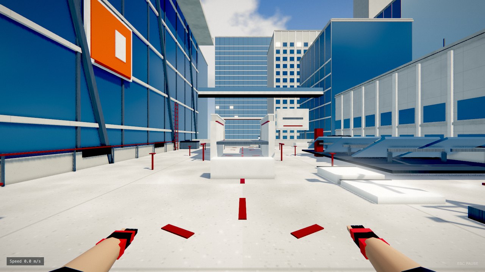
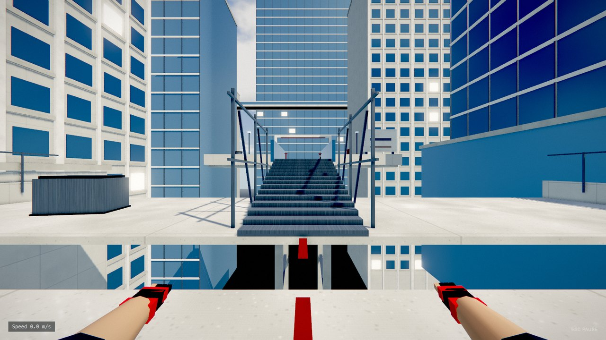
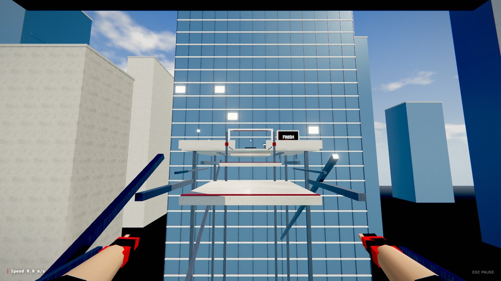
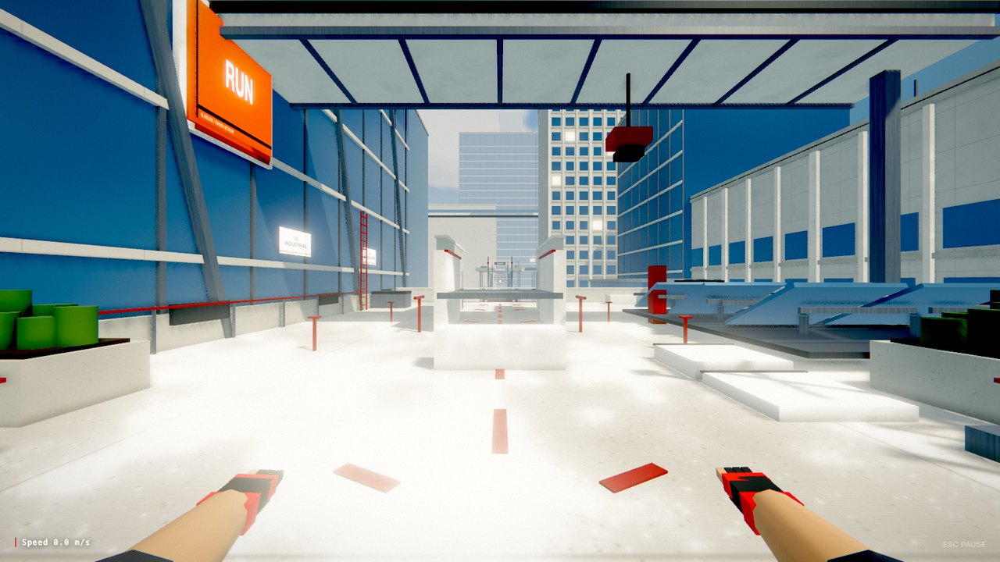
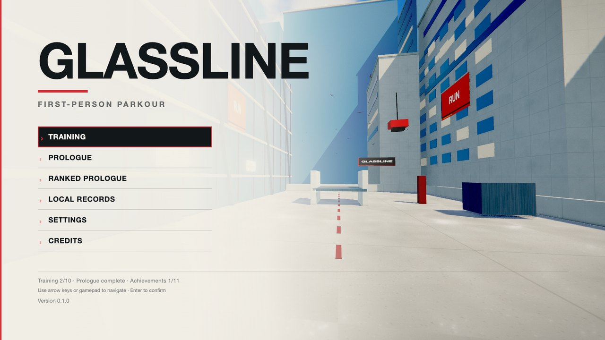
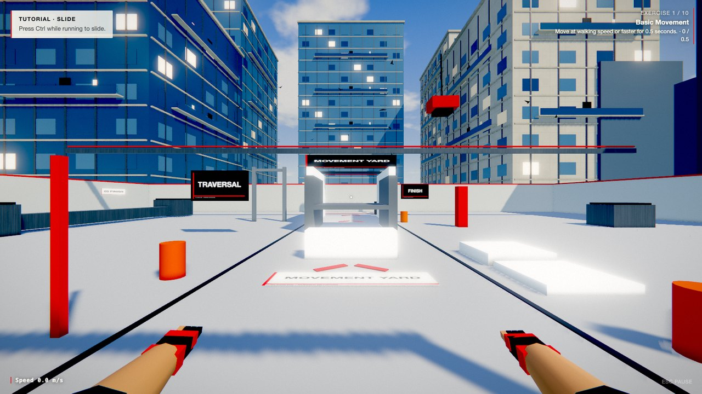
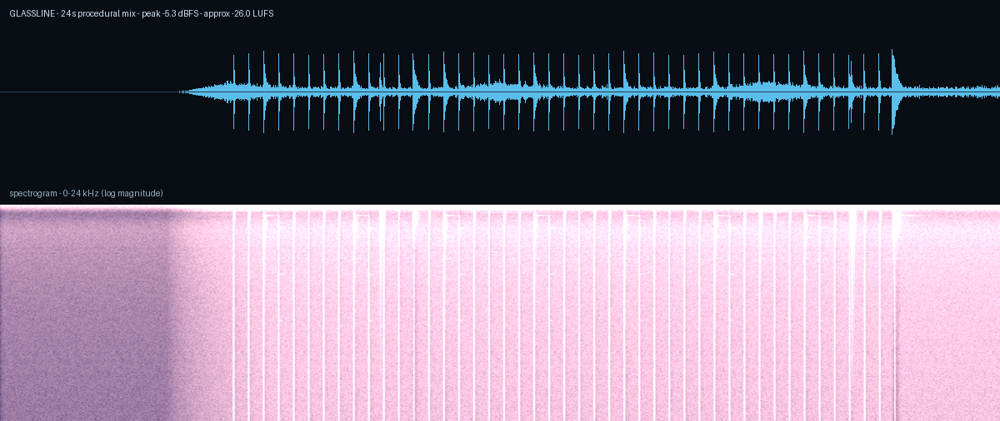
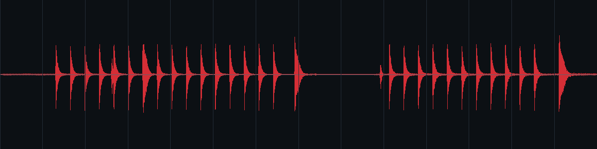

# Glassline

**A first-person parkour game focused on movement, momentum, and mastery.**

Glassline is an experimental browser-based 3D parkour game inspired by the original *Mirror's Edge* (2008).

The project explores responsive first-person movement, architectural traversal, procedural environments, and repeatable speedrun challenges.

Glassline is an independent project. It is not a remake of Mirror's Edge and does not use its proprietary assets.

---

## Project Vision

**Movement is the primary gameplay experience.**

Glassline is built around the feeling of moving continuously through an urban environment.

The player should learn to:

- Read architecture and recognize traversal opportunities.
- Build and preserve momentum.
- Combine movement mechanics into fluid sequences.
- Discover efficient routes.
- Improve execution through repeated attempts.
- Master routes and achieve better completion times.

The environment should feel like a route to master, not simply a space to explore.

## Visual Direction

The visual identity is inspired by the minimalist architectural presentation of the original Mirror's Edge.

Core principles:

- Predominantly white and light-grey architecture.
- Light concrete and clean geometric surfaces.
- Dark-grey industrial structures.
- Red navigation and gameplay accents.
- Large architectural forms.
- Strong silhouettes and readable traversal geometry.
- High contrast between important surfaces.
- Minimal visual clutter.

The interface follows the same principles: minimal, functional, readable, and unobtrusive.

Reference alignment is tracked in
[`docs/VISUAL_REFERENCE_PROGRESS.md`](docs/VISUAL_REFERENCE_PROGRESS.md).



The Prologue now descends from the white rooftop through a service roof, a
sprint gap, a construction stair climb, a narrow skybridge, a low finish roof,
a final scaffold jump ascent, and an exposed catwalk U-turn (~220 m route, 8.2 m
vertical).







The shell uses a paper-and-ink editorial language: ivory panels, black uppercase
type, hard red rules, a minimal HUD, and canvas-rendered `RUN` / section /
`FINISH` signage in the world.



The Training yard shares the same white/red rooftop language and city backdrop.



## Sound

All audio is generated procedurally at runtime: a multi-bus mix with limiter and
reverb, surface-aware footsteps and landings, slide/wall-run loops, layered wind
and city ambience, a sparse four-chord score, and radio cues. No samples or
downloaded audio assets are used.



The finale has its own deterministic profile: altitude wind with a lull/gust,
metal catwalk footsteps, jump/landing hits, and a finish impact. It measures 5/5
in its custom bands while the prologue mix keeps 5/5 reference targets.

[Cinematic route video](docs/evidence/video/round-30/cinematic-route.mp4) ·
[Gameplay through slide tunnel](docs/evidence/video/round-31/gameplay-route.mp4) ·
[Live high roof](docs/evidence/audio/round-29/high-10s.wav) ·
[Live ground](docs/evidence/audio/round-29/ground-8s.wav) ·
[High-route render](docs/evidence/audio/round-15/high-route.wav) ·
[metrics](docs/evidence/audio/round-15/metrics.json) ·


A live in-engine probe confirms the altitude path: wind gain/cutoff rise from
0.0131/263 Hz at the start roof to 0.0197/418 Hz on the high roof, with metal
footsteps adding mid-band energy
([report](docs/evidence/audio/round-16/live-high-route.json)).

---

## Gameplay

### Core Movement

The initial gameplay movement set includes:

- Walking and running.
- Sprinting.
- Acceleration and deceleration.
- Jumping.
- Landing.
- Crouching.
- Sliding.
- Vaulting.
- Wall running.
- Wall jumping.
- Momentum management.

Movement must be responsive, consistent, and independent of rendering frame rate.

Advanced traversal features outside the initial scope must not be introduced as mandatory dependencies.

### Game Modes

#### Training

A structured environment for learning and practicing movement mechanics.

Training introduces mechanics progressively through exercises, objectives, instructions, hints, and feedback.

The planned exercise sequence is:

1. Movement Basics.
2. Running and Sprinting.
3. Jumping.
4. Crouching and Sliding.
5. Vaulting.
6. Wall Running.
7. Wall Jumping.
8. Landing and Momentum.
9. Interaction.
10. Combined Traversal.

Training is separate from the Prologue speedrun leaderboard.

#### Prologue

The primary repeatable gameplay experience.

Prologue is a continuous parkour route divided into five sections:

1. Rooftop.
2. Industrial.
3. Construction.
4. Skybridge.
5. Finish.

The route contains five required checkpoints.

The level is designed around continuous traversal, route readability, movement combinations, and speedrun replayability.

Initial completion-time targets are approximately 2–3 minutes for a normal completion and 1–2 minutes for an experienced run. These are design targets, not gameplay restrictions.

### Speedrunning

Speedrunning is a central part of the gameplay loop.

The system supports:

- Monotonic run timing.
- Checkpoint splits.
- Ordered route validation.
- Bronze, Silver, and Gold performance medals.
- Personal best records.
- Local leaderboard records.
- Repeatable attempts.

Ghost Replay is a future feature and is not required for the initial release.

---

## Technology Stack

Glassline is designed as a desktop browser game.

| Technology | Responsibility |
|---|---|
| TypeScript | Application and gameplay logic |
| Three.js | 3D rendering |
| WebGLRenderer | Initial rendering backend |
| Vite | Development server and production build |
| Rapier Physics | Physics simulation and collision detection |
| Web Audio API | Procedural gameplay and environmental audio |
| IndexedDB | Persistent local data |
| HTML / CSS | Application interface |
| GLSL | Custom shaders where required |

The initial implementation uses Three.js `WebGLRenderer`.

WebGPU is a possible future extension, not part of the initial implementation.

Use Rapier through `@dimforge/rapier3d-compat`, as specified in the technical architecture.

Do not introduce additional frameworks or major dependencies without checking the existing architecture and documenting the reason.

---

## Architecture Principles

### Single Ownership

Every gameplay domain has one authoritative owner.

Examples:

- Movement owns locomotion physics.
- Camera owns first-person presentation.
- Checkpoint owns checkpoint progress.
- Respawn owns the recovery lifecycle.
- Level Runtime owns loaded level lifecycle.
- Gameplay Session owns session lifecycle.
- Gameplay Flow owns application navigation.
- Speedrun owns run timing and validation.
- Save owns persistence infrastructure.
- Settings owns configuration values and semantics.
- Statistics owns aggregated gameplay facts.
- Achievement owns achievement definitions and unlock state.

Systems communicate through defined interfaces, commands, snapshots, and events.

### Separation of Concerns

Gameplay rules, runtime orchestration, persistence, and presentation remain separate.

UI displays authoritative state. It must not independently calculate gameplay outcomes.

### Deterministic Gameplay

Physics uses a fixed timestep.

Speedrun timing uses a monotonic clock and must not depend on rendering FPS.

Procedural generation must support reproducible results through explicit seeds.

### Incremental Development

Implement systems in small, integrated stages.

Prefer a working and verified gameplay foundation over broad but incomplete implementations.

---

## Project Status

Glassline currently has a structured specification covering its intended architecture, gameplay systems, and initial release scope.

The specification baseline was reconciled on 2026-11-17: cross-document ownership conflicts were resolved, deferred mechanics were removed from active contracts, and duplicated rules were consolidated.

The repository foundation (**Phase 0**) is complete: Vite + TypeScript (strict) + Three.js + Rapier project scaffold, Biome linting/formatting, CI validation, and a unit-test runner are in place.

**Phase 1** (application runtime) is complete: application lifecycle, fixed 60 Hz game loop, WebGL2 renderer, Rapier physics world, input abstraction, IndexedDB save foundation, Settings System foundation, localization foundation, resource loading with structured errors, and the audio lifecycle foundation are implemented, unit-tested, and smoke-verified in a browser.

**Phase 2** (first-person player) is complete: fixed-step locomotion (walk/run/sprint), jump with buffering and coyote time, crouch, landing, Rapier kinematic character collision, first-person camera with mouse/gamepad look, camera height and movement feedback, and aggregated player state with capabilities.

**Phase 3** (traversal and recovery) is complete: sliding with physical posture changes, contextual vaulting over validated obstacles, wall running and wall jumping, checkpoint activation with deterministic progress, checkpoint-based respawn with control suspension, and validated contextual interactions (range, facing, line-of-sight, cooldown).

**Phase 4** (level runtime) is complete: validated level definitions, Level Runtime session lifecycle (load/start/pause/resume/complete/unload), section activation, spawn-point resolution, trigger registration with enter/exit signals, traversal surface metadata, runtime object registration/cleanup, and a full-level content loader. The checkpoint and interaction systems now consume Level Runtime authored content instead of hardcoded test scaffolding.

**Phase 5** (gameplay sessions and modes) is complete: session-driven flow (main menu → loading → gameplay → pause/results), Gameplay Session lifecycle with restart/completion/abandonment, ten Training exercises with event-driven objective evaluation, a five-section Prologue route with five checkpoints, and ranked Prologue speedruns with a monotonic timer, splits, checkpoint-sequence validation, medals, and results. Training and Prologue are launched from a temporary development session menu (final UI is Phase 6).

**Phase 6** (presentation and player feedback) is complete: player-facing DOM UI with main menu, loading, gameplay HUD, pause menu, settings, results, credits/records placeholders, and error screens; speedrun timer/splits, training objectives, interaction prompts, and checkpoint/exercise notifications; keyboard/gamepad/mouse navigation; accessibility preferences (Reduced Motion, high contrast, large text, UI scale, focus/ARIA/live regions); initial English localization; and procedural UI/gameplay audio cues. The previous development session menu and status overlay were replaced by this interface (the diagnostic overlay is now dev-only via `F3`).

**Phase 7** (progression and long-term systems) is complete: normalized gameplay event routing into persistent long-term systems — session/lifetime/mode statistics, achievement definitions and evaluation, cross-mode player progression with deterministic content unlock rules and milestones, event-driven tutorial progression, and local Speedrun records/personal bests. The main menu now shows a persistent progress summary, and the Local Records screen presents records and personal bests, progression, tutorial completion, lifetime statistics, and unlocked achievements. All long-term state is stored through Save System repositories and restored after reload; duplicate events are deduplicated and achievements unlock only from authoritative events.

**Phase 8** (stabilization) is complete: full Prologue speedrun E2E regression, Training lifecycle regression, performance/memory profiling, persistence corruption and migration checks, input/focus edge cases, accessibility/focus-trap/UI-scaling checks, and error handling. Stabilization fixed a critical reload deduplication bug in domain-event identities, made Speedrun record dates wall-clock and repaired legacy dates, corrected medal counting, rejected stale statistics replays, and improved accessible menu names. See [`docs/IMPLEMENTATION_STATUS.md`](docs/IMPLEMENTATION_STATUS.md) for the verification matrix and residual compatibility risks (Firefox/Safari gameplay verification remains environment-limited).

**Release polish** (post-Phase 8) is complete: the initial courses are now presented as `Training — Movement Yard` and `Prologue — Rooftop Run`, with procedural city skylines, gates, route markings, rooftop props, checkpoint beacons, level-owned sky/fog/light atmospheres, lit skyline windows, a localized next-step tutorial HUD panel, and procedural ambience plus speed-scaled footsteps. Gameplay contracts, save identifiers, and route validation are unchanged.

For actual implementation, integration, and verification status, see:

**[`docs/IMPLEMENTATION_STATUS.md`](docs/IMPLEMENTATION_STATUS.md)**

---

## Documentation

The `docs/` directory is the primary source of implementation specifications.

### Project Foundation

| Document | Description |
|---|---|
| [`00_PROJECT_BRIEF.md`](docs/00_PROJECT_BRIEF.md) | Project concept, scope, and design principles |
| [`01_AGENT_RULES.md`](docs/01_AGENT_RULES.md) | Detailed rules for implementation agents |
| [`02_TECHNICAL_ARCHITECTURE.md`](docs/02_TECHNICAL_ARCHITECTURE.md) | Technical architecture and runtime foundations |
| [`03_GAMEPLAY_SPEC.md`](docs/03_GAMEPLAY_SPEC.md) | Core gameplay design |
| [`04_ASSET_BIBLE.md`](docs/04_ASSET_BIBLE.md) | Asset, material, and visual conventions |
| [`05_PROCEDURAL_GENERATION_SPEC.md`](docs/05_PROCEDURAL_GENERATION_SPEC.md) | Procedural environment generation |
| [`06_LEVEL_DESIGN_SPEC.md`](docs/06_LEVEL_DESIGN_SPEC.md) | Level structure and traversal design |
| [`07_UI_UX_SPEC.md`](docs/07_UI_UX_SPEC.md) | User interface and experience |
| [`08_AUDIO_DESIGN_SPEC.md`](docs/08_AUDIO_DESIGN_SPEC.md) | Audio direction and implementation |

### Core Gameplay Systems

| Document | Description |
|---|---|
| [`09_SPEEDRUN_SYSTEM_SPEC.md`](docs/09_SPEEDRUN_SYSTEM_SPEC.md) | Timing, splits, route validation, and records |
| [`10_SAVE_SYSTEM_SPEC.md`](docs/10_SAVE_SYSTEM_SPEC.md) | Persistence infrastructure |
| [`11_INPUT_SYSTEM_SPEC.md`](docs/11_INPUT_SYSTEM_SPEC.md) | Input abstraction and device handling |
| [`12_MOVEMENT_SYSTEM_SPEC.md`](docs/12_MOVEMENT_SYSTEM_SPEC.md) | Movement and traversal physics |
| [`13_CAMERA_SYSTEM_SPEC.md`](docs/13_CAMERA_SYSTEM_SPEC.md) | First-person camera behavior |
| [`14_INTERACTION_SYSTEM_SPEC.md`](docs/14_INTERACTION_SYSTEM_SPEC.md) | Interaction detection and execution |
| [`15_LEVEL_RUNTIME_SYSTEM_SPEC.md`](docs/15_LEVEL_RUNTIME_SYSTEM_SPEC.md) | Runtime level lifecycle |
| [`16_CHECKPOINT_SYSTEM_SPEC.md`](docs/16_CHECKPOINT_SYSTEM_SPEC.md) | Checkpoint registration and progress |
| [`17_RESPAWN_SYSTEM_SPEC.md`](docs/17_RESPAWN_SYSTEM_SPEC.md) | Player recovery lifecycle |
| [`18_PLAYER_STATE_SYSTEM_SPEC.md`](docs/18_PLAYER_STATE_SYSTEM_SPEC.md) | Aggregated player lifecycle and state |

### Gameplay Orchestration

| Document | Description |
|---|---|
| [`19_GAMEPLAY_SESSION_SYSTEM_SPEC.md`](docs/19_GAMEPLAY_SESSION_SYSTEM_SPEC.md) | Gameplay session lifecycle |
| [`20_GAMEPLAY_FLOW_SYSTEM_SPEC.md`](docs/20_GAMEPLAY_FLOW_SYSTEM_SPEC.md) | Application navigation and transitions |
| [`21_TRAINING_SYSTEM_SPEC.md`](docs/21_TRAINING_SYSTEM_SPEC.md) | Training exercises and objective evaluation |
| [`22_PROGRESSION_SYSTEM_SPEC.md`](docs/22_PROGRESSION_SYSTEM_SPEC.md) | Content unlocks and long-term progression |
| [`28_TUTORIAL_SYSTEM_SPEC.md`](docs/28_TUTORIAL_SYSTEM_SPEC.md) | Tutorial guidance |
| [`29_ACHIEVEMENT_SYSTEM_SPEC.md`](docs/29_ACHIEVEMENT_SYSTEM_SPEC.md) | Achievement definitions and unlocking |
| [`30_STATISTICS_SYSTEM_SPEC.md`](docs/30_STATISTICS_SYSTEM_SPEC.md) | Gameplay statistics and aggregation |

### Presentation and Player Experience

| Document | Description |
|---|---|
| [`23_HUD_SYSTEM_SPEC.md`](docs/23_HUD_SYSTEM_SPEC.md) | In-game HUD and gameplay feedback |
| [`24_MENU_SYSTEM_SPEC.md`](docs/24_MENU_SYSTEM_SPEC.md) | Menu screens and behavior |
| [`25_SETTINGS_SYSTEM_SPEC.md`](docs/25_SETTINGS_SYSTEM_SPEC.md) | Application settings and configuration |
| [`26_ACCESSIBILITY_SYSTEM_SPEC.md`](docs/26_ACCESSIBILITY_SYSTEM_SPEC.md) | Accessibility policies and adaptations |
| [`27_LOCALIZATION_SYSTEM_SPEC.md`](docs/27_LOCALIZATION_SYSTEM_SPEC.md) | Translation and localization |

### Project Tracking

| Document | Description |
|---|---|
| [`IMPLEMENTATION_STATUS.md`](docs/IMPLEMENTATION_STATUS.md) | Implementation, integration, and verification tracking |

---

## Getting Started

### Requirements

- Node.js **22.12** or newer (Node 22 LTS recommended).
- npm **10** or newer.
- A desktop browser with WebGL2 for runtime verification. The initial verified runtime target is Chromium-based desktop browsers (Chrome/Edge); Firefox/Safari gameplay verification remains partially environment-limited (see implementation status).

### Install

```bash
npm install
```

### Commands

| Command | Purpose |
|---|---|
| `npm run dev` | Start the Vite development server at `http://127.0.0.1:5173` |
| `npm run build` | Typecheck and build the production bundle into `dist/` |
| `npm run preview` | Serve the production build locally |
| `npm run typecheck` | Strict TypeScript check without emitting files |
| `npm run check` | Biome: lint + formatting + import order (read-only) |
| `npm run check:fix` | Apply Biome lint/format/import fixes |
| `npm run lint` | Biome lint only (`npm run lint:fix` to apply) |
| `npm run format` | Format files with Biome (`format:check` for read-only) |
| `npm test` | Run the unit test suite once |
| `npm run test:watch` | Run unit tests in watch mode |
| `npm run validate` | Full validation: typecheck → Biome check → tests → build |

Do not report a task as complete based on `npm run build` alone. Runtime behavior must be checked in a browser when the change affects rendering, physics, input, or persistence.

CI runs the same `npm run validate` pipeline on pushes to `main` and on pull requests (`.github/workflows/validate.yml`).

### Current Runtime State (Release Candidate — Polished)

Running `npm run dev` boots to the Game Glassline main menu. Use the mouse, keyboard arrows (`↑`/`↓`), or gamepad to navigate and `Enter`/`Space`/confirm to activate.

- Main menu: Training, Prologue, Ranked Prologue (authoritative speedrun), Local Records, Settings, Credits; a persistent progress summary shows Training completion, Prologue completion, and achievements.
- `Esc` pauses during gameplay; the pause menu offers Resume, Restart, Settings, and Abandon to Main Menu.
- Settings changes apply immediately (audio/controls/camera/HUD/accessibility/gameplay/language). Unsupported browser display settings are hidden.
- Accessibility: Reduced Motion, High Contrast, Large Text, UI Scale; keyboard-only navigation and focus visibility are supported. Reduced Motion is also honored by camera presentation.
- Gameplay HUD: Speedrun timer/checkpoints/splits, Training exercise/objective progress, tutorial next-step guidance, speed, interaction prompt, and checkpoint/exercise notifications.
- Results: mode, duration, Training completion, Speedrun time/splits/medal/validity; Retry or return to Main Menu.
- Local Records: validated Prologue records and personal best, progression/tutorial summary, lifetime statistics (sessions, play time, distance, movement, checkpoints), and unlocked achievements.
- Initial courses: `Training — Movement Yard` (daylight movement yard) and `Prologue — Rooftop Run` (dusk rooftop route), with procedural city silhouettes, lit windows, route markings, gates, and rooftop props.
- Long-term progress: Training exercise and Prologue completion, deterministic content unlocks and milestones, achievements, tutorial steps, and statistics persist through the Save System and survive reload. Achievement unlocks show a toast and audio cue.
- During gameplay: click the canvas to capture the mouse (pointer lock); the first click or key press resumes the Web Audio context.
- `WASD` move, `Space` jump, `Ctrl` crouch, `Shift` sprint.
- `Ctrl` while running starts a slide; sliding lets the player pass under low ceilings.
- `E` vaults over a valid low obstacle ahead, and activates contextual interactions when one is in range and in view.
- Jumping while close to a wall at speed starts a wall run; `Space` again performs a wall jump.
- Checkpoints activate automatically inside their trigger volumes; falling into the pit respawns the player at the active checkpoint (or the initial spawn).
- `Esc` releases pointer lock and opens the pause menu.

Development-only diagnostics: `F3` toggles the diagnostics overlay; in dev builds `F2` completes the current session for results-flow verification, and `window.__glassline` exposes the application instance for QA. The diagnostics overlay is not player-facing UI and is disabled by default. The initial release courses use technical IDs `training_test`/`prologue_test` for save/route compatibility but are presented as `Training — Movement Yard` and `Prologue — Rooftop Run`.

---

## Development Guidelines

Before implementing a feature:

1. Read [`AGENT.md`](AGENT.md).
2. Read `docs/01_AGENT_RULES.md`.
3. Read `docs/02_TECHNICAL_ARCHITECTURE.md`.
4. Read the relevant system specifications.
5. Inspect the existing codebase and tests.
6. Check `docs/IMPLEMENTATION_STATUS.md`.
7. Implement only the agreed scope.
8. Run relevant validation commands.
9. Update implementation status honestly.

Do not recreate existing functionality, duplicate system ownership, or introduce undocumented gameplay rules.

When specifications conflict, identify the conflict before making an incompatible architectural decision.

---

## Initial Release Scope

The initial release focuses on a complete playable experience:

- First-person parkour movement.
- Mouse and keyboard input.
- Core traversal mechanics.
- Basic collision and player recovery.
- Training mode.
- Prologue with five sections.
- Five required checkpoints.
- Speedrun timing and splits.
- Personal best records.
- Local leaderboard.
- IndexedDB persistence.
- Main Menu, Pause Menu, Settings, and Results.
- Gameplay HUD.
- Basic procedural audio feedback.
- Initial accessibility support.
- English localization.
- Core tutorial guidance.

### Deferred Features

The following features must not block the initial release:

- Ghost Replay recording and playback.
- Online leaderboards.
- Cloud saves.
- Multiplayer.
- Online accounts.
- Advanced procedural campaigns.
- Ledge grabbing.
- Ledge climbing and hanging.
- Dedicated balance traversal.
- Swinging and ziplines.
- Advanced traversal variants outside the initial movement scope.
- Remote analytics.
- Full RTL layout.

Future features should extend the existing architecture rather than introduce parallel systems.

---

## Repository Structure

The following is a conceptual overview. Actual source directories and configuration must follow the repository's technical architecture.

```text
glassline/
├── AGENT.md
├── README.md
├── package.json
├── docs/
│   ├── 00_PROJECT_BRIEF.md
│   ├── 01_AGENT_RULES.md
│   ├── 02_TECHNICAL_ARCHITECTURE.md
│   ├── ...
│   └── IMPLEMENTATION_STATUS.md
├── src/
├── public/
└── tests/
```

Do not create empty directories merely to match this illustration.

---

## Project Philosophy

Glassline should prioritize:

- Responsive and satisfying movement.
- Consistent physics.
- Readable traversal opportunities.
- Strong level flow.
- Minimalist presentation.
- Reliable gameplay systems.
- Meaningful replayability.

Every feature should support the core experience of moving through the environment.

**The player should feel that the environment is a route to master, not simply a space to explore.**