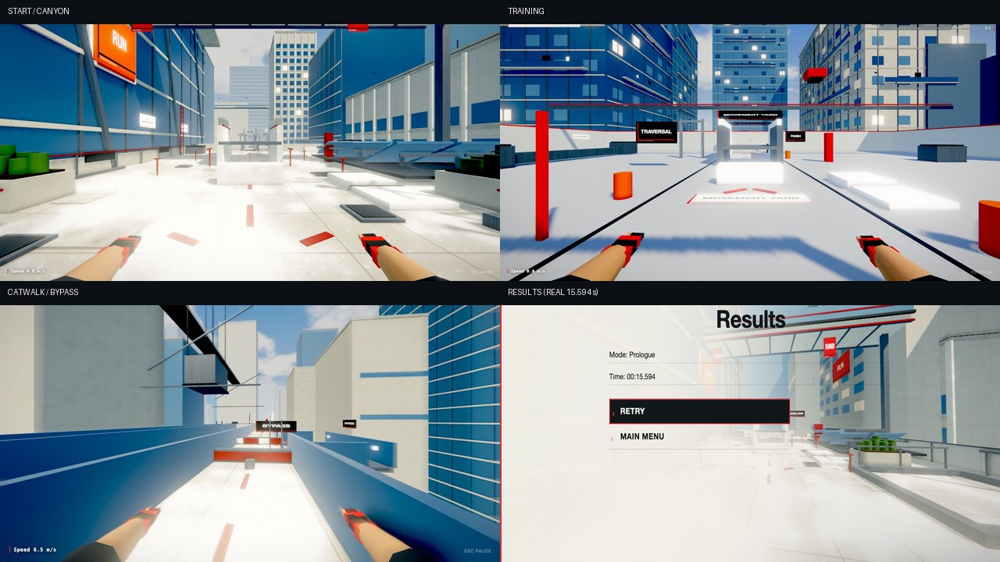

# Glassline — пакет для решения по референсу

**Быстрый просмотр:** [нормализованный 13,7-секундный забег](evidence/review/finish-results-run-review.mp4) (звук −26 LUFS, физический финиш и настоящий Results). Ниже — исходные live-записи и полный чек-лист.

Обновлено: 2026-11-19, раунд 43. Предел текущей итерации — **раунд 60**.

Этот файл сводит воедино доказательства, известные пробелы и варианты решения.
Цель — не заменить вашу оценку, а сделать её быстрой и предметной.

---

## 0. Итоговая верификация

Сводный прогон: [`VERIFICATION.md`](VERIFICATION.md) — 279 тестов, 13/13 старта,
5/5 звука, ~60 fps, 0 битых ссылок.

## 1. Что уже проверено автоматически

| Гейт | Результат | Где смотреть |
|---|---|---|
| Стартовый кадр против референса | **13/13** метрик | [`round-42/metrics.json`](evidence/visual/round-42/metrics.json) |
| Офлайн-звук Пролога | **5/5** полос | [`round-2`](evidence/audio/round-2/) |
| High-route звук | **5/5** полос | [`round-15`](evidence/audio/round-15/) |
| Тесты | **279 в 37 файлах** | `npm run validate` |
| Typecheck / Biome / build | зелёные | `npm run validate` |
| Производительность | **~60 fps** | `npm run perf` |
| Маршрут | ~220 м, 5 секций/чекпоинтов | `docs/VISUAL_REFERENCE_PROGRESS.md` |
| Bypass tradeoff | direct 6,30 с / bypass 6,75 с | [`round-37/lines.json`](evidence/design/round-37/lines.json) |
| Живой звук | high/ground WAV + gameplay WAV | [`round-29`](evidence/audio/round-29/), [`round-31`](evidence/video/round-31/) |
| Видео | 17,5 с cinematic + 9 с gameplay | [`round-30`](evidence/video/round-30/), [`round-31`](evidence/video/round-31/) |

Последние значения старта: **luma 0,608 · p25 0,352 · near-white 20,8% ·
deep-shadow 1,72% · sky 39,8% · split −16,69 · red 3,28**.

---

## 2. Что нужно оценить вам (≈10 минут)

1. **Послушать пару high/ground** — разница ветра, шагов, громкости:
   - [high-10s.wav](evidence/audio/round-29/high-10s.wav)
   - [ground-8s.wav](evidence/audio/round-29/ground-8s.wav)
   - [gameplay-route.wav](evidence/video/round-31/gameplay-route.wav) — реальный игровой микс.
2. **Посмотреть 9-секундный реальный геймплей** и 17,5-секундный обзор:
   - [finish-results-run-review.mp4](evidence/review/finish-results-run-review.mp4) — нормализованный, физический финиш + Results
   - [gameplay-route.mp4](evidence/video/round-31/gameplay-route.mp4)
   - [finish-terminal-run.mp4](evidence/video/round-49/finish-terminal-run.mp4) — 14,40 с, catwalk + терминал FINISH
   - [finish-results-run.mp4](evidence/video/round-53/finish-results-run.mp4) — 13,7 с, физический финиш + Results (15,594 с)
   - [cinematic-route.mp4](evidence/video/round-30/cinematic-route.mp4)
3. **Посмотреть стартовый кадр и Training**:
   - [start.jpg](evidence/visual/round-42/start.jpg)
   - [real-results.png](evidence/video/round-53/real-results.png) — настоящий финиш/экран результатов (секционный забег 15,594 с)
   - [training.jpg](evidence/visual/round-27/training.jpg)
4. **Пройти один забег** в браузере (если есть доступ к dev-сборке):
   - `npm run dev`, затем Training/Prologue.

Вопросы, на которые нужен ответ:

- Звук: слишком громкий/плотный? Ветер на высоте слышен? Шаги металла отличаются?
- Графика: пересветы крыши терпимы как стилизация или это главный блокер?
- Дизайн: маршрут и bypass читаются? Нет ли ощущения «тестового уровня»?
- Камера/меню: удар при приземлении не мешает? Дрейф меню уместен?

---

## 3. Известные пробелы (честно)

- **Арт низкополигональный**; до фотографического бетона/фасадов референса не дотягивает.
- **Стартовый кадр пересвечен**; 13/13 не означает «идеальная фотография».
- **Живого прослушивания не было**; все аудио-выводы — офлайн/анализатор/запись.
- **Автопилот не проходит маршрут целиком**; 9-секундный клип заканчивается у Construction.
- **Firefox/Safari и assistive-технологии** не проверялись.
- **Полного живого плейтеста** и сравнения с референсом «на глаз» нет.

---

## 4. Варианты решения

### A. Принять текущее как reference-grade

Закрыть цель, зафиксировав известные ограничения. Подходит, если стилизованная
графика и измеренная звуковая посадка достаточны.

### B. Продолжить до раунда 60 по короткому списку

Предлагаемый фокус оставшихся раундов:

1. Мост/вывески/меню — утончить самые заметные «игровые» артефакты.
2. Полный/более длинный геймплейный клип (починить автопилот нижнего маршрута).
3. Живой микс: убрать избыточную громкость/плотность, если вы её слышите.
4. Финальный пакет доказательств и повторная проверка 13/13 + 5/5.

### C. Закрыть технически, но не перцептивно

На раунде 60 зафиксировать: «технически цель выполнена, перцептивное принятие
не проводилось». Это честный статус, если вы не хотите тратить время на оценку.

---

## 5. Что сделаю на раунде 60

- Соберу финальные метрики, тесты, видео/аудио.
- Сверю известные пробелы с выбранным вариантом.
- Либо закрою цель, либо оставлю её активной с конкретным списком — **без
  молчаливого объявления победы**.

До этого цель остаётся активной.
