# Reference alignment progress

**Objective:** Bring Glassline to the presentation level of the *Mirror's Edge*
prologue reference — design, graphics, and sound.

**Reference:** `ref/reference/Прохождение Mirror's Edge #1 - Пролог (и обучение)
[dlbJTerGxCM].mp4` plus the extracted prologue study frames in
`ref/reference/prolog-kit/` (local only, git-ignored).

**Method:** deterministic gameplay screenshots, measured image statistics, and
manual review against the prologue rooftop frames. Tooling lives in
[`tools/capture`](../tools/capture/README.md).

---

## Round 1 — presentation foundation (2026-11-19)

### Scope

Replace the flat forward renderer and placeholder arena with an HDR
first-person presentation: sky and atmosphere, PBR materials, a dense rooftop
city, a shaped prologue route, and first-person runner arms. Sound and gameplay
depth are intentionally left for later rounds.

### What changed

**Rendering**

- New HDR post chain in `PostPipeline`: half-float MSAA target, GTAO, bloom,
  filmic ACES tone mapping, split toning, saturation/contrast grade, chromatic
  aberration, vignette, grain, dither, and a photographic highlight clip for
  clipped sunlit whites.
- Procedural sky dome (`SkyDome`): zenith/horizon gradient, sun disc and glow,
  two-scale cumulus with lit tops and shaded bases, and slow cloud drift.
- Sky-derived PMREM environment probe so glass and metal reflect the actual sky.
- Sun (PCF soft shadows), hemisphere, ambient fill, and a cool rim light; level
  environments now drive sky palette, sun angle, sun intensity, and fog.
- Procedural PBR material library (`MaterialLibrary`) with runtime canvas textures
  for roof, concrete, plaster, facade, metal, asphalt, and red paint. Materials
  use world-space triplanar mapping, so box geometry keeps a consistent surface
  scale at any size.
- Decorations are batched into instanced meshes by material/shape/shadow flags.

**Prologue design and content**

- The flat 44 m box arena becomes a 22 m rooftop with low parapets, an open
  skylight, and city visible over every edge.
- A close glazed tower wall runs along the west side with floor slabs, mullions,
  diagonal bracing, an orange billboard, a red maintenance ladder, and a red
  handrail — the reference's asymmetric "roof against a facade" composition.
- Dense surround: near facades with punched/curtain/ribbon window systems,
  rooftop plant, lower roofs, a 54 m skybridge, construction crane, billboards,
  and a 64-building far skyline above a city floor 31 m below.
- Rooftop kit: skylight glazing and rails, solar array, AC clusters, duct and pipe
  runs, stair bulkhead with red door, water tank, antenna, vents, crates, route
  paint, checkpoint chevrons, start/finish gantries, and a lit finish terminal.
- The wall-run corridor, slide duct, vault ledge, steps, and terminal are clad in
  white/metal with red trim instead of flat black boxes.
- Void kill triggers cover all five sections, so leaving the roof always respawns
  at the last checkpoint.

**Player presentation**

- First-person viewmodel: sleeves, forearms, gloved hands, red wrist wraps, and
  fingers attached to the camera.
- Viewmodel responds to idle breathing, run bob and arm swing, airtime, sliding,
  landing compression, and wall-run roll. It is lit by a dedicated camera light
  on layer 1.

**Tooling**

- `tools/capture/capture.mjs`: deterministic capture from CDP (start gameplay,
  teleport, aim, screenshot, scene statistics).
- `tools/capture/metrics.py`: luminance/contrast/colour/accent metrics against the
  reference frame set, with a JSON report.
- Round evidence: [`docs/evidence/visual/round-1`](evidence/visual/round-1/).

### Result

| View | Image |
|---|---|
| Prologue start | 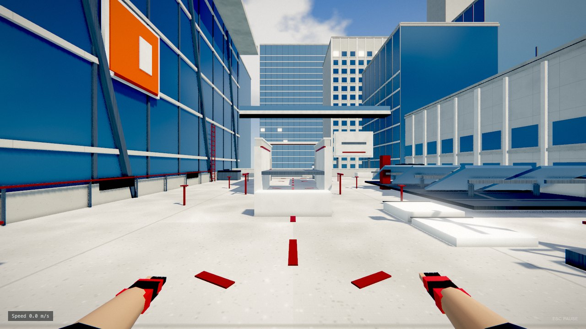 |
| Wall-run corridor | 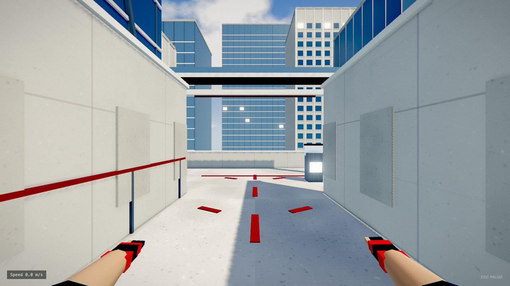 |
| Looking back |  |

Measured against the 20-frame prologue rooftop reference set
(`docs/evidence/visual/round-1/metrics.json`):

| Metric | Glassline start | Reference mean | Delta | Band |
|---|---:|---:|---:|---|
| luma mean | 0.586 | 0.615 | −0.029 | PASS |
| luma std | 0.265 | 0.295 | −0.030 | PASS |
| p25 luma | 0.331 | 0.371 | −0.040 | PASS |
| p95 luma | 0.895 | 0.981 | −0.086 | WATCH |
| near-white | 3.6 % | 34.5 % | −30.9 | WATCH |
| deep shadow | 1.9 % | 0.7 % | +1.2 | PASS |
| saturation | 0.360 | 0.300 | +0.060 | PASS |
| local contrast | 0.248 | 0.285 | −0.037 | PASS |
| edge energy | 0.027 | 0.019 | +0.007 | PASS |
| sky-blue area | 60.1 % | 43.3 % | +16.8 | WATCH |
| top-third contrast | 0.209 | 0.243 | −0.034 | PASS |
| split-tone dark R−B | −25.5 | −21.8 | −3.7 | PASS |
| red accent | 2.7 % | 2.4 % | +0.3 | PASS |

10/13 metrics are inside tolerance. Sky area runs high because the start frame
is a wide, open rooftop composition; reference sky area ranges from 15 % to
54 % across the set.

The two highlight metrics are the deliberate trade-off for this round. An
earlier grade clipped hard from luma 0.52 and reached 12/13 (near-white 27.7 %,
p95 0.953), but it flattened the roof and facade texture into flat white. The
shipped grade uses a gentler shoulder (0.62 → 0.90, 70 % blend), keeping surface
detail and accepting less clipped white. Closing the remaining highlight gap is
a lighting/content task — stronger sun, brighter albedo and more white surfaces —
not a reason to reintroduce the hard clip.

Runtime on Apple M1 Pro / ANGLE Metal, 1600×900:

- 60 fps (16.6 ms average, 16.8 ms p95) during live gameplay.
- 27 instanced decoration batches, 1,656 instances, ~24k triangles.
- 31 textures, 22 shader programs.

Functional checks:

- `npm run validate` passes: typecheck, Biome, 250 tests in 34 files, production
  build.
- Synthetic input: holding `W` moves the player 6.3 m in 1.8 s; `Space` enters
  `JUMPING` with +5.6 m/s vertical speed and returns to `FALLING`.
- Leaving the roof at x = 12 respawns at the rooftop checkpoint (z = 3).
- No console errors or exceptions during load, gameplay, jump, and respawn.

### Honest gaps

- **Sound is unchanged.** The release ambience/footstep bed is still the simple
  oscillator mix; there is no reference-grade wind/city bed, music, surface
  footsteps, wall-run/slide layers, or reverb/mix bus.
- **Design is still a straight rooftop corridor.** The prologue has one lane, a
  duct, a wall-run corridor, and a vault; it lacks the reference's leaps between
  rooftops, drops, climbs, ladders, and readable branching.
- **Graphics are stylized, not photoreal.** Facades are box masses with window
  grids; glass lacks local reflections; clouds are soft; billboards have no
  typography; hands are simple low-poly forms. Highlights do not clip as much as
  the reference (near-white 3.6 % vs 34.5 %); closing that needs stronger real
  lighting/content, not a harder grade clip.
- **No motion blur, depth of field, or animated world** (crane, birds, cloth,
  helicopter) yet.
- Training still uses the old 44 m yard and flat skyline dressing.
- Quality tiers and a dynamic-resolution policy are not wired to the new pipeline.

### Next

1. **Sound pass:** layered procedural wind/city ambience, a four-chord score,
   surface-aware footsteps, slide/wall-run/landing layers, reverb and ducking,
   exposed through the existing AudioManager and settings.
2. **Route design pass:** break the straight corridor into rooftop gaps, drops,
   climbs, and a readable red guidance language while preserving checkpoint and
   speedrun contracts.
3. **Graphics polish:** cloud shaping, billboard typography, facade variation,
   contact decals, motion blur, and animated city props.
4. **Training and menu presentation** to match the same language.

---

## Round 2 — procedural sound pass (2026-11-19)

### Scope

Replace the three-oscillator ambience bed and sine-blip footsteps with a
structured procedural mix: buses, limiter, reverb, layered ambience,
surface-aware movement feedback, a parkour set, a sparse score, and radio.
No external samples or audio assets were added.

### What changed

**Audio architecture**

- `AudioTypes.ts` defines Web-Audio-like contracts for gain, oscillator, buffer
  source, biquad, convolver, compressor, analyser, and buffer nodes, so the mix
  is testable without a real `AudioContext`.
- `noise.ts` provides deterministic white/pink/brown noise and stereo impulse
  responses from seeded generators.
- `surfaceAudio.ts` maps the SurfaceRegistry classification (`concrete`,
  `metal`, `rubber`, `glass`, `asphalt`) to synthesis presets, with an explicit
  fallback that is not a second classification system.
- `synthesis.ts` implements layered footstep, landing, whoosh, contact-loop, and
  UI-tone voices with attack/decay envelopes, filter shaping, variation, and
  dry/reverb routing.
- `AudioManager` now owns a real graph:
  `buses → master → mix trim → compressor/limiter → destination`, with a shared
  reverb send/return and independent environment, movement, parkour, UI, music,
  and radio buses. Every one-shot is voice-limited and cleaned up on `ended` or
  a timed fallback.

**Movement and parkour sound**

- Footsteps are surface-aware and combine band-passed noise, a low body thump,
  a high-frequency texture layer, and optional metal/glass ring or tick;
  intensity and variation follow speed.
- Landings scale with impact velocity and use the surface preset's body/ring.
- Jump, wall-jump, vault, slide, and wall-run have distinct voices. Slide and
  wall-run use continuous filtered-noise loops with speed-dependent gain and
  cutoff; loops stop on state change, pause, and session shutdown.
- Footstep scheduling now derives its interval from actual speed instead of two
  fixed buckets, and passes the current surface from `SurfaceRegistry`.

**Environment**

- Three continuous noise layers (wind, distant city, rooftop air) plus a very
  low two-oscillator hum. Profile (Training/Prologue) changes gains and filter
  frequencies; wind follows speed and breathes while idle.
- A sparse four-chord score starts with gameplay: slow triangle/sine pad with a
  low-pass filter, plus a quiet arpeggio only while moving. Speed increases the
  music bus slightly.
- Radio cues use filtered static and two signal tones; they duck the environment
  bus smoothly and restore it. The Prologue plays one at run start and on each
  section entry.
- Pause/resume stops contact loops, ducks ambience/music, and leaves UI audio
  available. Settings now apply `audio.music_volume` in addition to master, SFX,
  and UI volumes.

**Verification tooling**

- `audioDemo.ts` renders a deterministic 24 s mix through an
  `OfflineAudioContext`, using the same synthesis functions as live gameplay.
- `tools/capture/audio-render.mjs` saves the WAV; `audio-metrics.py` computes
  band shares, BS.1770-style gated loudness, peak, and short-term p5/p95 range;
  `audio-probe.mjs` measures the live post-limiter output through an
  `AnalyserNode`.
- Evidence: [`docs/evidence/audio/round-2`](evidence/audio/round-2/).

### Result

Demo mix (24 s: quiet ambience intro, footsteps, parkour, score):

| Metric | Demo | Reference prologue 500–800 s | Target | Band |
|---|---:|---:|---:|---|
| Energy < 500 Hz | 0.896 | 0.909 | 0.85–0.94 | PASS |
| Energy > 2 kHz | 0.060 | 0.026 | 0.03–0.08 | PASS |
| Gated loudness | −26.0 LUFS | −26.6 LUFS | −31…−26 | PASS |
| Sample peak | −5.26 dBFS | −1.94 dBFS | ≤ −3 dBFS | PASS |
| Short-term p95−p5 | 22.9 dB | 12.9 dB | 18–26 dB | PASS |

5/5 planned targets are satisfied. The reference column is measured by the same
script on the 500–800 s prologue segment (local `ref/` audio, not committed).

Live probe (post-limiter, deterministic metal footstep/landing sequence):

- RMS 0.128 (−17.9 dBFS), peak 0.655 (−3.7 dBFS).
- Band shares during the stress sequence: low 82 %, mid 12 %, high 2.9 %.
- Audio state running; 3 ambience sources; music active; 7 buses present; no
  console errors.
- Pause flow verified: environment bus 0.28, music bus 0.144, `paused: true`;
  resume restores 0.8 and the music target. Contact loops stop in both paths.

Tests: 30 dedicated audio tests cover lifecycle, graph construction, surface
presets, noise determinism, synthesis routing, loops, pause, voice limits,
settings, radio, and score scheduling.

### Honest gaps

- **No human listening test.** Headless verification proves graph, levels,
  spectral balance, and lifecycle, not subjective character. The mix still needs
  an art-director/owner listening pass.
- **No spatial audio** yet: no `PannerNode` emitters, listener transform, or
  occlusion. All current sources are player-local or bus-routed.
- **Music is a simple four-chord pad + arpeggio**, not the reference's full
  interactive score. It has no section changes, combat/tension layer, or stingers.
- **Radio is synthetic static/tones.** There is no speech or text-authored radio
  content; the ducking path exists but has no longer transmissions.
- **Surface transitions** update per step; continuous loops do not crossfade
  between materials.
- The demo's peak is conservatively low (−5.3 dBFS) versus the reference's
  −1.9 dBFS measured by the same script; transient headroom could be raised after
  a listening pass.

### Next

1. Listening pass and per-layer level tuning on desktop speakers/headphones.
2. Spatial emitters and listener integration for machinery, city, and radio.
3. Adaptive score sections (rooftop/industrial/construction/skybridge/finish).
4. Route design pass: rooftop gaps, drops, climbs, and red guidance while
   preserving checkpoint/speedrun contracts.
5. Graphics polish: clouds, billboard typography, motion blur, contact decals,
   animated city props, and Training/menu presentation.

---

## Round 3 — vertical Prologue extension (2026-11-19)

### Scope

The Prologue was a 25 m flat rooftop corridor. This round extends it into a
~66 m route with a roof drop, a sprint gap, a stair climb, a narrow skybridge,
and a separate finish roof, while preserving the five checkpoint IDs, their
order, the section chain, and the speedrun route contract.

### What changed

**Route and level design**

- The north parapet now opens into a 1 m drop from the upper roof (y = 0) to a
  lower service roof (y = −3). Void kill volumes moved below the lower route so
  falls still respawn.
- The lower service roof is split by a 2.4 m sprint gap. The far deck starts at
  z = −34.4 so a run jump clears it; a sprint jump is the intended line, and the
  gap is forgiving enough to recover.
- A 15-step, 0.15 m-riser construction stair climbs 2.1 m to the skybridge deck.
  The riser was deliberately reduced after a physics probe showed the character
  controller stalling on 0.28 m boxes despite `enableAutostep(0.3, ...)`.
- A 3.4 m-wide skybridge spans the canyon at y = −0.9 with 1.3 m glass rails;
  its supports drop into the city. The finish roof (18 × 12 m) follows at the
  same level with a gate at z = −60, lit terminal, and floodlights.
- Checkpoints moved to the new beats: `cp_rooftop` (z 3), `cp_industrial`
  (z −2.5), `cp_construction` (z −8.5), `cp_skybridge` (z −46, bridge), and
  `cp_finish` (z −56, finish roof). Section triggers and entry spawn points moved
  with them; IDs and ordering are unchanged.
- The sun shadow camera now covers z ≈ −74…26, so the lower route and finish
  receive shadows instead of falling outside the shadow frustum.

**Content language**

- Scaffold cage, red guide dashes, hazard line at the drop, bridge rail lights,
  AC/duct/crate clusters, floodlight masts, terminal screen, finish sign, and
  lower-roof parapets dress the new route.
- A lower service roof 16 m below the gap gives the drop visual depth; the old
  decorative skybridge moved to the far skyline so it no longer hangs as a black
  canopy over the new route.
- The bridge narrowed from 5 m to 3.4 m and its checkpoint beacons moved inboard,
  so it reads as a crossing rather than a plaza.

**Verification**

- New physics test loads every Prologue collider, sprint-jumps the 2.4 m gap,
  climbs the stair flight, crosses the bridge, and reaches z < −58 on the finish
  roof.
- The start-to-finish integration test now walks the extended waypoints through
  all five checkpoints, section transitions, and the finish trigger.
- Browser capture: drop from the upper roof settles at y ≈ −2.11 on the lower
  deck; lower route, stairs, bridge, and finish render without console errors.

### Result

| View | Image |
|---|---|
| Drop from the upper roof | 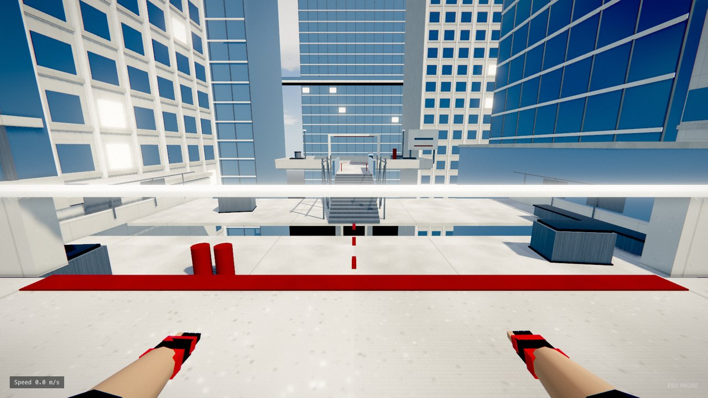 |
| Lower service roof and stairs |  |
| Skybridge | 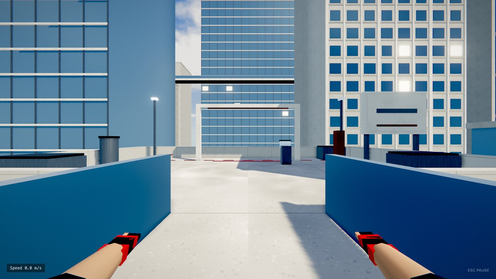 |
| Finish roof |  |

Route facts:

| Metric | Before | Round 3 | Plan target |
|---|---:|---:|---:|
| Forward route length | ~25 m | ~66 m | 180–220 m |
| Vertical delta | 0 m | 5.1 m (3.0 drop + 2.1 climb) | ≥ 8 m |
| Sections / checkpoints | 5 / 5 | 5 / 5 | 5 / 5 |
| Explicit gaps | 0 | 1 sprint gap | several |
| Distinct bridge | no | 3.4 m skybridge | yes |

Tests: **270 tests in 36 files**, including the new physical traversal test and
the updated route integration. The start frame remains at 10/13 image metrics
(highlight headroom and open-sky composition are unchanged from Round 1).

### Honest gaps

- The route is still **~66 m**, not the 180–220 m target, and has one authored
  gap rather than a sequence of rooftop-to-rooftop beats. It is a real vertical
  extension, not a finished reference-scale Prologue.
- The stair climb is physically reliable but slow under autostep; a faster
  parkour line needs jump platforms or a tuned ramp.
- The lower roof is broad and partly empty; the gap still reads as a dark void
  when looked at from the deck edge.
- Section geometry is section-gated by z; a surface on a boundary box can be
  deactivated one beat early. Colliders remain, but surface metadata should be
  authored explicitly in a later pass.
- No new sound or UI work this round; the mix still needs a listening verdict.

### Next

1. Extend the route to the reference scale with a second/third rooftop turn and
   a construction chain, or convert the stair climb into jump platforms.
2. Replace the boundary z-section mapping with explicit per-box section IDs.
3. Graphics polish: billboard typography, cloud shaping, motion blur, contact
   decals, animated props.
4. Listening pass on the Round 2 mix.

---

## Round 4 — reference UI, signage, and speed feedback (2026-11-19)

### Scope

The world had a reference-grade HDR pass but the interface and in-world
typography still read as a generic prototype. This round applies the reference's
editorial language to the shell and the street furniture, and adds speed-reactive
motion blur.

### What changed

**UI art direction**

- Main menu, pause, settings, results, and records use a paper-ivory split panel
  with black uppercase type and hard red rules instead of the old dark
  translucent cards. The selected row is solid ink with a red edge.
- Settings and records inherit the same language: black labels, thin rules,
  red-focused controls, ink-filled reset/back actions.
- HUD removed the dark backdrop panels: timer, checkpoint progress, objective,
  speed, and hints are now white type with a soft shadow over the world, marked
  by a single red rule. A small centre dot provides a reference-style crosshair.
- Training/tutorial copy is an ivory panel with ink text and a red edge; toasts
  remain dark for legibility over gameplay.
- The first-person body is hidden outside gameplay, so the menu no longer shows
  a floating forearm on the right side.
- High-contrast, large-text, and reduced-motion rules were updated for the new
  paper surfaces.

**In-world signage**

- `LevelDecorationShape` now supports `plane` signs. `MaterialLibrary.getSign`
  paints a 1024×512 canvas with background, accent rule, heavy uppercase text,
  a diagonal tint, and a small `GLASSLINE / RUNNER NETWORK` line; the result is
  used as map + emissive map.
- The orange billboard on the west facade now reads **RUN**; section indices
  `01 ROOFTOP`, `02 INDUSTRIAL`, `03 CONSTRUCTION` run along the facade; the
  bridge carries `04 / SKYBRIDGE`, the finish parapet `05 / FINISH`, and the
  finish billboard reads **FINISH**.
- Sign planes are individual meshes with owned geometry; their materials and
  textures are cached and disposed by the shared library.

**Speed feedback**

- The grade pass gained a radial speed blur driven by normalized player speed.
  The main camera already had FOV/bob response; the post pass now smears the
  periphery while sprinting and leaves idle frames untouched.
- `Renderer.render` / `PostPipeline.render` accept a speed ratio; the application
  passes `speed / 8.5` each frame.

**Tooling**

- `tools/capture/capture.mjs` gained `--menu`, `--settings`, and `--run <ms>` for
  deterministic shell and moving-HUD captures.

### Result

| View | Image |
|---|---|
| Main menu | 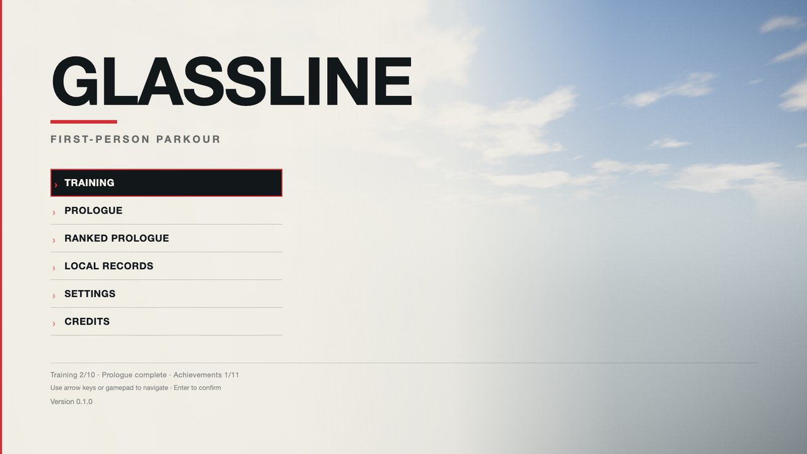 |
| Settings |  |
| Start with signage |  |
| Sprint HUD + speed blur | 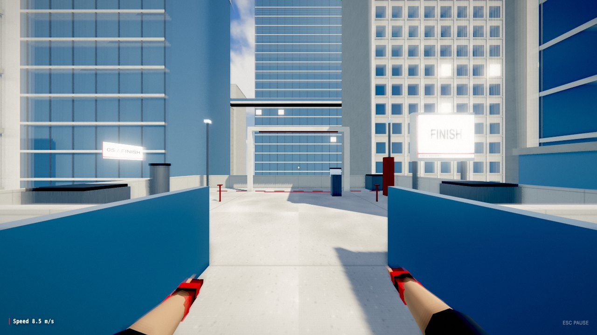 |
| Finish roof |  |

- Start frame remains **10/13** image metrics in tolerance; the paper UI and
  signs do not change the world grade.
- `npm run validate` green: typecheck, Biome, **270 tests in 36 files**, build.
- No new console errors from the sign material or motion-blur shader; captures
  show the RUN/section signs and the minimal HUD.

### Honest gaps

- The menu backdrop is only the procedural sky; it still lacks a city/level
  preview or authored key art on the right side.
- Sign copy is generic placeholder text (`RUN`, section indices), not a full
  brand/typographic system.
- Motion blur is implemented and captured at 8.5 m/s (the sprint frame), but its
  strength and the HUD's movement readability still need a human review.
- The capture tool's `--run` path is not yet reliable in headless focus; the
  sprint frame was produced with the debug held-key path.
- Route length, the slow stair climb, and the audio listening pass remain open
  from previous rounds.

### Next

1. Add a menu/level preview backdrop and a real sign/brand language.
2. Tune motion blur strength and add camera shake/landing weight if sprint reads
   too flat.
3. Extend the route toward 180–220 m and replace the stair grind.
4. Listening pass on the Round 2 mix.

---

## Round 5 — menu city vignette (2026-11-19)

### Scope

Round 4 left the menu's right side as empty procedural sky. This round adds a
purpose-built prologue city vignette behind the paper panel without loading the
playable level or duplicating gameplay state.

### What changed

- New `MenuBackdrop` owns a visual-only rooftop/city group: prologue roof deck,
  parapets, glass tower with mullions and braces, orange **RUN** sign, roof route
  paint, near AC units, a layered city with window grids, and a second orange
  **RUN** billboard on the near right tower.
- `RenderScene` owns the backdrop and exposes `setMenuBackdropVisible`; the group
  is hidden in gameplay and shown for boot, main menu, loading, results, and
  error states.
- `CameraSystem.setPresentationPose` places the menu camera at
  `(0, 2.1, 11)` with a slight left look; `Application` re-applies that pose
  whenever the flow is not gameplay, and leaves the gameplay camera untouched
  during pause/resume.
- The menu paper gradient now fades out by 66–72% instead of 100%, so the city
  vignette is not washed out across the open side.
- The first-person body remains hidden outside gameplay.

### Result

- The menu now reads as a designed prologue frame rather than a menu floating on
  empty sky.
- `npm run validate` green: typecheck, Biome, **270 tests in 36 files**, build.
- Start-frame metrics are unchanged at **10/13**; gameplay captures confirm the
  backdrop group is hidden during play.
- Menu render is lightweight: no colliders, no level runtime, no physics; the
  backdrop's small mesh set adds ~3.9k triangles to the menu frame.

### Honest gaps

- The vignette is a simplified static set, not the real loaded Prologue, and has
  no animated character, traffic, or camera drift.
- The menu city lighting is still bright/washed at the transition edge; it needs
  a final colour/contrast pass against the paper panel.
- Route length (~66 m), the stair climb, audio listening, and deeper world
  detail remain open.

### Next

1. Add gentle menu camera drift/parallax and a skyline silhouette layer.
2. Extend the playable route toward the 180–220 m target.
3. Tune menu colour/contrast and motion blur against the reference frames.
4. Listening pass on the Round 2 mix.

---

## Round 6 — final scaffold ascent (2026-11-19)

### Scope

Round 5 ended at the low finish roof, ~66 m into a 180–220 m target. This round
adds a final construction ascent after that roof: a narrow beam, eight rising
jump platforms, and a high finish roof. The five checkpoint IDs and section
order are preserved; `cp_finish` moves onto the beam and `trigger_finish` moves
to the high roof.

### What changed

**Route**

- The old finish roof (y = −0.9, ending z = −62) now ends at a red edge. A 2.3 m
  gap drops onto a 2.4 m-wide concrete beam at y = −2.0 (z −64.5…−72.5).
- Eight scaffold platforms climb 0.8 m each, with 2.0 m gaps and 3.6 m-deep
  landings, from y = −1.2 to y = 4.4 (z −74.5…−117.3).
- A 16 m-wide high finish roof at y = 5.2 spans z −119.3…−135, entered through
  a split south parapet; the finish gate/terminal/sign sit at z = −130/−128.
- `cp_finish` moved to the beam at z = −66 (respawn y = −1.07); the finish
  trigger moved to the high roof at y = 5.9, z = −130. Order and IDs unchanged.
- The old finish deck becomes a transition roof with the `05 / ASCENT` sign;
  the new jump tower carries `06 / FINISH`.
- Sun shadow frustum extended to z ≈ −140 and focus moved to z = −48; the far
  central tower moved from z = −140 to z = −160 so it no longer intersects the
  new finish roof.

**Construction dressing**

- Four 38 m scaffold standards, horizontal ledges, diagonal braces, red caps,
  work lights, platform edge paint, high-roof support columns, and a lower city
  roof under the tower.
- Finish gate, lit terminal, `FINISH` billboard (dark for contrast), floodlight,
  and service kit moved onto the high roof.

### Verification

- New physics test drives the beam and all eight jumps with held jump input and
  lands on the high roof (y > 4.8); it exposed and fixed a solid south parapet
  blocking the final landing.
- Integration test walks the updated waypoints through `cp_finish` and the
  high-roof finish trigger; speedrun route still has five checkpoints and
  `trigger_finish`.
- `npm run validate`: typecheck, Biome, **271 tests in 36 files**, build.
- Browser evidence captured at the beam, mid-ascent, and high roof; start-frame
  metrics unchanged at **10/13**. Frame probe still reports **60 fps**
  (16.6 ms average), 30 instanced batches, 1 841 instances, 28.7k triangles.

### Route result

| Metric | Round 3 | Round 6 | Plan target |
|---|---:|---:|---:|
| Distance start → finish gate | ~66 m | ~136 m | 180–220 m |
| Vertical range | 5.1 m | 8.2 m (−3.0…+5.2) | ≥ 8 m |
| Authored jump gaps | 1 | 10 | several |
| Sections / checkpoints | 5 / 5 | 5 / 5 | 5 / 5 |

### Evidence

| View | Image |
|---|---|
| Beam below the jump tower |  |
| Mid-ascent platforms | 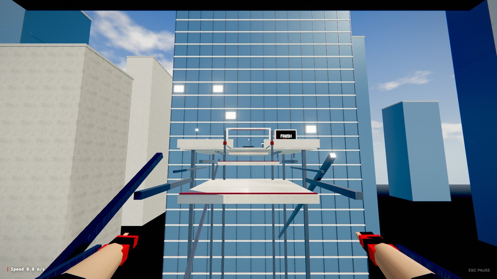 |
| High finish roof |  |
| Start regression |  |

### Honest gaps

- ~136 m is still short of the 180–220 m target; the new finale adds one long
  jump chain rather than another authored rooftop turn.
- The beam/platforms float over a dark city void; support/scaffold detail needs
  more depth from below.
- The high finish roof is sparse: gate, sign, terminal, and one service box only.
- Eight identical 0.8 m jumps are repetitive; the climb needs variation in
  height, direction, or surface.
- Falls on the climb respawn at the beam; there is no mid-climb checkpoint
  because the five-ID contract is fixed.
- Audio listening and final motion/menu calibration remain open.

### Next

1. Add a rooftop turn/second construction chain to reach 180–220 m.
2. Vary the ascent and add a mid-climb safety beat without changing checkpoint IDs.
3. Dress the high roof and city void below the tower.
4. Listening pass and final colour/motion calibration.

---

## Round 7 — high catwalk U-turn (2026-11-19)

### Scope

Round 6 reached a high finish roof at ~136 m. This round inserts a long exposed
catwalk U-turn before the gate, bringing the route into the 180–220 m band while
keeping the five checkpoint IDs and section order unchanged.

### What changed

- **Catwalk:** from the high roof (y = 5.2) the route exits east onto a 3.2 m
  catwalk at z = −122.8 (x 8…46), crosses a 10 m turn platform at x 46…56, and
  returns on a parallel catwalk at z = −130.8. Blue glass rails, red route paint,
  support masts, overhead cables, work lights, and a `07 / TURN` marker frame the
  span.
- **Finish gate** moved from z = −130 to z = −133 on the same high roof; the
  finish trigger moved with it. A centered dark **FINISH** banner now hangs in
  the gate so it reads from the return leg. `cp_finish` remains on the beam.
- **Connections:** the high-roof east parapet is split into three segments,
  leaving openings for both catwalk legs; the turn platform is large enough to
  walk a full 180° without falling through a rail seam.
- **Environment:** near east tower moved west to open the turn frame; far-skyline
  boxes that crowded the turn are skipped; shadow frustum widened to x ±60/z
  ≈ −140; a lower city roof sits under the catwalk for depth.
- **Tests:** new physical catwalk test walks out, around the turn, and back to
  the roof; integration waypoints now include the outbound, turn, return, and
  high-gate finish.

### Route result

| Metric | Round 6 | Round 7 | Plan target |
|---|---:|---:|---:|
| Path start → finish | ~136 m | **~220 m** | 180–220 m |
| Vertical range | 8.2 m | 8.2 m | ≥ 8 m |
| Explicit jumps | 10 | 10 | several |
| Sections / checkpoints | 5 / 5 | 5 / 5 | 5 / 5 |

### Verification

- `npm run validate`: typecheck, Biome, **272 tests in 36 files**, build.
- Physical catwalk test exposes the rail/seam problems fixed above: the return
  span was widened, the turn platform extended to both legs, and the rail gap
  opened at the turn.
- Integration test passes all five checkpoints and the relocated finish trigger.
- Browser captures at outbound, return, and gate; start remains 10/13 metrics.
- Frame probe: **60.4 fps** (16.6 ms average), 1 855 instances, 29k triangles.

### Evidence

| View | Image |
|---|---|
| Outbound catwalk | 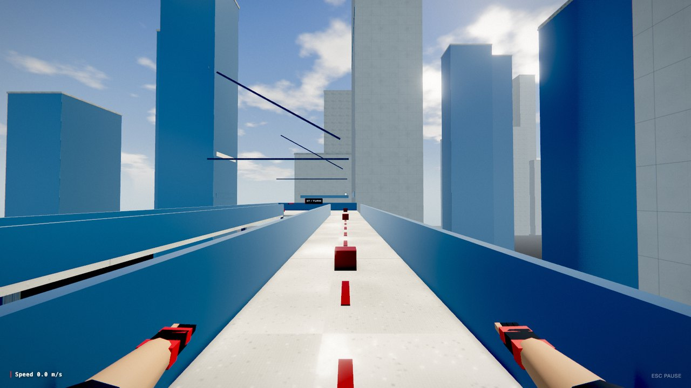 |
| Return catwalk |  |
| High finish gate |  |
| Start regression |  |

### Honest gaps

- The length is reached partly by an out-and-back catwalk; it is a real authored
  traverse, but not another vertical rooftop sequence.
- From the turn, a blank tower wall fills much of the frame; the view corridor
  needs a final art pass.
- The catwalk is visually repetitive: identical rails and dashes for 80 m.
- Falls on the catwalk respawn at the beam far below; there is no mid-climb or
  mid-catwalk checkpoint without changing the five-ID contract.
- High roof remains sparse, jump rhythm is uniform, and audio listening/final
  motion calibration are still open.

### Next

1. Break the catwalk repetition with a mid-span variation (gap, glass floor,
   service platform, or crane crossing).
2. Open the turn view and dress the high roof.
3. Add a mid-route safety beat without changing checkpoint IDs.
4. Listening pass and final colour/motion calibration.

---

## Round 8 — finale polish and altitude wind (2026-11-19)

### Scope

Round 7 hit the length target with a long catwalk. This round improves the
finale's readability and environmental sound without changing the route length,
checkpoint IDs, or section order.

### What changed

**Catwalk variety**

- A suspended construction load (container on four cables) hangs over the
  outbound/return span, with a dark underside and shadow.
- Deck seams every 6 m, a red chevron sequence and hazard plate at the turn,
  cable drums, and work lights break the repeated rails and white deck.
- `06 / ASCENT` replaces the premature `06 / FINISH`; `07 / TURN` remains at the
  turn.

**High roof**

- AC/service box, crate cluster, mast with cool work light, solar panel, vent
  drum, and service kit dress the high roof around the gate.
- The finish banner stays centred in the gate; the props are placed off the
  approach line.

**Turn view**

- The near east tower moved west, far-skyline boxes around the turn were
  skipped, and the far central tower moved to z = −190 so it no longer forms a
  wall immediately behind the turn.
- A blank skyline face still dominates part of the south view; this is improved
  but not fully solved.

**Sound**

- `AudioMovementState` now carries player altitude. The ambience wind gain and
  cutoff rise above the lower roof (altitude ratio from ~1.5 m to ~7.5 m), so the
  high catwalk and finish roof are audibly windier even at low movement speed.
- This is a code-level mix change, not a human listening verdict.

### Verification

- `npm run validate` green: typecheck, Biome, **272 tests in 36 files**, build.
- Captures show the suspended load, deck seams, high-roof kit, and gate.
- Performance **60.2 fps** (16.6 ms average); start frame remains **10/13**.
- Catwalk route/tests unchanged; no new collision surfaces were added by the
  dressing.

### Evidence

| View | Image |
|---|---|
| Catwalk with suspended load |  |
| Dressed high roof and gate | 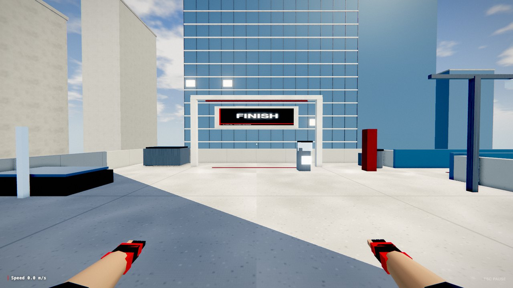 |
| Finish gate |  |
| Start regression |  |

### Honest gaps

- The turn still faces a mostly blank skyline wall; the view needs authored
  towers/signage rather than only removed boxes.
- Catwalk length/rails remain repetitive; the load and seams help but do not
  turn it into a new traversal idea.
- High roof is better dressed but still sparse compared with the start roof.
- Altitude wind is unverified by ear and may need level balancing against
  footsteps/music.
- No mid-climb/mid-catwalk checkpoint; falls return to the beam.
- Uniform 0.8 m jump rhythm, final menu/motion calibration, and listening pass
  remain open.

### Next

1. Author the turn view: a hero tower/billboard rather than a blank wall.
2. Add one mid-catwalk traversal variation (glass floor, gap, or crane platform).
3. Consider a respawn-only safety beat without changing checkpoint IDs.
4. Listening pass and final colour/motion calibration.

---

## Round 9 — turn vista and catwalk gap (2026-11-19)

### Scope

Round 8 opened the turn view but left it empty, and the catwalk was still a pure
run. This round adds the first catwalk traversal beat and a deliberate distant
silhouette, without changing route length or checkpoint IDs.

### What changed

- **Catwalk gap:** the outbound span is split at x 23.8…26.0 with a 2.2 m
  construction gap. Red edge plates mark both sides; a rail-mounted `GAP / 2.2M`
  sign sits above the north rail; deck seams and the suspended load continue
  beyond it.
- **Physical test:** the catwalk test now jumps the gap with held jump input,
  then continues through the turn and back. A fall still respawns at the beam.
- **Turn vista:** the far-skyline exclusion sector was widened to z > −260, so
  the tall face that filled the south view is gone. A second distant tower crane
  (x 74, jib at y 71) and a floating red accent removal give the turn an open
  skyline silhouette instead of a wall.
- **Catwalk/high-roof detail from Round 8** remains: suspended container, deck
  seams, work lights, high-roof service kit, altitude wind.

### Verification

- `npm run validate` green: typecheck, Biome, **272 tests in 36 files**, build.
- Catwalk physical test: gap jump + turn + return all pass.
- Integration route unchanged (no trigger/checkpoint changes).
- Performance **60.1 fps** (16.6 ms), start frame **10/13**.
- Captures: gap close-up, open turn vista, catwalk detail.

### Evidence

| View | Image |
|---|---|
| Catwalk gap and suspended load |  |
| Turn vista with distant crane |  |
| Catwalk detail | 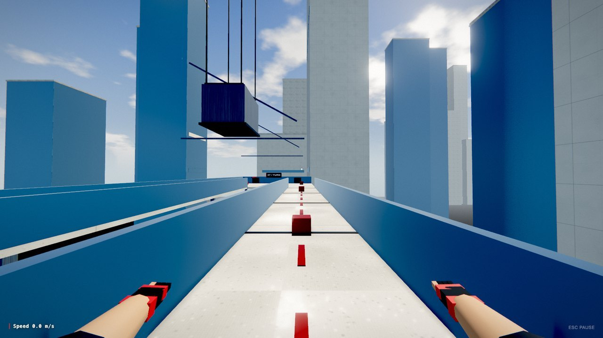 |
| Start regression |  |

### Honest gaps

- The turn now opens to sky but is sparse; the crane is a silhouette, not a full
  authored vista.
- The 2.2 m gap is punishing with no mid-catwalk checkpoint; a fall returns to
  the beam and repeats the climb.
- Catwalk rails/white deck still repeat; only one real traversal beat was added.
- High roof is dressed but still sparse; audio listening and final motion/menu
  calibration remain open.
- Uniform 0.8 m jump rhythm and no dedicated catwalk surface audio.

### Next

1. Add a mid-catwalk respawn anchor (without changing the five speedrun IDs).
2. Author the turn vista (hero tower/billboard) and vary the gap approach.
3. Add catwalk/grate surface audio; run the listening pass.
4. Final menu/motion/colour calibration.

---

## Round 10 — catwalk safety, surface audio, turn skyline (2026-11-19)

### Scope

Round 9 added a punishing catwalk gap. This round adds a fall-only safety anchor
for the high route, gives the catwalk a metal surface for footsteps/landings, and
closes the open turn view with a distant hero skyline.

### What changed

**Safety without changing the speedrun contract**

- `RespawnManager` gained `setEmergencyAnchor(destination)`: it is used only for
  `fall` recovery and never for scripted/manual restarts, checkpoints, or
  speedrun splits.
- The application sets a high-route anchor at `(0, 6.075, −121)` once the player
  is above y = 4.6 and past z = −110 (high roof/catwalk). It clears when the
  player is grounded below y = 3 and back at z > −112 (beam/ascent).
- Result: a catwalk/gap fall respawns on the high roof instead of replaying the
  climb; the five checkpoint IDs, order, triggers, and route length are
  unchanged. Training sessions are excluded.

**Catwalk surface audio**

- New `surface_catwalk` (`surfaceType: metal`) is assigned to all four catwalk
  decks. Footsteps and landings now use the metal preset on the grate rather than
  concrete; the beam/ascent remain concrete.
- Verified in-browser: feet on the catwalk resolve `surfaceType: metal`, altitude
  ~6.1 m, while the altitude wind remains active.

**Turn vista**

- Three distant hero towers at z = −300/−318/−330 close the southern horizon,
  with a red beacon on the tallest; the existing distant crane provides the
  industrial silhouette.
- Removed the red mast caps that read as floating blocks at the catwalk edge and
  moved a support mast out of the 2.2 m gap.

### Verification

- `npm run validate` green: typecheck, Biome, **274 tests in 36 files**, build.
- New respawn tests: anchor wins over the active checkpoint for falls; ignored
  for manual restarts; can be cleared.
- In-browser anchor probe: high-route anchor set, fall destination
  `respawn_high_route` at (0, 6.075, −121), anchor cleared after returning to the
  beam.
- Physical catwalk/gap/turn test still passes; integration route unchanged.
- Performance **60.1 fps**; start frame **10/13**.

### Evidence

| View | Image |
|---|---|
| Turn with hero skyline and crane |  |
| Catwalk gap, clear of support mast |  |
| High roof | 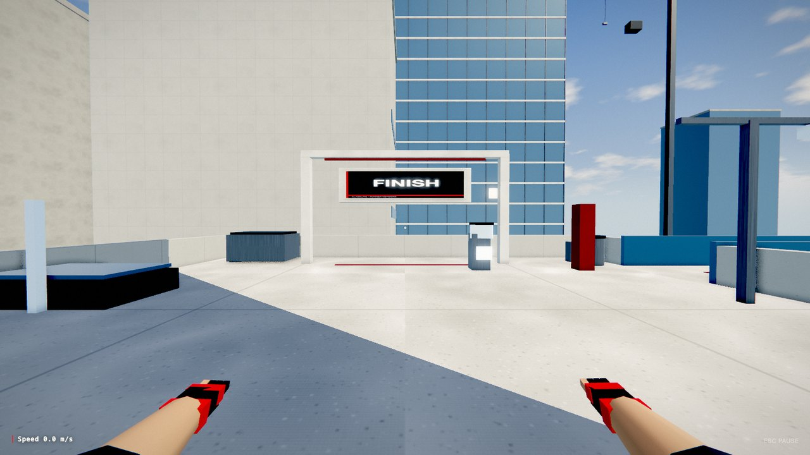 |
| Start regression |  |

### Honest gaps

- The safety anchor covers the high route only; a fall on the scaffold ascent
  still returns to the beam.
- Hero towers are simple boxes, not authored architecture; the turn remains
  stylised rather than reference-photographic.
- Catwalk still has one jump beat and repeated rails; no dedicated grate visual.
- Metal surface audio is code-verified, not listening-verified.
- No mid-catwalk variation after the gap; high roof remains sparse; final
  menu/motion/colour calibration remains open.

### Next

1. Add a second mid-catwalk traversal beat or a service platform detour.
2. Author the hero-tower facades/billboards instead of simple boxes.
3. Run the listening pass; balance metal footsteps against wind/music.
4. Mid-climb safety and final menu/motion calibration.

---

## Round 11 — authored turn skyline and return barrier (2026-11-19)

### Scope

Round 10 opened the turn and added safety/audio. This round gives the horizon
real facade detail and adds a second, different catwalk traversal beat on the
return span.

### What changed

- **Hero towers:** the three distant boxes are replaced by `addBuilding`
  instances with window grids/bands, roof caps, and rooftop props. The central
  tower carries a 13 × 6.4 m **GLASSLINE** billboard and a red beacon; the
  northern faces are detailed toward the catwalk.
- **Return barrier:** a 0.5 m construction barrier spans the return catwalk at
  x = 34, with red/white face plates. It is a collider; the player must jump or
  vault it. The physical catwalk test now detects the barrier, jumps it with held
  input, and continues back to the roof.
- **Route/checkpoints unchanged:** ~220 m, 8.2 m vertical, five IDs, same
  triggers. The barrier adds a second traversal beat without a new checkpoint.
- Catwalk gap/return anchor/metal surface from Round 10 remain.

### Verification

- `npm run validate`: typecheck, Biome, **274 tests in 36 files**, build.
- Physical catwalk test: gap, turn, barrier jump, return all pass.
- Integration route unchanged.
- Performance **60.1 fps**; start frame **10/13**.
- Captures: turn skyline/billboard, return barrier, start.

### Evidence

| View | Image |
|---|---|
| Authored turn skyline and billboard |  |
| Return catwalk barrier |  |
| Start regression |  |

### Honest gaps

- Hero towers are 160+ m away; the billboard reads as a small mark, not a
  designed close-up. The barrier stripes are only partly legible against metal.
- Catwalk still has two discrete obstacles but no lateral/detour choice.
- No mid-climb safety; falls on the scaffold return to the beam.
- Audio listening, final menu/motion/colour calibration, and high-roof density
  remain open.
- Route remains an out-and-back catwalk for a large share of its length.

### Next

1. Add a mid-climb safety beat and a catwalk detour/lateral choice.
2. Bring one hero facade closer or add a closer billboard for the turn.
3. Listening pass and final UI/motion calibration.
4. Continue world-detail parity on the start/industrial roofs.

## Round log

| Round | Date | Focus | Outcome |
|---|---|---|---|
| 1 | 2026-11-19 | HDR renderer, sky, materials, city, viewmodel | 10/13 reference metrics in band (2 highlight metrics open); 60 fps at 1600×900 |
| 2 | 2026-11-19 | Procedural audio: buses, ambience, movement/parkour, score, radio | 5/5 audio targets in band; live post-limiter peak −3.7 dBFS; 30 audio tests |
| 3 | 2026-11-19 | Vertical Prologue extension: drop, gap, stair climb, skybridge, finish roof | Route ~66 m / 5.1 m vertical; 270 tests; physical traversal verified |
| 4 | 2026-11-19 | Reference UI, canvas signage, speed blur | Paper/ink menu, minimalist HUD, RUN/section signs, radial blur; 270 tests |
| 5 | 2026-11-19 | Menu city vignette | Visual-only prologue rooftop/city behind paper menu; hidden in gameplay; 270 tests |
| 6 | 2026-11-19 | Final scaffold ascent | ~136 m route, 8.2 m vertical, 8 jump platforms, high finish roof; 271 tests |
| 7 | 2026-11-19 | High catwalk U-turn | ~220 m route, 8.2 m vertical, exposed catwalk, high gate; 272 tests |
| 8 | 2026-11-19 | Finale polish + altitude wind | Suspended load, deck seams, high-roof kit, altitude-scaled wind; 272 tests |
