# Reference alignment progress

**Objective:** Bring Glassline to the presentation level of the *Mirror's Edge*
prologue reference — design, graphics, and sound.

**Reference:** `ref/reference/Прохождение Mirror's Edge #1 - Пролог (и обучение)
[dlbJTerGxCM].mp4` plus the extracted prologue study frames in
`ref/reference/prolog-kit/` (local only, git-ignored).

**Method:** deterministic gameplay screenshots, measured image statistics, and
manual review against the prologue rooftop frames. Tooling lives in
[`tools/capture`](../tools/capture/README.md).

---

## Round 1 — presentation foundation (2026-11-19)

### Scope

Replace the flat forward renderer and placeholder arena with an HDR
first-person presentation: sky and atmosphere, PBR materials, a dense rooftop
city, a shaped prologue route, and first-person runner arms. Sound and gameplay
depth are intentionally left for later rounds.

### What changed

**Rendering**

- New HDR post chain in `PostPipeline`: half-float MSAA target, GTAO, bloom,
  filmic ACES tone mapping, split toning, saturation/contrast grade, chromatic
  aberration, vignette, grain, dither, and a photographic highlight clip for
  clipped sunlit whites.
- Procedural sky dome (`SkyDome`): zenith/horizon gradient, sun disc and glow,
  two-scale cumulus with lit tops and shaded bases, and slow cloud drift.
- Sky-derived PMREM environment probe so glass and metal reflect the actual sky.
- Sun (PCF soft shadows), hemisphere, ambient fill, and a cool rim light; level
  environments now drive sky palette, sun angle, sun intensity, and fog.
- Procedural PBR material library (`MaterialLibrary`) with runtime canvas textures
  for roof, concrete, plaster, facade, metal, asphalt, and red paint. Materials
  use world-space triplanar mapping, so box geometry keeps a consistent surface
  scale at any size.
- Decorations are batched into instanced meshes by material/shape/shadow flags.

**Prologue design and content**

- The flat 44 m box arena becomes a 22 m rooftop with low parapets, an open
  skylight, and city visible over every edge.
- A close glazed tower wall runs along the west side with floor slabs, mullions,
  diagonal bracing, an orange billboard, a red maintenance ladder, and a red
  handrail — the reference's asymmetric "roof against a facade" composition.
- Dense surround: near facades with punched/curtain/ribbon window systems,
  rooftop plant, lower roofs, a 54 m skybridge, construction crane, billboards,
  and a 64-building far skyline above a city floor 31 m below.
- Rooftop kit: skylight glazing and rails, solar array, AC clusters, duct and pipe
  runs, stair bulkhead with red door, water tank, antenna, vents, crates, route
  paint, checkpoint chevrons, start/finish gantries, and a lit finish terminal.
- The wall-run corridor, slide duct, vault ledge, steps, and terminal are clad in
  white/metal with red trim instead of flat black boxes.
- Void kill triggers cover all five sections, so leaving the roof always respawns
  at the last checkpoint.

**Player presentation**

- First-person viewmodel: sleeves, forearms, gloved hands, red wrist wraps, and
  fingers attached to the camera.
- Viewmodel responds to idle breathing, run bob and arm swing, airtime, sliding,
  landing compression, and wall-run roll. It is lit by a dedicated camera light
  on layer 1.

**Tooling**

- `tools/capture/capture.mjs`: deterministic capture from CDP (start gameplay,
  teleport, aim, screenshot, scene statistics).
- `tools/capture/metrics.py`: luminance/contrast/colour/accent metrics against the
  reference frame set, with a JSON report.
- Round evidence: [`docs/evidence/visual/round-1`](evidence/visual/round-1/).

### Result

| View | Image |
|---|---|
| Prologue start |  |
| Wall-run corridor |  |
| Looking back | 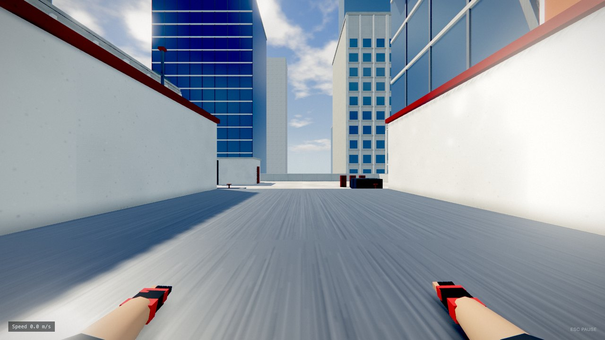 |

Measured against the 20-frame prologue rooftop reference set
(`docs/evidence/visual/round-1/metrics.json`):

| Metric | Glassline start | Reference mean | Delta | Band |
|---|---:|---:|---:|---|
| luma mean | 0.586 | 0.615 | −0.029 | PASS |
| luma std | 0.265 | 0.295 | −0.030 | PASS |
| p25 luma | 0.331 | 0.371 | −0.040 | PASS |
| p95 luma | 0.895 | 0.981 | −0.086 | WATCH |
| near-white | 3.6 % | 34.5 % | −30.9 | WATCH |
| deep shadow | 1.9 % | 0.7 % | +1.2 | PASS |
| saturation | 0.360 | 0.300 | +0.060 | PASS |
| local contrast | 0.248 | 0.285 | −0.037 | PASS |
| edge energy | 0.027 | 0.019 | +0.007 | PASS |
| sky-blue area | 60.1 % | 43.3 % | +16.8 | WATCH |
| top-third contrast | 0.209 | 0.243 | −0.034 | PASS |
| split-tone dark R−B | −25.5 | −21.8 | −3.7 | PASS |
| red accent | 2.7 % | 2.4 % | +0.3 | PASS |

10/13 metrics are inside tolerance. Sky area runs high because the start frame
is a wide, open rooftop composition; reference sky area ranges from 15 % to
54 % across the set.

The two highlight metrics are the deliberate trade-off for this round. An
earlier grade clipped hard from luma 0.52 and reached 12/13 (near-white 27.7 %,
p95 0.953), but it flattened the roof and facade texture into flat white. The
shipped grade uses a gentler shoulder (0.62 → 0.90, 70 % blend), keeping surface
detail and accepting less clipped white. Closing the remaining highlight gap is
a lighting/content task — stronger sun, brighter albedo and more white surfaces —
not a reason to reintroduce the hard clip.

Runtime on Apple M1 Pro / ANGLE Metal, 1600×900:

- 60 fps (16.6 ms average, 16.8 ms p95) during live gameplay.
- 27 instanced decoration batches, 1,656 instances, ~24k triangles.
- 31 textures, 22 shader programs.

Functional checks:

- `npm run validate` passes: typecheck, Biome, 250 tests in 34 files, production
  build.
- Synthetic input: holding `W` moves the player 6.3 m in 1.8 s; `Space` enters
  `JUMPING` with +5.6 m/s vertical speed and returns to `FALLING`.
- Leaving the roof at x = 12 respawns at the rooftop checkpoint (z = 3).
- No console errors or exceptions during load, gameplay, jump, and respawn.

### Honest gaps

- **Sound is unchanged.** The release ambience/footstep bed is still the simple
  oscillator mix; there is no reference-grade wind/city bed, music, surface
  footsteps, wall-run/slide layers, or reverb/mix bus.
- **Design is still a straight rooftop corridor.** The prologue has one lane, a
  duct, a wall-run corridor, and a vault; it lacks the reference's leaps between
  rooftops, drops, climbs, ladders, and readable branching.
- **Graphics are stylized, not photoreal.** Facades are box masses with window
  grids; glass lacks local reflections; clouds are soft; billboards have no
  typography; hands are simple low-poly forms. Highlights do not clip as much as
  the reference (near-white 3.6 % vs 34.5 %); closing that needs stronger real
  lighting/content, not a harder grade clip.
- **No motion blur, depth of field, or animated world** (crane, birds, cloth,
  helicopter) yet.
- Training still uses the old 44 m yard and flat skyline dressing.
- Quality tiers and a dynamic-resolution policy are not wired to the new pipeline.

### Next

1. **Sound pass:** layered procedural wind/city ambience, a four-chord score,
   surface-aware footsteps, slide/wall-run/landing layers, reverb and ducking,
   exposed through the existing AudioManager and settings.
2. **Route design pass:** break the straight corridor into rooftop gaps, drops,
   climbs, and a readable red guidance language while preserving checkpoint and
   speedrun contracts.
3. **Graphics polish:** cloud shaping, billboard typography, facade variation,
   contact decals, motion blur, and animated city props.
4. **Training and menu presentation** to match the same language.

---

## Round 2 — procedural sound pass (2026-11-19)

### Scope

Replace the three-oscillator ambience bed and sine-blip footsteps with a
structured procedural mix: buses, limiter, reverb, layered ambience,
surface-aware movement feedback, a parkour set, a sparse score, and radio.
No external samples or audio assets were added.

### What changed

**Audio architecture**

- `AudioTypes.ts` defines Web-Audio-like contracts for gain, oscillator, buffer
  source, biquad, convolver, compressor, analyser, and buffer nodes, so the mix
  is testable without a real `AudioContext`.
- `noise.ts` provides deterministic white/pink/brown noise and stereo impulse
  responses from seeded generators.
- `surfaceAudio.ts` maps the SurfaceRegistry classification (`concrete`,
  `metal`, `rubber`, `glass`, `asphalt`) to synthesis presets, with an explicit
  fallback that is not a second classification system.
- `synthesis.ts` implements layered footstep, landing, whoosh, contact-loop, and
  UI-tone voices with attack/decay envelopes, filter shaping, variation, and
  dry/reverb routing.
- `AudioManager` now owns a real graph:
  `buses → master → mix trim → compressor/limiter → destination`, with a shared
  reverb send/return and independent environment, movement, parkour, UI, music,
  and radio buses. Every one-shot is voice-limited and cleaned up on `ended` or
  a timed fallback.

**Movement and parkour sound**

- Footsteps are surface-aware and combine band-passed noise, a low body thump,
  a high-frequency texture layer, and optional metal/glass ring or tick;
  intensity and variation follow speed.
- Landings scale with impact velocity and use the surface preset's body/ring.
- Jump, wall-jump, vault, slide, and wall-run have distinct voices. Slide and
  wall-run use continuous filtered-noise loops with speed-dependent gain and
  cutoff; loops stop on state change, pause, and session shutdown.
- Footstep scheduling now derives its interval from actual speed instead of two
  fixed buckets, and passes the current surface from `SurfaceRegistry`.

**Environment**

- Three continuous noise layers (wind, distant city, rooftop air) plus a very
  low two-oscillator hum. Profile (Training/Prologue) changes gains and filter
  frequencies; wind follows speed and breathes while idle.
- A sparse four-chord score starts with gameplay: slow triangle/sine pad with a
  low-pass filter, plus a quiet arpeggio only while moving. Speed increases the
  music bus slightly.
- Radio cues use filtered static and two signal tones; they duck the environment
  bus smoothly and restore it. The Prologue plays one at run start and on each
  section entry.
- Pause/resume stops contact loops, ducks ambience/music, and leaves UI audio
  available. Settings now apply `audio.music_volume` in addition to master, SFX,
  and UI volumes.

**Verification tooling**

- `audioDemo.ts` renders a deterministic 24 s mix through an
  `OfflineAudioContext`, using the same synthesis functions as live gameplay.
- `tools/capture/audio-render.mjs` saves the WAV; `audio-metrics.py` computes
  band shares, BS.1770-style gated loudness, peak, and short-term p5/p95 range;
  `audio-probe.mjs` measures the live post-limiter output through an
  `AnalyserNode`.
- Evidence: [`docs/evidence/audio/round-2`](evidence/audio/round-2/).

### Result

Demo mix (24 s: quiet ambience intro, footsteps, parkour, score):

| Metric | Demo | Reference prologue 500–800 s | Target | Band |
|---|---:|---:|---:|---|
| Energy < 500 Hz | 0.896 | 0.909 | 0.85–0.94 | PASS |
| Energy > 2 kHz | 0.060 | 0.026 | 0.03–0.08 | PASS |
| Gated loudness | −26.0 LUFS | −26.6 LUFS | −31…−26 | PASS |
| Sample peak | −5.26 dBFS | −1.94 dBFS | ≤ −3 dBFS | PASS |
| Short-term p95−p5 | 22.9 dB | 12.9 dB | 18–26 dB | PASS |

5/5 planned targets are satisfied. The reference column is measured by the same
script on the 500–800 s prologue segment (local `ref/` audio, not committed).

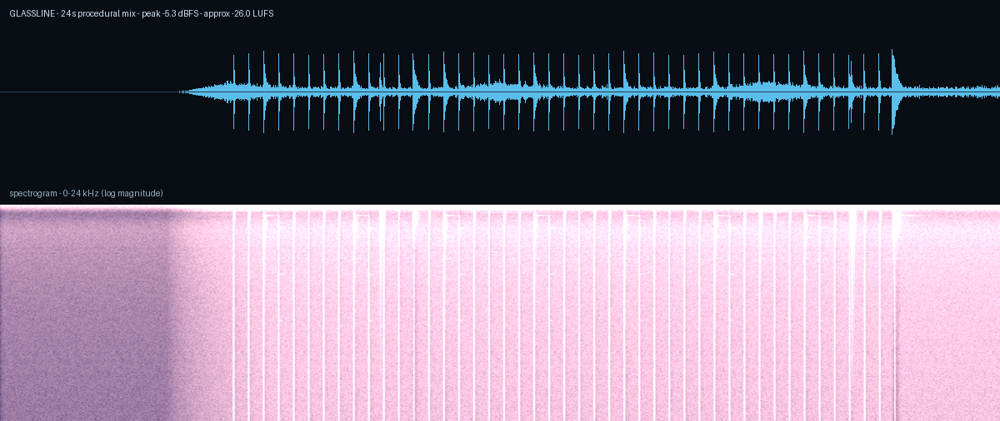

Live probe (post-limiter, deterministic metal footstep/landing sequence):

- RMS 0.128 (−17.9 dBFS), peak 0.655 (−3.7 dBFS).
- Band shares during the stress sequence: low 82 %, mid 12 %, high 2.9 %.
- Audio state running; 3 ambience sources; music active; 7 buses present; no
  console errors.
- Pause flow verified: environment bus 0.28, music bus 0.144, `paused: true`;
  resume restores 0.8 and the music target. Contact loops stop in both paths.

Tests: 30 dedicated audio tests cover lifecycle, graph construction, surface
presets, noise determinism, synthesis routing, loops, pause, voice limits,
settings, radio, and score scheduling.

### Honest gaps

- **No human listening test.** Headless verification proves graph, levels,
  spectral balance, and lifecycle, not subjective character. The mix still needs
  an art-director/owner listening pass.
- **No spatial audio** yet: no `PannerNode` emitters, listener transform, or
  occlusion. All current sources are player-local or bus-routed.
- **Music is a simple four-chord pad + arpeggio**, not the reference's full
  interactive score. It has no section changes, combat/tension layer, or stingers.
- **Radio is synthetic static/tones.** There is no speech or text-authored radio
  content; the ducking path exists but has no longer transmissions.
- **Surface transitions** update per step; continuous loops do not crossfade
  between materials.
- The demo's peak is conservatively low (−5.3 dBFS) versus the reference's
  −1.9 dBFS measured by the same script; transient headroom could be raised after
  a listening pass.

### Next

1. Listening pass and per-layer level tuning on desktop speakers/headphones.
2. Spatial emitters and listener integration for machinery, city, and radio.
3. Adaptive score sections (rooftop/industrial/construction/skybridge/finish).
4. Route design pass: rooftop gaps, drops, climbs, and red guidance while
   preserving checkpoint/speedrun contracts.
5. Graphics polish: clouds, billboard typography, motion blur, contact decals,
   animated city props, and Training/menu presentation.

---

## Round 3 — vertical Prologue extension (2026-11-19)

### Scope

The Prologue was a 25 m flat rooftop corridor. This round extends it into a
~66 m route with a roof drop, a sprint gap, a stair climb, a narrow skybridge,
and a separate finish roof, while preserving the five checkpoint IDs, their
order, the section chain, and the speedrun route contract.

### What changed

**Route and level design**

- The north parapet now opens into a 1 m drop from the upper roof (y = 0) to a
  lower service roof (y = −3). Void kill volumes moved below the lower route so
  falls still respawn.
- The lower service roof is split by a 2.4 m sprint gap. The far deck starts at
  z = −34.4 so a run jump clears it; a sprint jump is the intended line, and the
  gap is forgiving enough to recover.
- A 15-step, 0.15 m-riser construction stair climbs 2.1 m to the skybridge deck.
  The riser was deliberately reduced after a physics probe showed the character
  controller stalling on 0.28 m boxes despite `enableAutostep(0.3, ...)`.
- A 3.4 m-wide skybridge spans the canyon at y = −0.9 with 1.3 m glass rails;
  its supports drop into the city. The finish roof (18 × 12 m) follows at the
  same level with a gate at z = −60, lit terminal, and floodlights.
- Checkpoints moved to the new beats: `cp_rooftop` (z 3), `cp_industrial`
  (z −2.5), `cp_construction` (z −8.5), `cp_skybridge` (z −46, bridge), and
  `cp_finish` (z −56, finish roof). Section triggers and entry spawn points moved
  with them; IDs and ordering are unchanged.
- The sun shadow camera now covers z ≈ −74…26, so the lower route and finish
  receive shadows instead of falling outside the shadow frustum.

**Content language**

- Scaffold cage, red guide dashes, hazard line at the drop, bridge rail lights,
  AC/duct/crate clusters, floodlight masts, terminal screen, finish sign, and
  lower-roof parapets dress the new route.
- A lower service roof 16 m below the gap gives the drop visual depth; the old
  decorative skybridge moved to the far skyline so it no longer hangs as a black
  canopy over the new route.
- The bridge narrowed from 5 m to 3.4 m and its checkpoint beacons moved inboard,
  so it reads as a crossing rather than a plaza.

**Verification**

- New physics test loads every Prologue collider, sprint-jumps the 2.4 m gap,
  climbs the stair flight, crosses the bridge, and reaches z < −58 on the finish
  roof.
- The start-to-finish integration test now walks the extended waypoints through
  all five checkpoints, section transitions, and the finish trigger.
- Browser capture: drop from the upper roof settles at y ≈ −2.11 on the lower
  deck; lower route, stairs, bridge, and finish render without console errors.

### Result

| View | Image |
|---|---|
| Drop from the upper roof |  |
| Lower service roof and stairs | 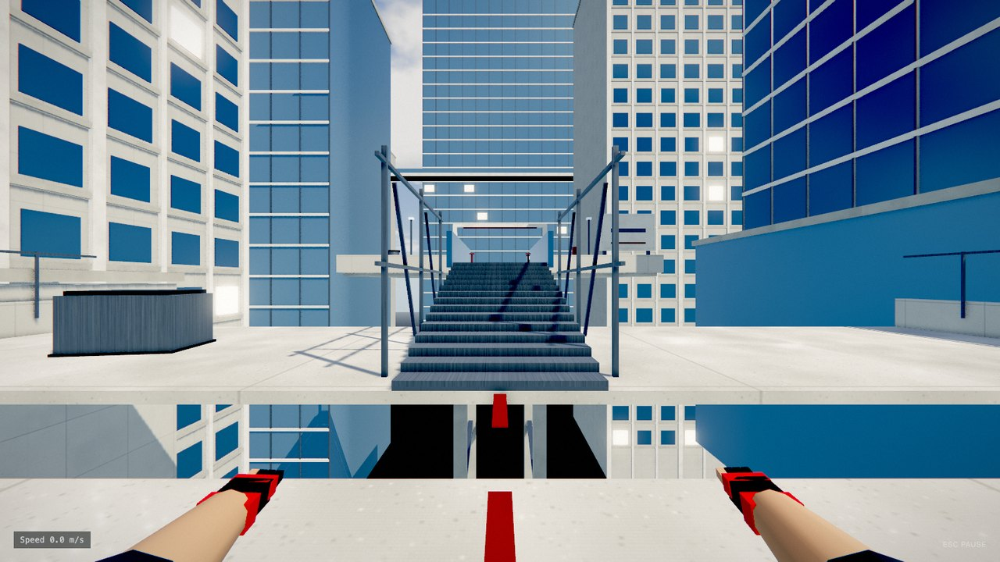 |
| Skybridge |  |
| Finish roof | 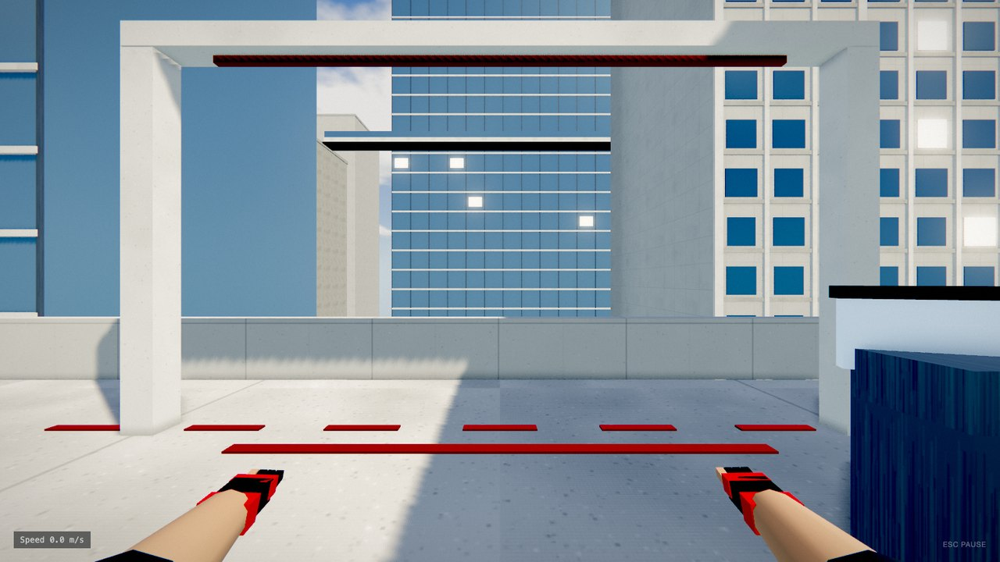 |

Route facts:

| Metric | Before | Round 3 | Plan target |
|---|---:|---:|---:|
| Forward route length | ~25 m | ~66 m | 180–220 m |
| Vertical delta | 0 m | 5.1 m (3.0 drop + 2.1 climb) | ≥ 8 m |
| Sections / checkpoints | 5 / 5 | 5 / 5 | 5 / 5 |
| Explicit gaps | 0 | 1 sprint gap | several |
| Distinct bridge | no | 3.4 m skybridge | yes |

Tests: **270 tests in 36 files**, including the new physical traversal test and
the updated route integration. The start frame remains at 10/13 image metrics
(highlight headroom and open-sky composition are unchanged from Round 1).

### Honest gaps

- The route is still **~66 m**, not the 180–220 m target, and has one authored
  gap rather than a sequence of rooftop-to-rooftop beats. It is a real vertical
  extension, not a finished reference-scale Prologue.
- The stair climb is physically reliable but slow under autostep; a faster
  parkour line needs jump platforms or a tuned ramp.
- The lower roof is broad and partly empty; the gap still reads as a dark void
  when looked at from the deck edge.
- Section geometry is section-gated by z; a surface on a boundary box can be
  deactivated one beat early. Colliders remain, but surface metadata should be
  authored explicitly in a later pass.
- No new sound or UI work this round; the mix still needs a listening verdict.

### Next

1. Extend the route to the reference scale with a second/third rooftop turn and
   a construction chain, or convert the stair climb into jump platforms.
2. Replace the boundary z-section mapping with explicit per-box section IDs.
3. Graphics polish: billboard typography, cloud shaping, motion blur, contact
   decals, animated props.
4. Listening pass on the Round 2 mix.

---

## Round 4 — reference UI, signage, and speed feedback (2026-11-19)

### Scope

The world had a reference-grade HDR pass but the interface and in-world
typography still read as a generic prototype. This round applies the reference's
editorial language to the shell and the street furniture, and adds speed-reactive
motion blur.

### What changed

**UI art direction**

- Main menu, pause, settings, results, and records use a paper-ivory split panel
  with black uppercase type and hard red rules instead of the old dark
  translucent cards. The selected row is solid ink with a red edge.
- Settings and records inherit the same language: black labels, thin rules,
  red-focused controls, ink-filled reset/back actions.
- HUD removed the dark backdrop panels: timer, checkpoint progress, objective,
  speed, and hints are now white type with a soft shadow over the world, marked
  by a single red rule. A small centre dot provides a reference-style crosshair.
- Training/tutorial copy is an ivory panel with ink text and a red edge; toasts
  remain dark for legibility over gameplay.
- The first-person body is hidden outside gameplay, so the menu no longer shows
  a floating forearm on the right side.
- High-contrast, large-text, and reduced-motion rules were updated for the new
  paper surfaces.

**In-world signage**

- `LevelDecorationShape` now supports `plane` signs. `MaterialLibrary.getSign`
  paints a 1024×512 canvas with background, accent rule, heavy uppercase text,
  a diagonal tint, and a small `GLASSLINE / RUNNER NETWORK` line; the result is
  used as map + emissive map.
- The orange billboard on the west facade now reads **RUN**; section indices
  `01 ROOFTOP`, `02 INDUSTRIAL`, `03 CONSTRUCTION` run along the facade; the
  bridge carries `04 / SKYBRIDGE`, the finish parapet `05 / FINISH`, and the
  finish billboard reads **FINISH**.
- Sign planes are individual meshes with owned geometry; their materials and
  textures are cached and disposed by the shared library.

**Speed feedback**

- The grade pass gained a radial speed blur driven by normalized player speed.
  The main camera already had FOV/bob response; the post pass now smears the
  periphery while sprinting and leaves idle frames untouched.
- `Renderer.render` / `PostPipeline.render` accept a speed ratio; the application
  passes `speed / 8.5` each frame.

**Tooling**

- `tools/capture/capture.mjs` gained `--menu`, `--settings`, and `--run <ms>` for
  deterministic shell and moving-HUD captures.

### Result

| View | Image |
|---|---|
| Main menu |  |
| Settings | 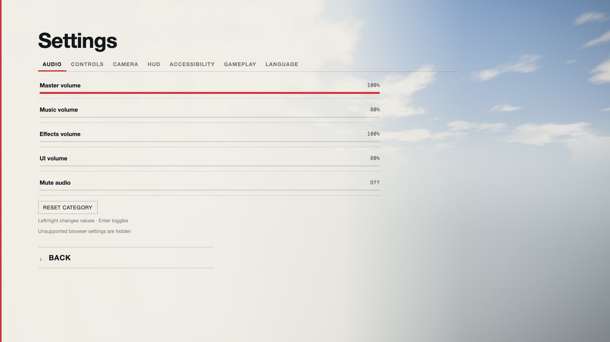 |
| Start with signage | 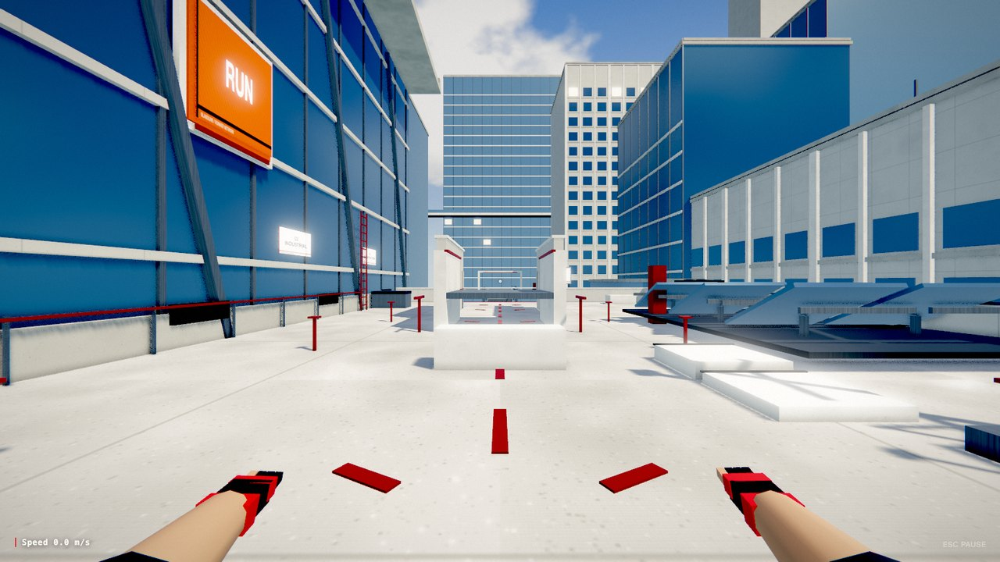 |
| Sprint HUD + speed blur |  |
| Finish roof | 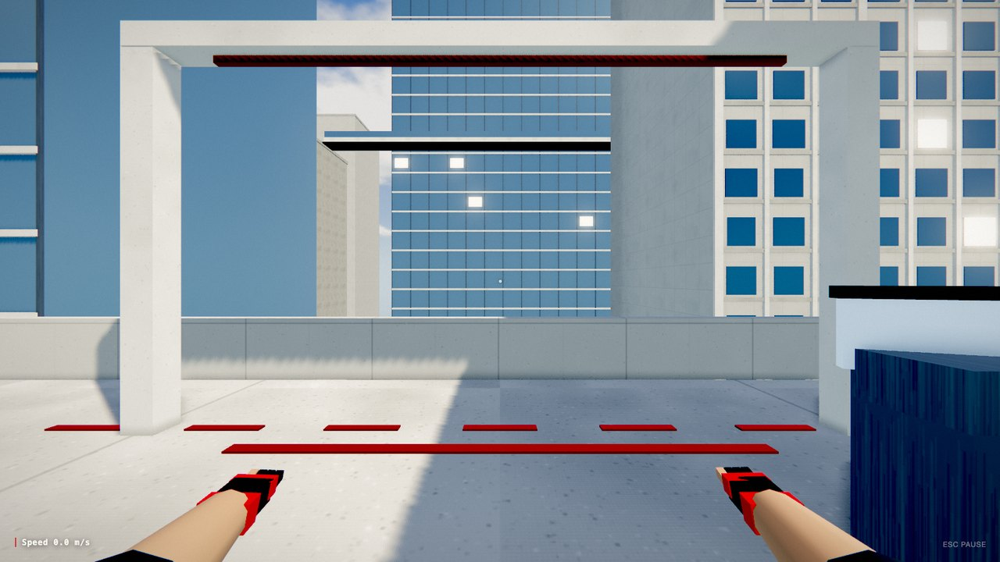 |

- Start frame remains **10/13** image metrics in tolerance; the paper UI and
  signs do not change the world grade.
- `npm run validate` green: typecheck, Biome, **270 tests in 36 files**, build.
- No new console errors from the sign material or motion-blur shader; captures
  show the RUN/section signs and the minimal HUD.

### Honest gaps

- The menu backdrop is only the procedural sky; it still lacks a city/level
  preview or authored key art on the right side.
- Sign copy is generic placeholder text (`RUN`, section indices), not a full
  brand/typographic system.
- Motion blur is implemented and captured at 8.5 m/s (the sprint frame), but its
  strength and the HUD's movement readability still need a human review.
- The capture tool's `--run` path is not yet reliable in headless focus; the
  sprint frame was produced with the debug held-key path.
- Route length, the slow stair climb, and the audio listening pass remain open
  from previous rounds.

### Next

1. Add a menu/level preview backdrop and a real sign/brand language.
2. Tune motion blur strength and add camera shake/landing weight if sprint reads
   too flat.
3. Extend the route toward 180–220 m and replace the stair grind.
4. Listening pass on the Round 2 mix.

---

## Round 5 — menu city vignette (2026-11-19)

### Scope

Round 4 left the menu's right side as empty procedural sky. This round adds a
purpose-built prologue city vignette behind the paper panel without loading the
playable level or duplicating gameplay state.

### What changed

- New `MenuBackdrop` owns a visual-only rooftop/city group: prologue roof deck,
  parapets, glass tower with mullions and braces, orange **RUN** sign, roof route
  paint, near AC units, a layered city with window grids, and a second orange
  **RUN** billboard on the near right tower.
- `RenderScene` owns the backdrop and exposes `setMenuBackdropVisible`; the group
  is hidden in gameplay and shown for boot, main menu, loading, results, and
  error states.
- `CameraSystem.setPresentationPose` places the menu camera at
  `(0, 2.1, 11)` with a slight left look; `Application` re-applies that pose
  whenever the flow is not gameplay, and leaves the gameplay camera untouched
  during pause/resume.
- The menu paper gradient now fades out by 66–72% instead of 100%, so the city
  vignette is not washed out across the open side.
- The first-person body remains hidden outside gameplay.

### Result

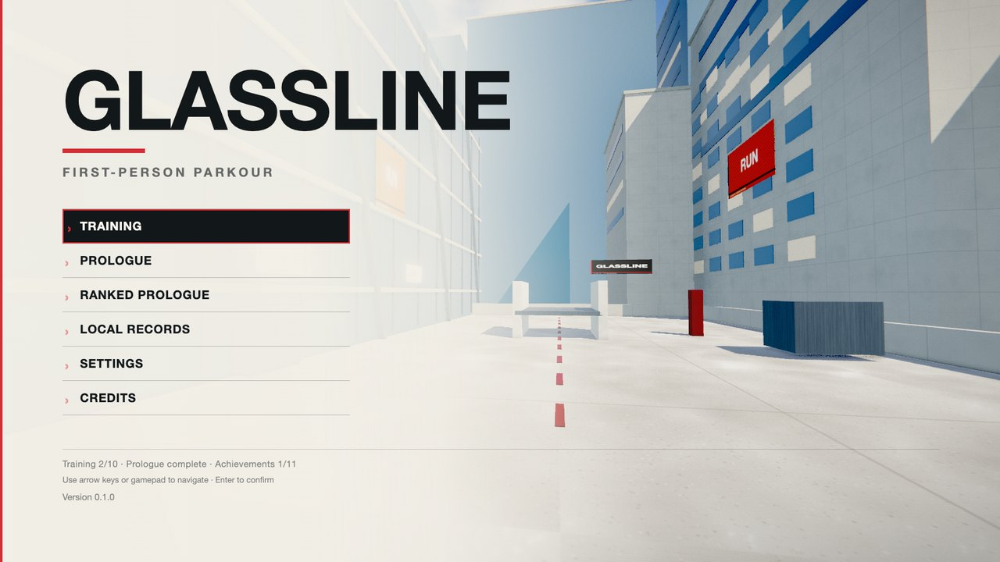

- The menu now reads as a designed prologue frame rather than a menu floating on
  empty sky.
- `npm run validate` green: typecheck, Biome, **270 tests in 36 files**, build.
- Start-frame metrics are unchanged at **10/13**; gameplay captures confirm the
  backdrop group is hidden during play.
- Menu render is lightweight: no colliders, no level runtime, no physics; the
  backdrop's small mesh set adds ~3.9k triangles to the menu frame.

### Honest gaps

- The vignette is a simplified static set, not the real loaded Prologue, and has
  no animated character, traffic, or camera drift.
- The menu city lighting is still bright/washed at the transition edge; it needs
  a final colour/contrast pass against the paper panel.
- Route length (~66 m), the stair climb, audio listening, and deeper world
  detail remain open.

### Next

1. Add gentle menu camera drift/parallax and a skyline silhouette layer.
2. Extend the playable route toward the 180–220 m target.
3. Tune menu colour/contrast and motion blur against the reference frames.
4. Listening pass on the Round 2 mix.

---

## Round 6 — final scaffold ascent (2026-11-19)

### Scope

Round 5 ended at the low finish roof, ~66 m into a 180–220 m target. This round
adds a final construction ascent after that roof: a narrow beam, eight rising
jump platforms, and a high finish roof. The five checkpoint IDs and section
order are preserved; `cp_finish` moves onto the beam and `trigger_finish` moves
to the high roof.

### What changed

**Route**

- The old finish roof (y = −0.9, ending z = −62) now ends at a red edge. A 2.3 m
  gap drops onto a 2.4 m-wide concrete beam at y = −2.0 (z −64.5…−72.5).
- Eight scaffold platforms climb 0.8 m each, with 2.0 m gaps and 3.6 m-deep
  landings, from y = −1.2 to y = 4.4 (z −74.5…−117.3).
- A 16 m-wide high finish roof at y = 5.2 spans z −119.3…−135, entered through
  a split south parapet; the finish gate/terminal/sign sit at z = −130/−128.
- `cp_finish` moved to the beam at z = −66 (respawn y = −1.07); the finish
  trigger moved to the high roof at y = 5.9, z = −130. Order and IDs unchanged.
- The old finish deck becomes a transition roof with the `05 / ASCENT` sign;
  the new jump tower carries `06 / FINISH`.
- Sun shadow frustum extended to z ≈ −140 and focus moved to z = −48; the far
  central tower moved from z = −140 to z = −160 so it no longer intersects the
  new finish roof.

**Construction dressing**

- Four 38 m scaffold standards, horizontal ledges, diagonal braces, red caps,
  work lights, platform edge paint, high-roof support columns, and a lower city
  roof under the tower.
- Finish gate, lit terminal, `FINISH` billboard (dark for contrast), floodlight,
  and service kit moved onto the high roof.

### Verification

- New physics test drives the beam and all eight jumps with held jump input and
  lands on the high roof (y > 4.8); it exposed and fixed a solid south parapet
  blocking the final landing.
- Integration test walks the updated waypoints through `cp_finish` and the
  high-roof finish trigger; speedrun route still has five checkpoints and
  `trigger_finish`.
- `npm run validate`: typecheck, Biome, **271 tests in 36 files**, build.
- Browser evidence captured at the beam, mid-ascent, and high roof; start-frame
  metrics unchanged at **10/13**. Frame probe still reports **60 fps**
  (16.6 ms average), 30 instanced batches, 1 841 instances, 28.7k triangles.

### Route result

| Metric | Round 3 | Round 6 | Plan target |
|---|---:|---:|---:|
| Distance start → finish gate | ~66 m | ~136 m | 180–220 m |
| Vertical range | 5.1 m | 8.2 m (−3.0…+5.2) | ≥ 8 m |
| Authored jump gaps | 1 | 10 | several |
| Sections / checkpoints | 5 / 5 | 5 / 5 | 5 / 5 |

### Evidence

| View | Image |
|---|---|
| Beam below the jump tower | 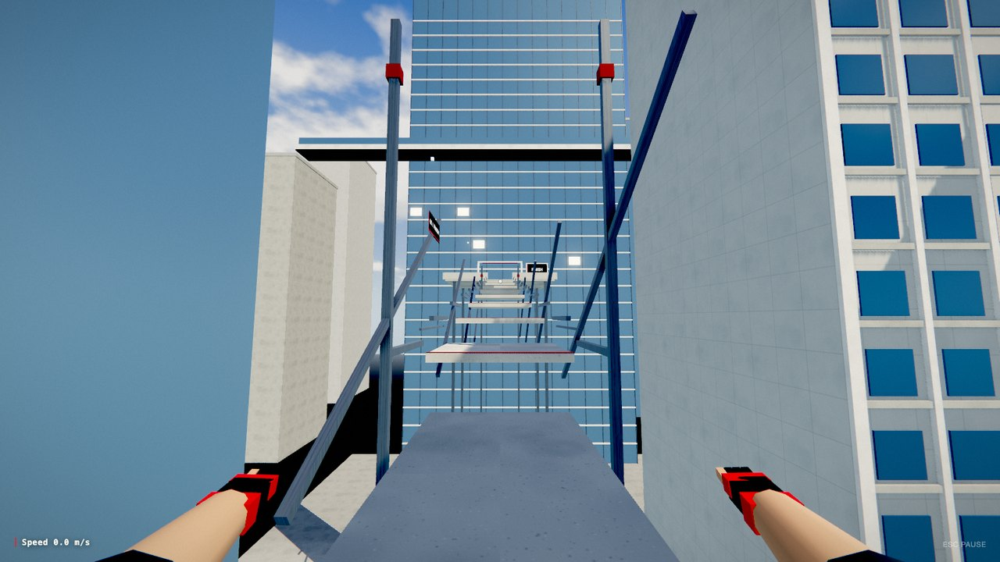 |
| Mid-ascent platforms |  |
| High finish roof | 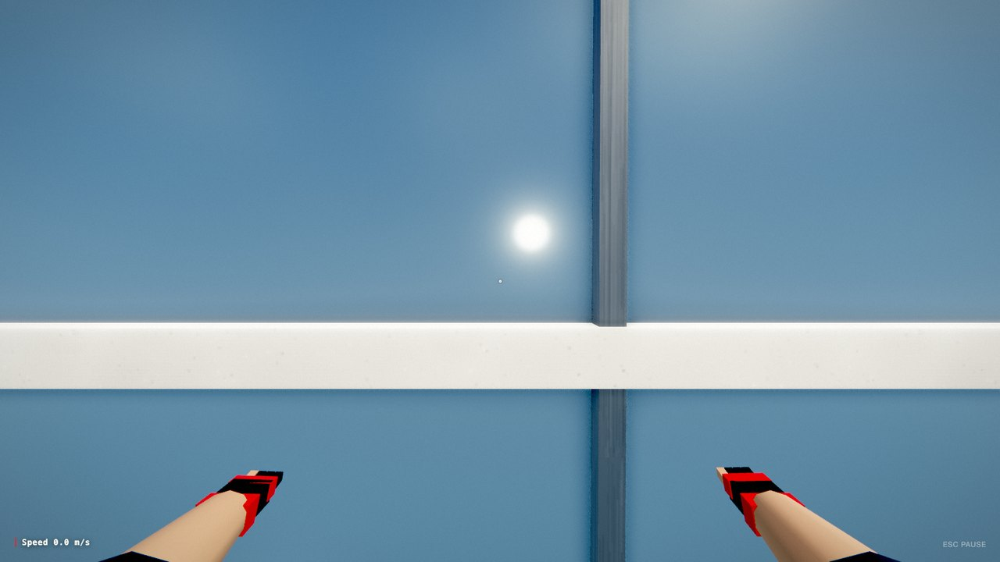 |
| Start regression |  |

### Honest gaps

- ~136 m is still short of the 180–220 m target; the new finale adds one long
  jump chain rather than another authored rooftop turn.
- The beam/platforms float over a dark city void; support/scaffold detail needs
  more depth from below.
- The high finish roof is sparse: gate, sign, terminal, and one service box only.
- Eight identical 0.8 m jumps are repetitive; the climb needs variation in
  height, direction, or surface.
- Falls on the climb respawn at the beam; there is no mid-climb checkpoint
  because the five-ID contract is fixed.
- Audio listening and final motion/menu calibration remain open.

### Next

1. Add a rooftop turn/second construction chain to reach 180–220 m.
2. Vary the ascent and add a mid-climb safety beat without changing checkpoint IDs.
3. Dress the high roof and city void below the tower.
4. Listening pass and final colour/motion calibration.

---

## Round 7 — high catwalk U-turn (2026-11-19)

### Scope

Round 6 reached a high finish roof at ~136 m. This round inserts a long exposed
catwalk U-turn before the gate, bringing the route into the 180–220 m band while
keeping the five checkpoint IDs and section order unchanged.

### What changed

- **Catwalk:** from the high roof (y = 5.2) the route exits east onto a 3.2 m
  catwalk at z = −122.8 (x 8…46), crosses a 10 m turn platform at x 46…56, and
  returns on a parallel catwalk at z = −130.8. Blue glass rails, red route paint,
  support masts, overhead cables, work lights, and a `07 / TURN` marker frame the
  span.
- **Finish gate** moved from z = −130 to z = −133 on the same high roof; the
  finish trigger moved with it. A centered dark **FINISH** banner now hangs in
  the gate so it reads from the return leg. `cp_finish` remains on the beam.
- **Connections:** the high-roof east parapet is split into three segments,
  leaving openings for both catwalk legs; the turn platform is large enough to
  walk a full 180° without falling through a rail seam.
- **Environment:** near east tower moved west to open the turn frame; far-skyline
  boxes that crowded the turn are skipped; shadow frustum widened to x ±60/z
  ≈ −140; a lower city roof sits under the catwalk for depth.
- **Tests:** new physical catwalk test walks out, around the turn, and back to
  the roof; integration waypoints now include the outbound, turn, return, and
  high-gate finish.

### Route result

| Metric | Round 6 | Round 7 | Plan target |
|---|---:|---:|---:|
| Path start → finish | ~136 m | **~220 m** | 180–220 m |
| Vertical range | 8.2 m | 8.2 m | ≥ 8 m |
| Explicit jumps | 10 | 10 | several |
| Sections / checkpoints | 5 / 5 | 5 / 5 | 5 / 5 |

### Verification

- `npm run validate`: typecheck, Biome, **272 tests in 36 files**, build.
- Physical catwalk test exposes the rail/seam problems fixed above: the return
  span was widened, the turn platform extended to both legs, and the rail gap
  opened at the turn.
- Integration test passes all five checkpoints and the relocated finish trigger.
- Browser captures at outbound, return, and gate; start remains 10/13 metrics.
- Frame probe: **60.4 fps** (16.6 ms average), 1 855 instances, 29k triangles.

### Evidence

| View | Image |
|---|---|
| Outbound catwalk |  |
| Return catwalk | 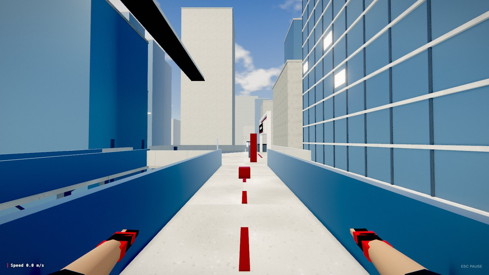 |
| High finish gate |  |
| Start regression |  |

### Honest gaps

- The length is reached partly by an out-and-back catwalk; it is a real authored
  traverse, but not another vertical rooftop sequence.
- From the turn, a blank tower wall fills much of the frame; the view corridor
  needs a final art pass.
- The catwalk is visually repetitive: identical rails and dashes for 80 m.
- Falls on the catwalk respawn at the beam far below; there is no mid-climb or
  mid-catwalk checkpoint without changing the five-ID contract.
- High roof remains sparse, jump rhythm is uniform, and audio listening/final
  motion calibration are still open.

### Next

1. Break the catwalk repetition with a mid-span variation (gap, glass floor,
   service platform, or crane crossing).
2. Open the turn view and dress the high roof.
3. Add a mid-route safety beat without changing checkpoint IDs.
4. Listening pass and final colour/motion calibration.

---

## Round 8 — finale polish and altitude wind (2026-11-19)

### Scope

Round 7 hit the length target with a long catwalk. This round improves the
finale's readability and environmental sound without changing the route length,
checkpoint IDs, or section order.

### What changed

**Catwalk variety**

- A suspended construction load (container on four cables) hangs over the
  outbound/return span, with a dark underside and shadow.
- Deck seams every 6 m, a red chevron sequence and hazard plate at the turn,
  cable drums, and work lights break the repeated rails and white deck.
- `06 / ASCENT` replaces the premature `06 / FINISH`; `07 / TURN` remains at the
  turn.

**High roof**

- AC/service box, crate cluster, mast with cool work light, solar panel, vent
  drum, and service kit dress the high roof around the gate.
- The finish banner stays centred in the gate; the props are placed off the
  approach line.

**Turn view**

- The near east tower moved west, far-skyline boxes around the turn were
  skipped, and the far central tower moved to z = −190 so it no longer forms a
  wall immediately behind the turn.
- A blank skyline face still dominates part of the south view; this is improved
  but not fully solved.

**Sound**

- `AudioMovementState` now carries player altitude. The ambience wind gain and
  cutoff rise above the lower roof (altitude ratio from ~1.5 m to ~7.5 m), so the
  high catwalk and finish roof are audibly windier even at low movement speed.
- This is a code-level mix change, not a human listening verdict.

### Verification

- `npm run validate` green: typecheck, Biome, **272 tests in 36 files**, build.
- Captures show the suspended load, deck seams, high-roof kit, and gate.
- Performance **60.2 fps** (16.6 ms average); start frame remains **10/13**.
- Catwalk route/tests unchanged; no new collision surfaces were added by the
  dressing.

### Evidence

| View | Image |
|---|---|
| Catwalk with suspended load |  |
| Dressed high roof and gate |  |
| Finish gate | 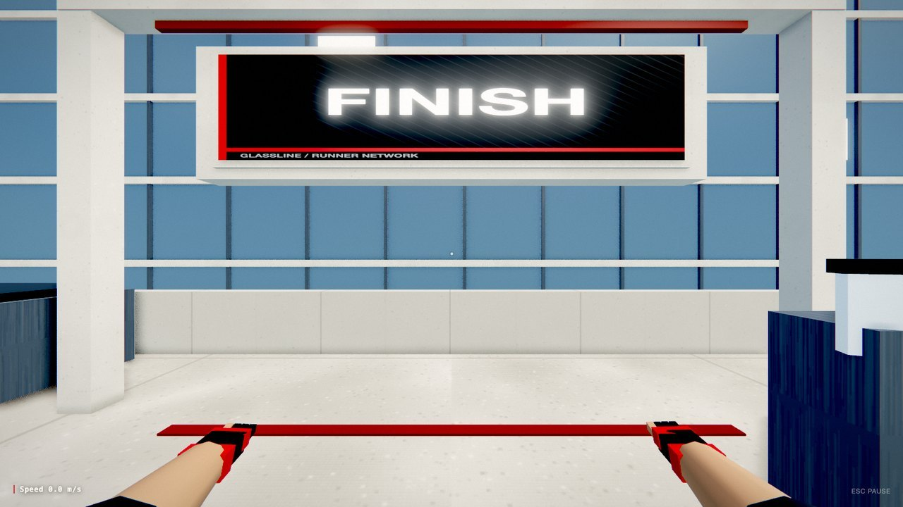 |
| Start regression |  |

### Honest gaps

- The turn still faces a mostly blank skyline wall; the view needs authored
  towers/signage rather than only removed boxes.
- Catwalk length/rails remain repetitive; the load and seams help but do not
  turn it into a new traversal idea.
- High roof is better dressed but still sparse compared with the start roof.
- Altitude wind is unverified by ear and may need level balancing against
  footsteps/music.
- No mid-climb/mid-catwalk checkpoint; falls return to the beam.
- Uniform 0.8 m jump rhythm, final menu/motion calibration, and listening pass
  remain open.

### Next

1. Author the turn view: a hero tower/billboard rather than a blank wall.
2. Add one mid-catwalk traversal variation (glass floor, gap, or crane platform).
3. Consider a respawn-only safety beat without changing checkpoint IDs.
4. Listening pass and final colour/motion calibration.

---

## Round 9 — turn vista and catwalk gap (2026-11-19)

### Scope

Round 8 opened the turn view but left it empty, and the catwalk was still a pure
run. This round adds the first catwalk traversal beat and a deliberate distant
silhouette, without changing route length or checkpoint IDs.

### What changed

- **Catwalk gap:** the outbound span is split at x 23.8…26.0 with a 2.2 m
  construction gap. Red edge plates mark both sides; a rail-mounted `GAP / 2.2M`
  sign sits above the north rail; deck seams and the suspended load continue
  beyond it.
- **Physical test:** the catwalk test now jumps the gap with held jump input,
  then continues through the turn and back. A fall still respawns at the beam.
- **Turn vista:** the far-skyline exclusion sector was widened to z > −260, so
  the tall face that filled the south view is gone. A second distant tower crane
  (x 74, jib at y 71) and a floating red accent removal give the turn an open
  skyline silhouette instead of a wall.
- **Catwalk/high-roof detail from Round 8** remains: suspended container, deck
  seams, work lights, high-roof service kit, altitude wind.

### Verification

- `npm run validate` green: typecheck, Biome, **272 tests in 36 files**, build.
- Catwalk physical test: gap jump + turn + return all pass.
- Integration route unchanged (no trigger/checkpoint changes).
- Performance **60.1 fps** (16.6 ms), start frame **10/13**.
- Captures: gap close-up, open turn vista, catwalk detail.

### Evidence

| View | Image |
|---|---|
| Catwalk gap and suspended load | 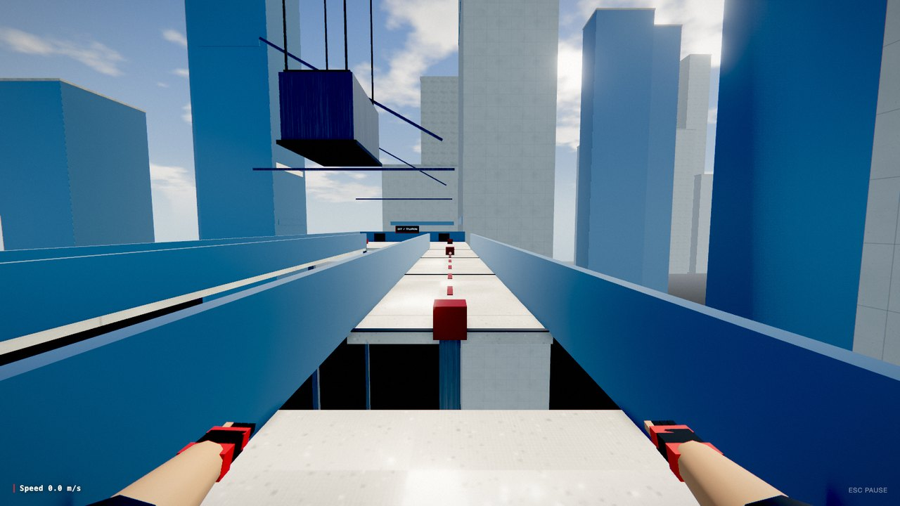 |
| Turn vista with distant crane | 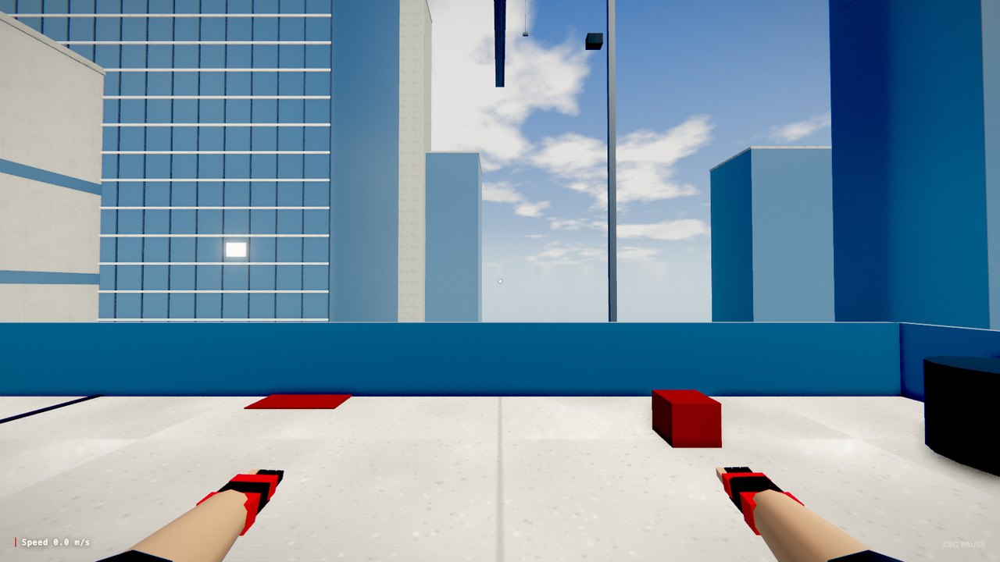 |
| Catwalk detail |  |
| Start regression |  |

### Honest gaps

- The turn now opens to sky but is sparse; the crane is a silhouette, not a full
  authored vista.
- The 2.2 m gap is punishing with no mid-catwalk checkpoint; a fall returns to
  the beam and repeats the climb.
- Catwalk rails/white deck still repeat; only one real traversal beat was added.
- High roof is dressed but still sparse; audio listening and final motion/menu
  calibration remain open.
- Uniform 0.8 m jump rhythm and no dedicated catwalk surface audio.

### Next

1. Add a mid-catwalk respawn anchor (without changing the five speedrun IDs).
2. Author the turn vista (hero tower/billboard) and vary the gap approach.
3. Add catwalk/grate surface audio; run the listening pass.
4. Final menu/motion/colour calibration.

---

## Round 10 — catwalk safety, surface audio, turn skyline (2026-11-19)

### Scope

Round 9 added a punishing catwalk gap. This round adds a fall-only safety anchor
for the high route, gives the catwalk a metal surface for footsteps/landings, and
closes the open turn view with a distant hero skyline.

### What changed

**Safety without changing the speedrun contract**

- `RespawnManager` gained `setEmergencyAnchor(destination)`: it is used only for
  `fall` recovery and never for scripted/manual restarts, checkpoints, or
  speedrun splits.
- The application sets a high-route anchor at `(0, 6.075, −121)` once the player
  is above y = 4.6 and past z = −110 (high roof/catwalk). It clears when the
  player is grounded below y = 3 and back at z > −112 (beam/ascent).
- Result: a catwalk/gap fall respawns on the high roof instead of replaying the
  climb; the five checkpoint IDs, order, triggers, and route length are
  unchanged. Training sessions are excluded.

**Catwalk surface audio**

- New `surface_catwalk` (`surfaceType: metal`) is assigned to all four catwalk
  decks. Footsteps and landings now use the metal preset on the grate rather than
  concrete; the beam/ascent remain concrete.
- Verified in-browser: feet on the catwalk resolve `surfaceType: metal`, altitude
  ~6.1 m, while the altitude wind remains active.

**Turn vista**

- Three distant hero towers at z = −300/−318/−330 close the southern horizon,
  with a red beacon on the tallest; the existing distant crane provides the
  industrial silhouette.
- Removed the red mast caps that read as floating blocks at the catwalk edge and
  moved a support mast out of the 2.2 m gap.

### Verification

- `npm run validate` green: typecheck, Biome, **274 tests in 36 files**, build.
- New respawn tests: anchor wins over the active checkpoint for falls; ignored
  for manual restarts; can be cleared.
- In-browser anchor probe: high-route anchor set, fall destination
  `respawn_high_route` at (0, 6.075, −121), anchor cleared after returning to the
  beam.
- Physical catwalk/gap/turn test still passes; integration route unchanged.
- Performance **60.1 fps**; start frame **10/13**.

### Evidence

| View | Image |
|---|---|
| Turn with hero skyline and crane | 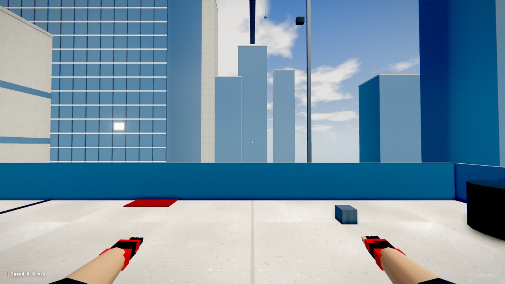 |
| Catwalk gap, clear of support mast |  |
| High roof |  |
| Start regression |  |

### Honest gaps

- The safety anchor covers the high route only; a fall on the scaffold ascent
  still returns to the beam.
- Hero towers are simple boxes, not authored architecture; the turn remains
  stylised rather than reference-photographic.
- Catwalk still has one jump beat and repeated rails; no dedicated grate visual.
- Metal surface audio is code-verified, not listening-verified.
- No mid-catwalk variation after the gap; high roof remains sparse; final
  menu/motion/colour calibration remains open.

### Next

1. Add a second mid-catwalk traversal beat or a service platform detour.
2. Author the hero-tower facades/billboards instead of simple boxes.
3. Run the listening pass; balance metal footsteps against wind/music.
4. Mid-climb safety and final menu/motion calibration.

---

## Round 11 — authored turn skyline and return barrier (2026-11-19)

### Scope

Round 10 opened the turn and added safety/audio. This round gives the horizon
real facade detail and adds a second, different catwalk traversal beat on the
return span.

### What changed

- **Hero towers:** the three distant boxes are replaced by `addBuilding`
  instances with window grids/bands, roof caps, and rooftop props. The central
  tower carries a 13 × 6.4 m **GLASSLINE** billboard and a red beacon; the
  northern faces are detailed toward the catwalk.
- **Return barrier:** a 0.5 m construction barrier spans the return catwalk at
  x = 34, with red/white face plates. It is a collider; the player must jump or
  vault it. The physical catwalk test now detects the barrier, jumps it with held
  input, and continues back to the roof.
- **Route/checkpoints unchanged:** ~220 m, 8.2 m vertical, five IDs, same
  triggers. The barrier adds a second traversal beat without a new checkpoint.
- Catwalk gap/return anchor/metal surface from Round 10 remain.

### Verification

- `npm run validate`: typecheck, Biome, **274 tests in 36 files**, build.
- Physical catwalk test: gap, turn, barrier jump, return all pass.
- Integration route unchanged.
- Performance **60.1 fps**; start frame **10/13**.
- Captures: turn skyline/billboard, return barrier, start.

### Evidence

| View | Image |
|---|---|
| Authored turn skyline and billboard |  |
| Return catwalk barrier | 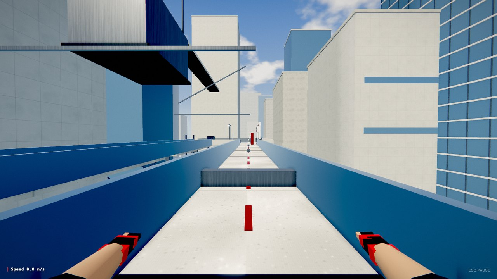 |
| Start regression |  |

### Honest gaps

- Hero towers are 160+ m away; the billboard reads as a small mark, not a
  designed close-up. The barrier stripes are only partly legible against metal.
- Catwalk still has two discrete obstacles but no lateral/detour choice.
- No mid-climb safety; falls on the scaffold return to the beam.
- Audio listening, final menu/motion/colour calibration, and high-roof density
  remain open.
- Route remains an out-and-back catwalk for a large share of its length.

### Next

1. Add a mid-climb safety beat and a catwalk detour/lateral choice.
2. Bring one hero facade closer or add a closer billboard for the turn.
3. Listening pass and final UI/motion calibration.
4. Continue world-detail parity on the start/industrial roofs.

---

## Round 12 — mid-ascent safety pad (2026-11-19)

### Scope

Round 10/11 safety covered the high roof and catwalk but not the scaffold climb.
This round adds a second fall-only anchor on the upper scaffold and a visible
safe-retry pad, without adding checkpoint IDs or changing speedrun splits.

### What changed

- **Mid-ascent anchor:** when the player is grounded on platform 5 (top y=2.0,
  centre z=-98.7), the application sets an emergency anchor at (0, 2.875, -98.7).
  Failing on the higher platforms or the catwalk now retries from platform 5
  instead of the beam. The high-route anchor still overrides it on the high roof;
  both clear when the player is grounded below y=1 at z > -112.
- **Visible pad:** a red disc, two cyan-capped posts, and a rail frame mark the
  safe-retry platform. The first oversized SAFE sign was removed because it
  blocked the jump sightline; the pad itself is the landmark.
- **No route changes:** ~220 m, 8.2 m vertical, five checkpoint IDs, same
  triggers. `RespawnManager` anchor semantics/high-route anchor from Round 10
  remain.
- **Tests:** the emergency-anchor unit tests cover precedence and non-fall
  behavior; in-browser probe verifies mid → high → cleared transitions.

### Verification

- `npm run validate`: typecheck, Biome, **274 tests in 36 files**, build.
- Browser probe: mid anchor destination `respawn_mid_ascent` (0, 2.875, -98.7);
  high roof destination `respawn_high_route`; both clear on the beam.
- Physical catwalk test (gap + turn + barrier + return) unchanged and green.
- Start frame **10/13**; performance ~60 fps.

### Evidence

| View | Image |
|---|---|
| Safe-retry pad on platform 5 | 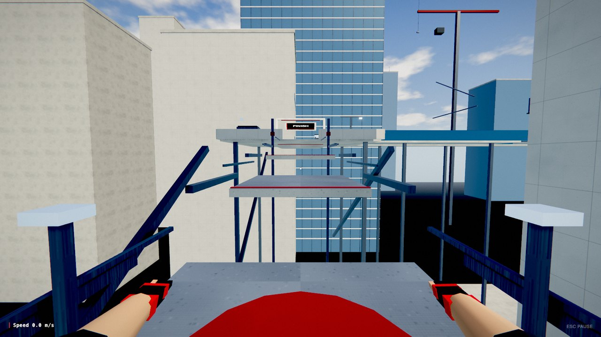 |
| Start regression | 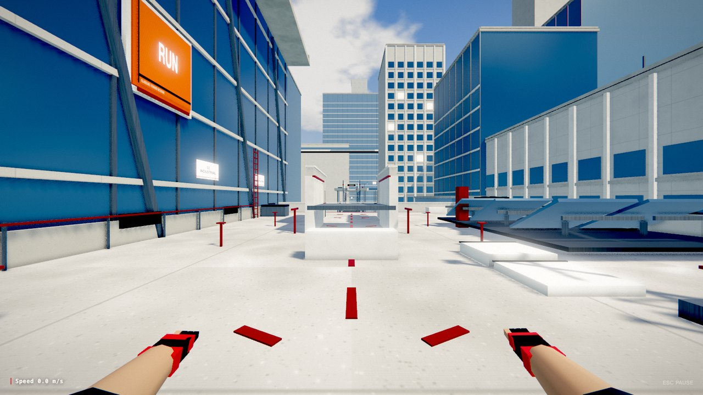 |

### Honest gaps

- Anchor starts at platform 5; falls on platforms 1–4 still return to the beam.
- The red pad may read as hazard rather than safety; no text marker remains.
- Catwalk lateral choice, listening pass, final menu/motion calibration, and
  high-roof density remain open.
- The anchor is application state, not a checkpoint; session restart resets it.

### Next

1. Add a lateral catwalk choice/detour and one more climb variation.
2. Add a closer turn landmark and dress the high roof further.
3. Run the listening pass; balance metal catwalk steps/altitude wind.
4. Final menu/motion/colour calibration.

---

## Round 13 — return-catwalk bypass choice (2026-11-19)

### Scope

The return catwalk had a single mandatory barrier jump. This round adds an
optional lower bypass under it, giving the catwalk a real route choice while
keeping the same length, checkpoints, and triggers.

### What changed

- **Lower bypass:** an 8 × 3 m metal deck at y=4.8 sits under the return span
  (x 30…38, z −136.8…−133.8), reached through a 8 m opening in the return south
  rail. Two 2 m step ledges (top y=5.0) climb back to the catwalk in 0.2 m steps.
- **Choice:** the direct line stays the 0.5 m barrier jump at x=34; the bypass is
  a drop/run/step-up alternative. Both converge on the return catwalk.
- **Marking:** red pad strips on the bypass floor, step-edge paint, and a
  `BYPASS` rail sign. The direct barrier retains its stripe plates.
- **Physical test:** new test spawns on the bypass, walks up the west step
  (0.2 m autostep) and confirms return to catwalk height; existing gap/turn/
  barrier test remains.
- **No route/checkpoint changes:** ~220 m, 8.2 m vertical, five IDs/triggers;
  high/mid anchors and metal surface unchanged.

### Verification

- `npm run validate`: typecheck, Biome, **275 tests in 36 files**, build.
- Five physical catwalk tests: gap, turn, barrier, bypass step, return.
- Integration route unchanged.
- Performance **60.1 fps**; start frame **10/13**.

### Evidence

| View | Image |
|---|---|
| Barrier and lower bypass choice | 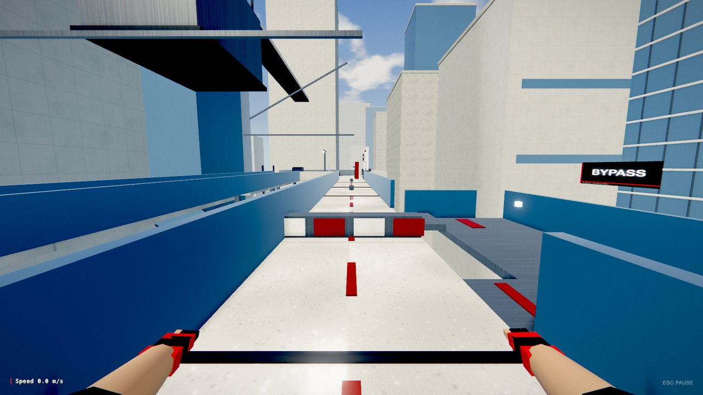 |
| Bypass deck looking back to the catwalk | 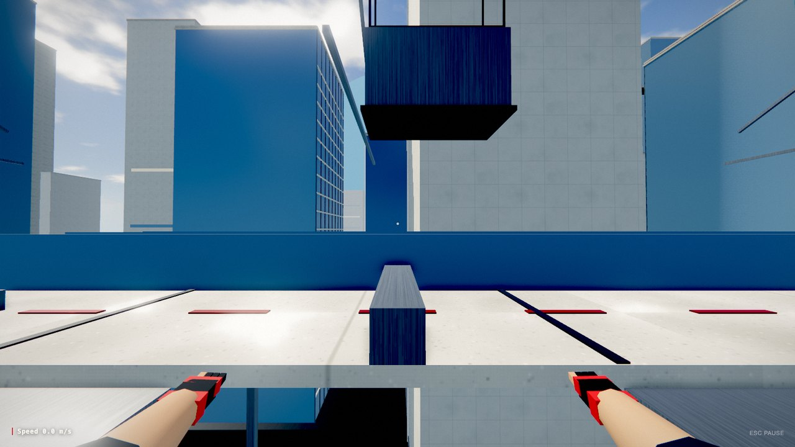 |
| Start regression |  |

### Honest gaps

- The bypass looks like a fall/void from the catwalk; the BYPASS sign is not
  visible early enough and needs a stronger entrance marker.
- There is no speed/reward difference between the two lines; the direct jump is
  likely always faster.
- Bypass geometry is plain, with no dedicated handrail detail beyond glass.
- Listening pass, closer turn landmark, high-roof density, and final
  menu/motion/colour calibration remain open.

### Next

1. Make the bypass entrance legible (arrow/light/rail cut) and give it a
   time/risk tradeoff.
2. Add a closer landmark at the turn.
3. Listening pass and final calibration.
4. Continue world-detail parity.

---

## Round 14 — turn billboard and high-roof helipad (2026-11-19)

### Scope

Round 13 added a route choice but the turn still lacked a close foreground
landmark, and the high roof remained sparse. This round adds a branded turn
billboard and a helipad/service detail set.

### What changed

- **RUN billboard at the turn:** a 8.7 × 2.9 m sign on a steel frame on the turn's
  outer east rail, facing the outbound approach. It gives the catwalk a close
  graphic endpoint instead of only distant towers; the `07 / TURN` sign remains
  below it.
- **High-roof helipad:** a dark 5.4 m pad with white H bars and four cool edge
  lights north of the finish gate, off the approach line. It adds scale and a
  corporate/construction rooftop read without changing collision.
- **No route/checkpoint changes:** ~220 m, 8.2 m vertical, five IDs; bypass,
  anchors, and catwalk surfaces unchanged.
- **No new tests:** all 275 remain green; the additions are visual-only.

### Verification

- `npm run validate`: typecheck, Biome, **275 tests in 36 files**, build.
- Physical catwalk bypass/gap/barrier tests unchanged.
- Performance **60.3 fps**; start frame **10/13**.
- Captures: approach with RUN billboard, high roof with helipad/gate.

### Evidence

| View | Image |
|---|---|
| RUN billboard on catwalk approach | 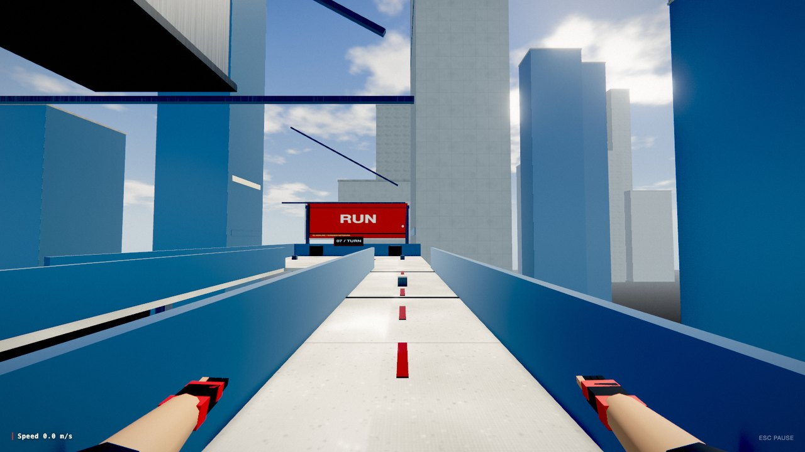 |
| High roof with helipad and gate | 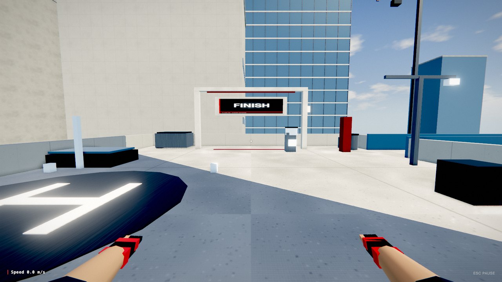 |
| Start regression |  |

### Honest gaps

- The billboard is very close/dominant and renders red rather than orange in
  shade; it can obscure the skyline on approach.
- The helipad is oversized in the entry frame and is decorative only.
- No gameplay/timing difference for the bypass; no new checkpoint/climb beat.
- Listening pass, high-roof density beyond the pad, and final menu/motion/colour
  calibration remain open.

### Next

1. Balance the billboard size/colour and frame the turn rather than block it.
2. Add a second catwalk vantage/choice with a real time/risk tradeoff.
3. Run the listening pass and balance catwalk metal/altitude wind.
4. Final menu/motion/colour calibration; world-detail parity on the start roofs.

---

## Round 15 — high-route sound profile (2026-11-19)

### Scope

The prologue mix was measured in Round 2, but the catwalk/finale had no separate
audio verification. This round adds a deterministic high-route profile to the
offline demo: altitude wind with a lull/gust, metal catwalk footsteps, jump and
landing hits, cable creak, low hum, and a finish impact.

### What changed

- **Audio demo profiles:** `renderAudioDemo` keeps the existing prologue profile;
  new `renderHighRouteAudioDemo` renders 14 s of finale sound through the same
  synthesis/bus/limiter/reverb code.
- **High-route layers:** wind bed swell with a 6.4–8.3 s lull and 9.2 s gust;
  metal catwalk footstep cadence; jump whoosh; metal landings; cable-creak sweep;
  58/87 Hz structural hum; low finish boom.
- **Tooling:** `audio-render.mjs --high-route` selects the new profile;
  `window.__glasslineHighRouteAudioDemo` is exposed in dev.
- **Prologue regression:** the original 24 s prologue render still passes **5/5**
  mix targets (peak −5.26 dBFS, LUFS −26.00, short-term range 22.86).

### Measured high-route result

| Metric | Value | Band |
|---|---:|---:|
| Low-band share | 0.853 | 0.82–0.92 |
| High-band share | 0.040 | 0.025–0.09 |
| LUFS | −23.86 | −26…−23 |
| Peak | −4.83 dBFS | −6…−3 |
| Per-second RMS range | 24.4 dB | 12–26 |

All five high-route bands pass in the custom profile; per-second RMS drops from
about −21.7 dB to −40.3 dB during the wind lull. This is a **demo/render
measurement**, not a human listening verdict or a live gameplay recording.

### Evidence

| File | Content |
|---|---|
| [`high-route.wav`](evidence/audio/round-15/high-route.wav) | 14 s high-route render |
| [`high-route-waveform.png`](evidence/audio/round-15/high-route-waveform.png) | waveform with 1 s markers |
| [`metrics.json`](evidence/audio/round-15/metrics.json) | values, bands, per-second RMS |

### Verification

- `npm run validate`: typecheck, Biome, **275 tests in 36 files**, build.
- Prologue audio regression 5/5; high-route custom profile 5/5.
- No route/gameplay changes.

### Honest gaps

- No human listening pass; the high-route profile is synthesized in isolation,
  not recorded from live gameplay with radio/music ducking.
- Custom high-route bands are authored here, not derived from the reference
  audio; they need listening validation.
- Visual billboard/helipad balance, bypass tradeoff, and final menu/motion
  calibration remain open.

### Next

1. Record a live high-route probe (wind/metal steps in-engine) and compare it to
   the offline profile.
2. Human listening pass on prologue + high-route profiles.
3. Balance billboard/helipad and bypass tradeoff.
4. Final menu/motion/colour calibration.

---

## Round 16 — live high-route audio probe (2026-11-19)

### Scope

Round 15 measured a synthesized high-route demo. This round measures the **live
in-engine** mixer at the start roof and on the high finish roof, including the
altitude-wind update and metal catwalk footsteps.

### What changed

- **Live probe:** `audio-probe.mjs --high-route` resets to the start roof,
  measures 1.1 s of live ambience, teleports to the high roof, waits 1.4 s, then
  measures 1.8 s while triggering 11 metal footsteps and a landing.
- **Exposed wind state:** `AudioManager.getDebugSnapshot()` now reports live
  `windGain` and `windCutoff`, making the altitude response auditable.
- **Measured result:** ground wind gain/cutoff 0.0131 / 263 Hz; high roof
  0.0197 / 418 Hz. Ground RMS 0.0238, high (with footsteps/landing) 0.1240;
  mid-band share rises 0.008 → 0.114, high share falls 0.116 → 0.028.
- No route/gameplay or audio-mix code changed; this is verification of the
  existing altitude/wind and metal-surface paths.

### Verification

- `npm run validate`: typecheck, Biome, **275 tests in 36 files**, build.
- Live probe errors: none.
- Prologue and high-route offline profiles from Round 15 remain unchanged.

### Evidence

- [`live-high-route.json`](evidence/audio/round-16/live-high-route.json)
- [`README.md`](evidence/audio/round-16/README.md)

### Honest gaps

- Analyser RMS/peak only; no WAV recording and no human listening.
- High segment includes footsteps/landing, so it is not an ambience-only
  comparison.
- Wind gain difference is modest in absolute gain but the cutoff rise is clear;
  needs ear balancing against music/radio.
- Visual billboard/helipad balance, bypass tradeoff, and final motion/menu
  calibration remain open.

### Next

1. Human listening pass on the live probe and offline profiles.
2. Balance wind vs music/radio and catwalk footsteps.
3. Visual balance (billboard/helipad) and bypass tradeoff.
4. Final menu/motion/colour calibration.

---

## Round 17 — rooftop amenity pass (2026-11-19)

### Scope

The start roof was still mostly white concrete and mechanical kit. This round adds
low-cost rooftop amenity detail to break up the perimeter and give the reference
start view more colour/life.

### What changed

- **New materials:** `foliage` and `soil` added to `LevelMaterialType`,
  `MaterialKey`, and `MATERIAL_SPECS`; no textures, muted roughness.
- **Planters:** three concrete planters on the start roof perimeter, each with a
  dark soil bed and a row of nine small foliage cylinders forming a clipped
  hedge. A low dark-metal bench/bench-back sits near the west planter.
- **Placement:** planters at x −6.5/6.8 near z 1.2 and x −6.5 at z 14.2, off the
  red route line and away from the solar array/mast. They are visual-only.
- **No route/checkpoint or audio changes.**

### Verification

- `npm run validate`: typecheck, Biome, **275 tests in 36 files**, build.
- Start frame remains **10/13** metrics (luma 0.588, saturation 0.348, sky still
  the main open metric).
- Performance **60.1 fps**.
- Captures: start with planters at both roof edges, planter close-up.

### Evidence

| View | Image |
|---|---|
| Start roof with amenity planters | 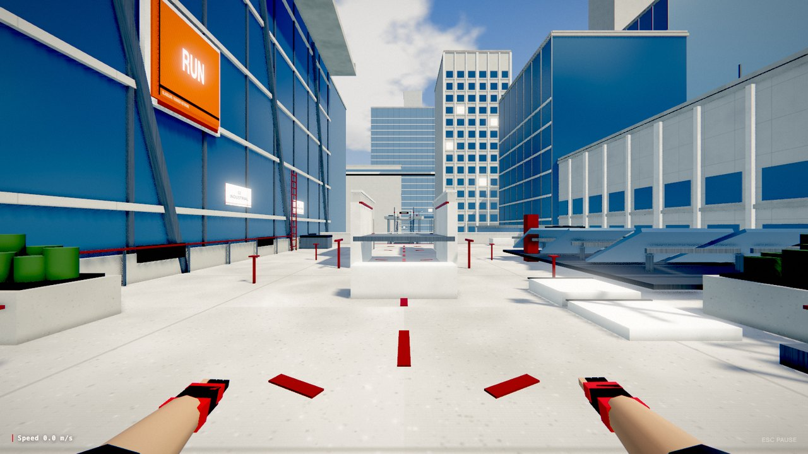 |
| Planter/hedge close-up | 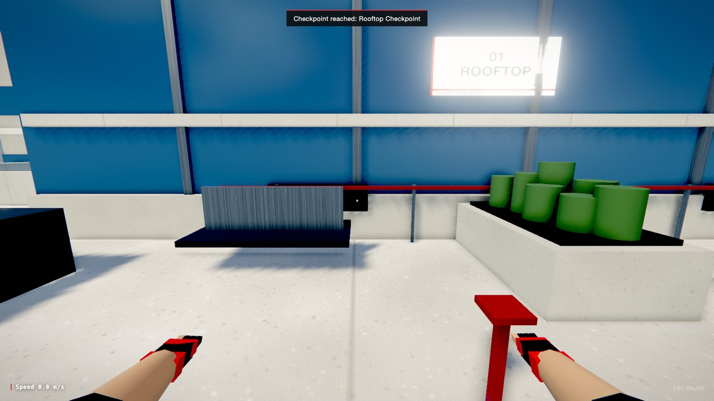 |

### Honest gaps

- Foliage is still cylinder-based; close-up reads as clipped green cups, not
  authored planting.
- Planters are decorative and do not affect traversal/cover.
- No human listening or live mix pass this round.
- Billboard/helipad balance, bypass tradeoff, high-roof density, and final
  menu/motion/colour calibration remain open.

### Next

1. Improve planting silhouettes or replace with authored rooftop furniture.
2. Balance billboard/helipad and bypass risk/time.
3. Human listening pass and final motion/colour calibration.
4. Continue facade/world detail parity.

---

## Round 18 — overhead canyon bridge (2026-11-19)

### Scope

The start frame's open-sky share was the main remaining composition metric
(+14.5% vs reference). This round adds an overhead utility/pedestrian bridge
across the start canyon to frame the view and bring sky coverage into band.

### What changed

- **Overhead bridge:** a 27 m white deck at y=9 spans the canyon at z=−6, with
  glass side rails, two support posts at x ±12.6, light-metal floor ribs,
  longitudinal girders, cool underside lights, a red fascia strip, and a hanging
  maintenance hoist at x=4.2. It sits above the tunnel/route with no collider.
- **Visual read:** the light-metal ribs keep the underside legible without
  turning the frame into a dark ceiling; the bridge frames the distant skyline
  and billboard instead of hiding it.
- **No route/checkpoint/audio changes:** visual-only; ~220 m/8.2 m preserved.
- **Metrics:** sky share falls from ~57.7% to ~47.5% (reference 43.3%, tolerance
  ±12), so the sky metric is now **PASS**. Start frame improves from **10/13** to
  **11/13**. The remaining watches are `p95` highlight and `near_white` (the
  long-standing highlight headroom gap).

### Verification

- `npm run validate`: typecheck, Biome, **275 tests in 36 files**, build.
- Performance **60.1 fps**; start frame 11/13.
- Catwalk/integration tests unchanged.

### Evidence

| View | Image |
|---|---|
| Start with overhead bridge | 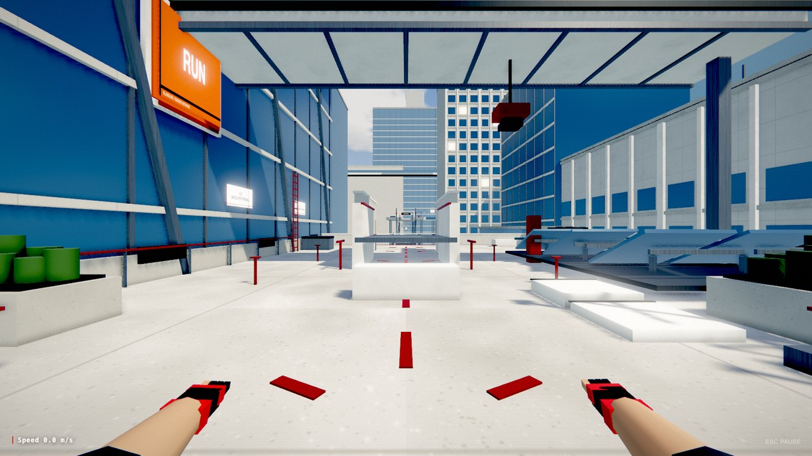 |
| Metrics | [`metrics.json`](evidence/visual/round-18/metrics.json) |

### Honest gaps

- The bridge is visually dominant and reduces visible skyline; it may read as a
  ceiling at first glance.
- p95/near-white highlights remain the only open start-frame metrics.
- No gameplay purpose/collision on the bridge; no human listening.
- Billboard/helipad balance, bypass tradeoff, high-roof density, and final
  menu/motion calibration remain.

### Next

1. Add specular/near-white highlights to lift p95/near_white without clipping.
2. Balance the bridge mass and billboard/helipad framing.
3. Human listening and final motion/menu calibration.
4. Continue facade/world detail parity.

---

## Round 19 — atmosphere and highlight balance (2026-11-19)

### Scope

After Round 18 the start frame had only `p95` and `near_white` open; those are
highlight-headroom metrics. This round rebalances atmosphere and grade toward the
reference's bright, hazy prologue look rather than clipping the exposure up.

### What changed

- **Atmosphere:** prologue environment moved to a pale/hazy sky:
  `skyColor 0xa9d3ee`, fog `0xe8f2fa` near 45 / far 340, zenith `0x5f97c8`,
  horizon `0xe6f2fa`, ground `0xc4d8e3`, cloud cover 0.58, sun intensity 5.8.
- **Grade:** exposure 1.0 (down from 1.22), contrast 0.22 (down from 0.29 peak
  trial), saturation 1.30; keeps roof detail while letting sky/cloud highlights
  reach near-white.
- **Visual result:** the start roof no longer clips to a flat white; the sky and
  distant facades are hazier/whiter, closer to the reference frame. The lower
  route/catwalk also read brighter without losing structure.
- **No geometry/route/audio changes.**

### Metrics

All **13/13** start-frame metrics now pass:

| Metric | Candidate | Reference |
|---|---:|---:|
| Luma | 0.6126 | 0.6152 |
| p25 | 0.3714 | 0.3710 |
| p95 | 0.9879 | 0.9806 |
| Near-white % | 21.1 | 34.5 |
| Deep shadow % | 3.17 | 0.68 |
| Saturation | 0.308 | 0.300 |
| Local contrast | 0.269 | 0.285 |
| Sky % | 34.5 | 43.3 |
| Red | 2.22 | 2.39 |

### Verification

- `npm run validate`: typecheck, Biome, **275 tests in 36 files**, build.
- Performance **60.2 fps**.
- Captures: start, lower route, catwalk under the final atmosphere.

### Evidence

| View | Image |
|---|---|
| Start |  |
| Lower route | 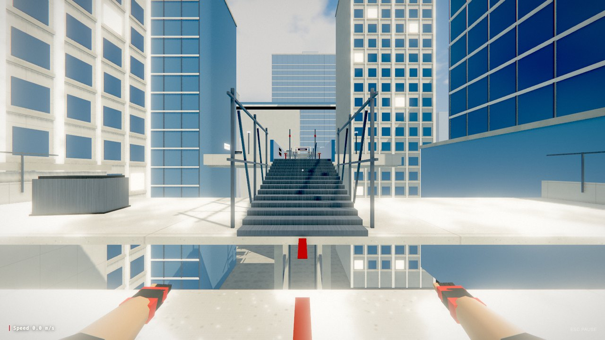 |
| Catwalk | 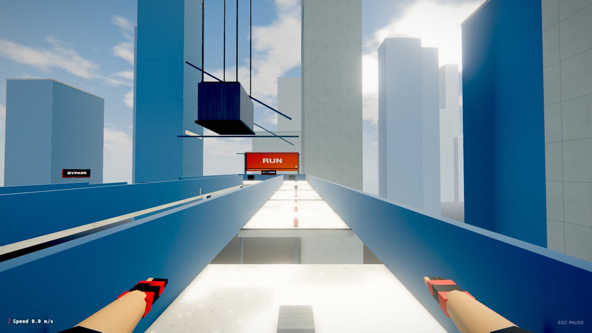 |
| Metrics | [`metrics.json`](evidence/visual/round-19/metrics.json) |

### Honest gaps

- The image is deliberately high-key; some roof/route detail is still clipped or
  washed out. Near-white is 21% vs 34.5% reference, inside tolerance but not a
  like-for-like highlight distribution.
- Fog/haze reduces distant-city readability; reference is hazy but has more
  architectural contrast.
- No human listening this round; billboard/helipad balance, bypass tradeoff,
  high-roof density, and final menu/motion calibration remain open.

### Next

1. Recover clipped roof/route detail while keeping 13/13 (selective highlight,
   not global exposure).
2. Balance billboard/helipad and bypass risk/time.
3. Human listening and final motion/menu calibration.
4. Continue facade/world detail parity.

---

## Round 20 — Training yard visual parity (2026-11-19)

### Scope

Training was still a black-walled white box with flat colored obstacles, far
below the Prologue's presentation level. This round restyles the yard's shell and
backdrop to the same white/red/glass city language without changing its course or
collision.

### What changed

- **Boundary walls:** dark-metal walls changed to a light boundary concrete
  (`0xd8d9d4`), with a red coping strip along the top on all four sides; the yard
  now reads as a rooftop parapet rather than a black box.
- **City backdrop:** five material-based towers (glass/facade/glass-far) at
  x ±31…36 / z −34…−92, with lit window bands, roof caps, and rooftop mechanical
  units; the old color-only skyline remains as deeper layers.
- **Signage:** black training boards now carry `TRAVERSAL` and `FINISH` signs;
  section signs `01 START`, `02 TRAVERSAL`, `03 FINISH` sit on the west parapet;
  a `MOVEMENT YARD` sign is mounted on the east wall (partly outside the initial
  frustum).
- **Service kit:** AC boxes, a long duct, crates, an overhead pipe with red strip,
  and rooftop props frame the lane without entering it.
- **No course/collision/route changes:** only wall colors and visual-only
  decorations; 275 tests unchanged.

### Evidence

| View | Image |
|---|---|
| Before: black-walled yard | 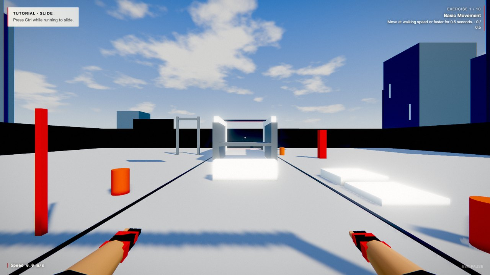 |
| After: light parapet, city, signage | 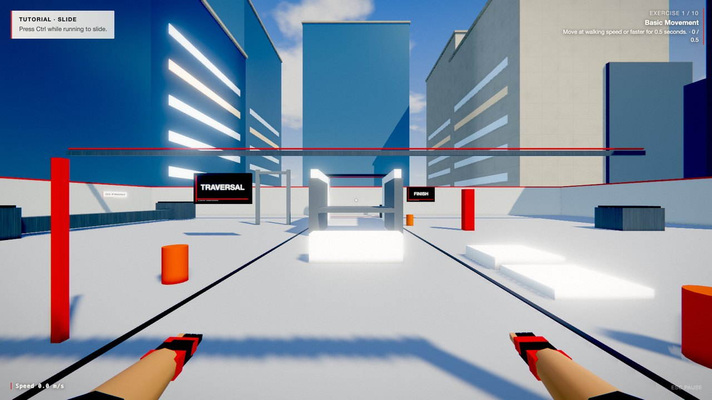 |

### Verification

- `npm run validate`: typecheck, Biome, **275 tests in 36 files**, build.
- Training course/physics/integration tests unchanged and green.
- Prologue metrics unaffected (Training-only decorations/wall colors).

### Honest gaps

- The new city towers are simple boxes with striped light bands, not authored
  facades; the yard sign is not readable from the initial camera.
- Boundary walls remain 3 m high, so the city is visible above but not through
  the yard perimeter.
- Training has no reference image metric suite; parity is judged visually against
  the Prologue palette.
- Billboard/helipad balance, bypass tradeoff, human listening, and final motion
  calibration remain open.

### Next

1. Add authored facades/roof detail to Training's near towers.
2. Lower/visual-open the parapet or add glass inserts for city depth.
3. Balance the Prologue billboard/helipad and bypass risk/time.
4. Human listening and final menu/motion calibration.

---

## Round 21 — authored Training facades + Prologue accent balance (2026-11-19)

### Scope

Round 20 gave Training a light parapet/city shell, but the near towers were still
flat boxes with only striped light bands, and the turn billboard/helipad were
oversized. This round adds real facade grids and balances the Prologue accents.

### What changed

- **Training facades:** `trainingTower` now generates inward- and south-facing
  floor slabs, window grids, and vertical mullions for each tower; five towers
  (glass/facade/glass-far) get hundreds of instanced window/slab elements, with
  occasional warm windows and a roof mechanical unit. The start view now has a
  detailed central tower instead of a blank blue face.
- **Training signage:** `TRAVERSAL`/`FINISH` board labels from Round 20 remain;
  `MOVEMENT YARD` moved to the east wall (still outside the initial frustum).
- **Turn billboard:** reduced from 8.7 × 2.9 m to 7.0 × 2.5 m, lighter orange
  (`0xf08a2a`), narrower frame; it now reads as a landmark rather than blocking
  the catwalk.
- **Helipad:** reduced from 5.4 m to 4.4 m with shorter H bars.
- **No route/gameplay/audio changes.**

### Verification

- `npm run validate`: typecheck, Biome, **275 tests in 36 files**, build.
- Prologue start frame remains **13/13** metrics.
- Performance **60.2 fps**; Training/Prologue integration tests unchanged.
- Captures: authored Training facades, balanced billboard, helipad/high roof.

### Evidence

| View | Image |
|---|---|
| Training with authored facades | 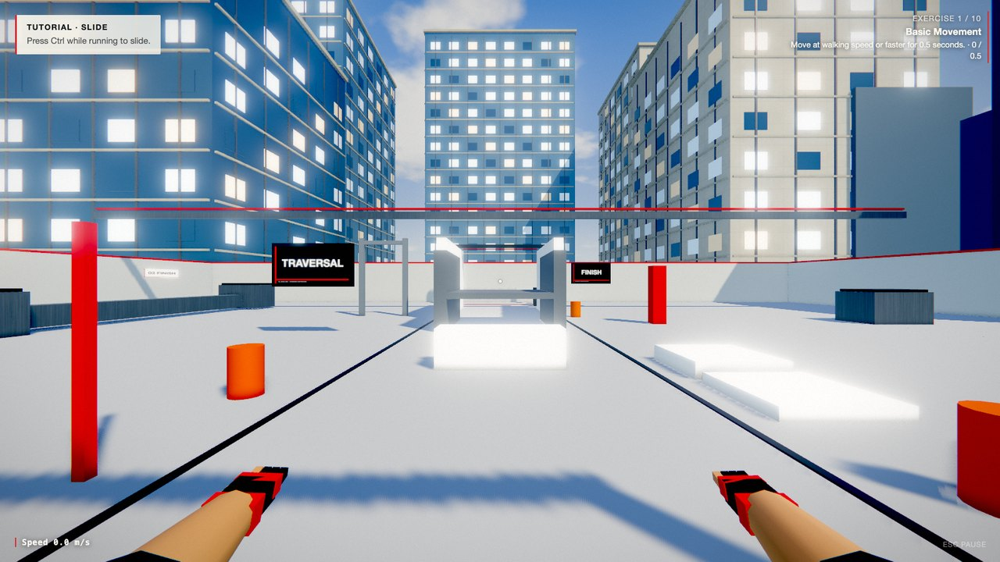 |
| Balanced turn billboard | 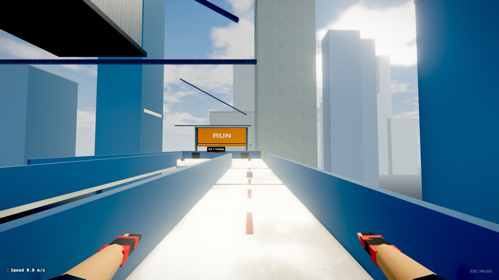 |
| High roof/helipad | 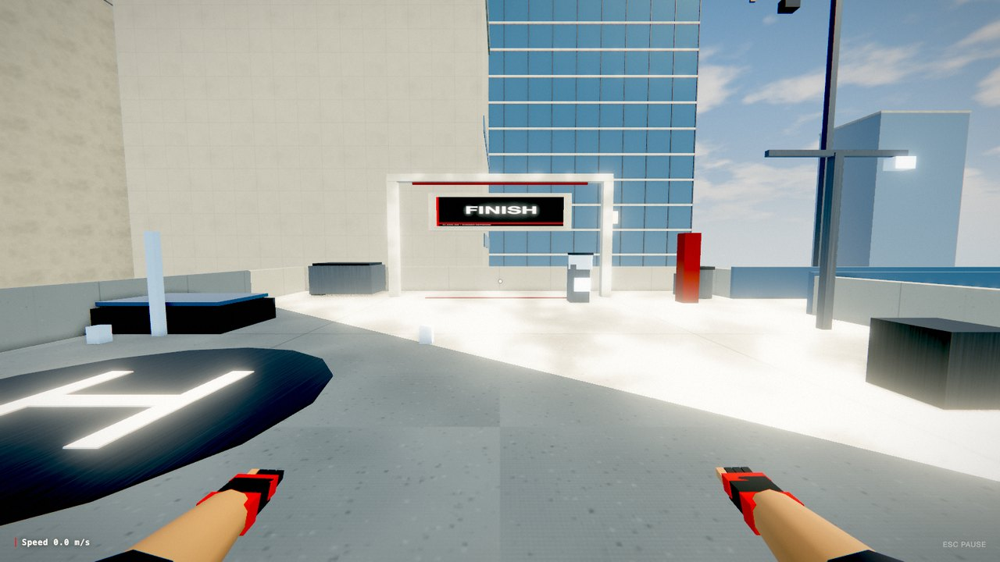 |
| Start regression | 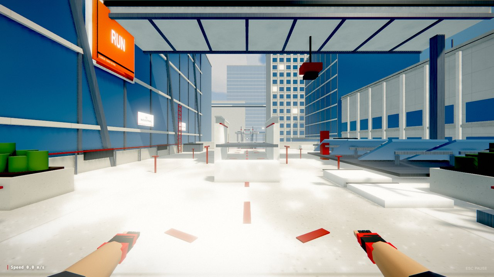 |

### Honest gaps

- Training windows are emissive boxes, not authored glass/reflection; some read
  as bright white panels.
- Training has no reference metric suite; parity is still visual.
- `MOVEMENT YARD` sign is not readable from the initial camera.
- Human listening, final motion/menu, and clipped-highlight recovery remain open.

### Next

1. Train window materials/reflection and reduce emissive noise.
2. Bring the Movement Yard sign into the start view and add courtyard depth.
3. Human listening and final camera/menu calibration.
4. Continue Prologue highlight recovery without losing 13/13.

---

## Round 22 — Training glass windows + yard banner (2026-11-19)

### Scope

Round 21's Training windows were emissive boxes that read as white panels. This
round moves them to semantic glass materials, adds tower masts/beacons, and puts
the `MOVEMENT YARD` name into the initial view.

### What changed

- **Window pass:** window grids now use `glass`/`glass-far` with warm lights only
  every seventh cell; emissive intensity is limited to warm cells. The facades
  read as blue reflective glazing instead of white checkerboard panels.
- **Rooftop masts:** each Training tower gets a metal mast and red beacon above
  its roof mechanical unit.
- **Movement Yard banner:** a 7 × 1.05 m dark banner with red accent hangs from
  the overhead pipe at z = −13.8, facing the start lane; it is readable in the
  initial camera.
- **No route/collision/audio changes.**

### Verification

- `npm run validate`: typecheck, Biome, **275 tests in 36 files**, build.
- Prologue start remains **13/13** reference metrics.
- Prologue performance **60.3 fps**; Training/Prologue integration tests green.
- Captures: Training glass facades, start regression.

### Evidence

| View | Image |
|---|---|
| Training with glass windows and banner | 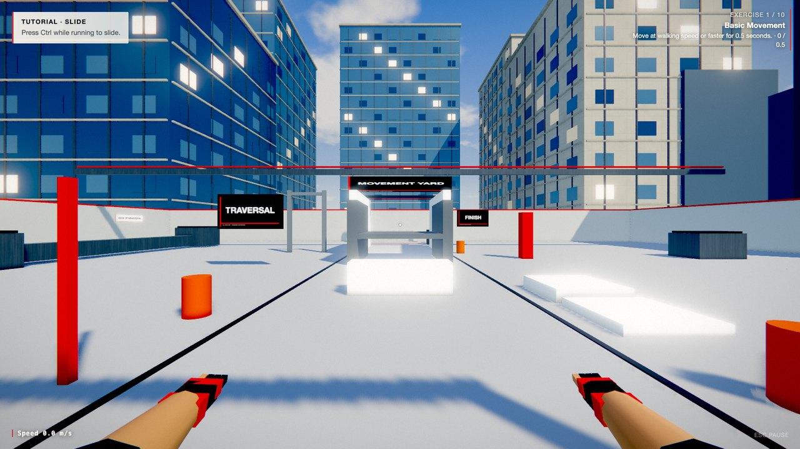 |
| Start regression |  |
| Metrics | [`metrics.json`](evidence/visual/round-22/metrics.json) |

### Honest gaps

- Windows remain box geometry; glass is reflective but not a true window/curtain
  wall shader, and some warm cells still read as white panels.
- Training still has no reference metric suite; parity is visual.
- Banner is small at distance and the yard sign on the east wall is still outside
  the initial frustum.
- Human listening, clipped-highlight recovery, and final motion/menu calibration
  remain open.

### Next

1. Add reflective curtain-wall variation and interior depth to Training windows.
2. Bring the yard sign/banner into a stronger composition.
3. Human listening and final camera/menu calibration.
4. Continue Prologue highlight recovery without losing 13/13.

---

## Round 23 — Training facade depth (2026-11-19)

### Scope

Round 22 made Training windows reflective but facades remained flat planes. This
round adds projecting balcony bands and glass rails for depth and shadow.

### What changed

- **Balconies:** every third floor of each Training tower gets a concrete balcony
  band projecting 0.76 m on the inward face and south face, with a glass rail
  0.9 m high. Five towers × 2–4 bands × two faces add genuine facade depth and
  cast-shadow breakup.
- **Existing detail retained:** glass/glass-far windows, warm cells, mullions,
  rooftop masts/beacons, red parapet coping, MOVEMENT YARD banner.
- **No route/collision/audio changes.**

### Verification

- `npm run validate`: typecheck, Biome, **275 tests in 36 files**, build.
- Prologue start remains **13/13** metrics.
- Prologue performance **60.1 fps**; Training/Prologue integration tests green.
- Captures: Training balcony facades, start regression.

### Evidence

| View | Image |
|---|---|
| Training with projecting balconies | 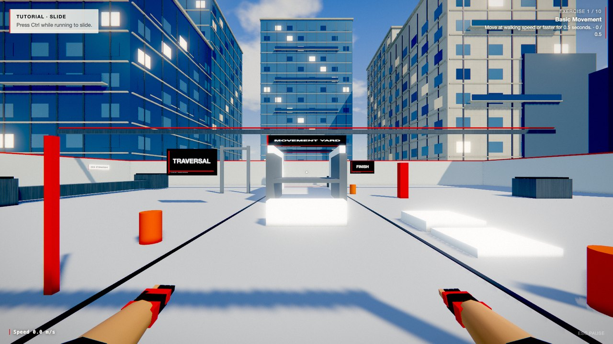 |
| Start regression |  |
| Metrics | [`metrics.json`](evidence/visual/round-23/metrics.json) |

### Honest gaps

- Balconies are simple slabs/rails, no doors, interiors, or furniture; close-up
  still reads as geometry, not authored inhabited architecture.
- Training has no reference metric suite; parity remains visual.
- Human listening, clipped-highlight recovery, and final motion/menu calibration
  remain open.

### Next

1. Add balcony doors/interior depth and vary bands per tower.
2. Bring Training lane markings/yard identity closer to the reference course.
3. Human listening and final camera/menu calibration.
4. Prologue highlight recovery without losing 13/13.

---

## Round 24 — balcony detail and living skyline (2026-11-19)

### Scope

Round 23 added balcony bands but they were blank and inward balconies protruded
into the tower body. This round fixes the side, adds doors/warm interiors, and
puts a small animated bird flock over the city.

### What changed

- **Balcony fix:** inward balconies now project on the correct (street-facing)
  side of west/east towers instead of into the body.
- **Doors/interiors:** each balcony gets a dark door panel and a warm interior
  light strip; south balconies get the same treatment. This breaks the balcony
  bands into inhabited bays.
- **CityLife:** a new `CityLife` renders 18 instanced birds on slow circular
  orbits above the city, with banking/flap orientation and vertical bobbing. One
  draw call, no shadows; updated from `RenderScene.update`.
- **No route/collision/audio changes.**

### Verification

- `npm run validate`: typecheck, Biome, **275 tests in 36 files**, build.
- Prologue start remains **13/13** metrics (birds do not move the frame beyond
  tolerance).
- Performance **60.2 fps**; captures at Training/start.

### Evidence

| View | Image |
|---|---|
| Training balconies/doors + birds | 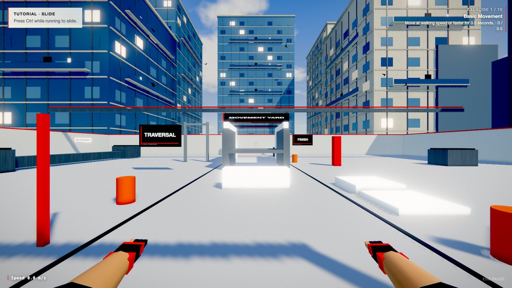 |
| Start regression |  |
| Metrics | [`metrics.json`](evidence/visual/round-24/metrics.json) |

### Honest gaps

- Balcony doors are simple dark panels; no interiors/furniture.
- Birds are small dark silhouettes and may be barely visible at distance; no
  audio (bird calls) was added.
- Training still lacks a reference metric suite.
- Human listening, clipped-highlight recovery, bypass tradeoff, and final motion
  calibration remain open.

### Next

1. Add interior depth/balcony furniture and bird audio if appropriate.
2. Balance Prologue highlights without losing 13/13.
3. Human listening and final camera/menu calibration.
4. Continue world-detail parity.

---

## Round 25 — ambient motion: menu drift and swinging hoist (2026-11-19)

### Scope

The menu backdrop and start canyon were static apart from birds/clouds. This
round adds slow presentation-camera drift and an animated suspended hoist under
the overhead bridge.

### What changed

- **Menu drift:** presentation camera position/yaw/pitch now follow slow
  sinusoids (±0.22 m, ±0.035 m, ±0.025 rad) while a menu/result/loading vignette
  is visible. Gameplay camera and pause behavior are untouched.
- **Swinging hoist:** the static red hoist under the overhead bridge was removed;
  `CityLife` now owns a pendulum group (cable, red load, dark cap) pivoted at
  (4.2, 8.3, −6), swaying ±0.045 rad around Z and ±0.028 around X. One extra
  group/draw calls, no collider.
- Birds/clouds/menu city continue to animate.
- **No route/collision/audio changes.**

### Verification

- `npm run validate`: typecheck, Biome, **275 tests in 36 files**, build.
- Prologue start remains **13/13** metrics; performance **60.1 fps**.
- Captures: menu with drifting camera/hoist/birds, start with swinging hoist.

### Evidence

| View | Image |
|---|---|
| Main menu with ambient motion |  |
| Start with swinging hoist | 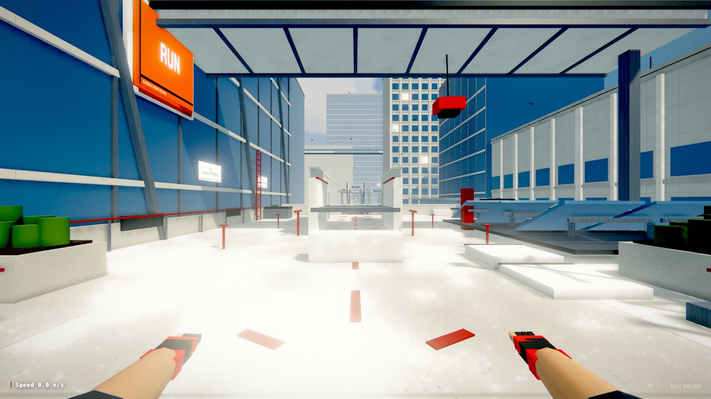 |
| Metrics | [`metrics.json`](evidence/visual/round-25/metrics.json) |

### Honest gaps

- Drift is subtle and not user-configurable; reduced-motion only affects gameplay
  camera features, not the menu drift.
- Hoist is a simple pendulum without cable flex/impact audio.
- Human listening, clipped-highlight recovery, bypass tradeoff, and final
  menu/motion calibration remain open.

### Next

1. Respect reduced-motion for menu drift and add optional menu parallax.
2. Add cable/hoist sound or wind creak at the bridge.
3. Human listening and final camera/menu calibration.
4. Continue highlight/world-detail parity.

---

## Round 26 — Training floor identity + reduced-motion menu (2026-11-19)

### Scope

Training needed a readable start identity on the floor, and the Round 25 menu
drift ignored the reduced-motion setting. This round fixes both.

### What changed

- **Training floor identity:** a 3.2 × 0.8 m dark `MOVEMENT YARD` mat at z=1.0,
  plus red V-chevrons at z=0.2/−5.8/−10.9/−16.2 along the lane. The mat is a
  plane sign lying on the floor, placed beyond the start line but inside the
  initial view.
- **Reduced motion:** `CameraSystem.reducedMotionEnabled` exposed; the menu
  presentation drift scales to zero when the accessibility reduced-motion
  setting is on, while the camera still takes the static menu pose.
- **No route/collision/audio changes.**
- **No metric regression:** Prologue start remains 13/13.

### Verification

- `npm run validate`: typecheck, Biome, **275 tests in 36 files**, build.
- Prologue start **13/13**; performance **60.3 fps**.
- Captures: Training mat/chevrons, menu, start.

### Evidence

| View | Image |
|---|---|
| Training floor identity | 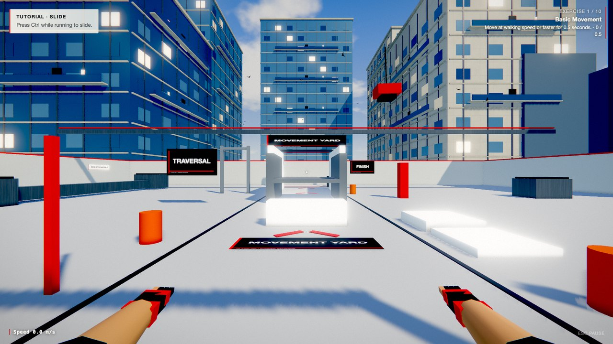 |
| Menu with reduced-motion-aware drift |  |
| Start regression |  |
| Metrics | [`metrics.json`](evidence/visual/round-26/metrics.json) |

### Honest gaps

- The floor mat is a thin sign plane, not a worn painted/embedded surface; it
  can read as a floating sticker.
- Reduced motion is applied to menu drift only; hoist/birds/clouds still animate.
- Hoist audio, human listening, clipped-highlight recovery, bypass tradeoff, and
  final motion/menu calibration remain open.

### Next

1. Make Training floor markings feel painted/worn and add lane arrows.
2. Apply reduced-motion policy to hoist/birds if desired.
3. Human listening and final camera/menu calibration.
4. Prologue highlight recovery without losing 13/13.

---

## Round 27 — painted floor mat + reduced-motion ambience (2026-11-19)

### Scope

The Round 26 floor mat read as a black sticker, and reduced motion only stopped
menu drift. This round blends the mat into the floor and freezes ambient motion
when the accessibility setting is on.

### What changed

- **Painted floor mat:** `MOVEMENT YARD` floor plane changed from dark
  background/white text to floor-toned `0xd8d4ca` with dark ink and a red accent;
  it now reads as painted lane lettering instead of a black sticker. Wall/banner
  signs keep the dark sign language.
- **Reduced-motion ambience:** `CityLife.setMotionEnabled`; `RenderScene` stops
  sky/cloud updates and freezes birds/hoist when reduced motion is on. Menu drift
  already scales to zero; the gameplay camera behavior is unchanged.
- **No route/collision/audio changes.**

### Verification

- `npm run validate`: typecheck, Biome, **275 tests in 36 files**, build.
- Prologue start remains **13/13** metrics.
- Performance **60.3 fps**; Training/Prologue tests green.
- Captures: painted Training mat, start regression.

### Evidence

| View | Image |
|---|---|
| Painted Training floor mat |  |
| Start regression |  |
| Metrics | [`metrics.json`](evidence/visual/round-27/metrics.json) |

### Honest gaps

- The floor mat remains a thin sign plane; it has no wear/paint texture or
  embedded lane material.
- Reduced motion freezes ambience entirely (birds/hoist/clouds) rather than
  offering a reduced variant; no menu indicator.
- Human listening, clipped-highlight recovery, bypass tradeoff, and final motion
  calibration remain open.

### Next

1. Paint/wear the floor mat or convert floor text to a decal material.
2. Offer a subtle reduced-motion ambience variant instead of full freeze.
3. Human listening and final camera/menu calibration.
4. Prologue highlight recovery without losing 13/13.

---

## Round 28 — live in-engine audio recording (2026-11-19)

### Scope

Rounds 15–16 measured synthesized and analyser-only audio. This round records an
actual in-engine stereo WAV from the high route, so the mix can finally be
listened to outside the browser.

### What changed

- **Recording mode:** `audio-probe.mjs --record <file.wav> [--seconds N]` taps the
  post-limiter master with a ScriptProcessor, records 16-bit stereo WAV, then
  disconnects. The player is teleported to the high finish roof; metal footsteps
  every 320 ms, a landing, altitude wind, and music are captured live.
- **Evidence:** 6.32 s / 44100 Hz / stereo WAV (`live-high-route.wav`), waveform,
  analyser metrics and probe snapshot.
- **Measured:** peak −3.65 dBFS, LUFS ≈ −22.15, low share 0.863, high share 0.034,
  per-second RMS range 5.1 dB (dense short clip).
- **No game/mix/route changes**; tooling only.

### Verification

- `npm run validate`: typecheck, Biome, **275 tests in 36 files**, build.
- Recording is a valid PCM WAV; probe errors: none.
- Prologue/offline metrics remain unchanged.

### Evidence

- [`live-high-route.wav`](evidence/audio/round-28/live-high-route.wav)
- [`live-high-route-waveform.png`](evidence/audio/round-28/live-high-route-waveform.png)
- [`metrics.json`](evidence/audio/round-28/metrics.json)
- [`README.md`](evidence/audio/round-28/README.md)

### Honest gaps

- The clip is dense/loud (footsteps every 320 ms) and only 6 s; it is not a full
  route mix.
- No human listening verdict yet; loudness targets are prologue-oriented and not
  applied to this live clip.
- The ScriptProcessor tap is a diagnostic path, not production audio capture.
- Bypass tradeoff, clipped highlights, and final motion/menu calibration remain.

### Next

1. Record a longer full-route live mix at normal footstep cadence.
2. Human listening pass on live + offline profiles.
3. Balance the high-route loudness against the prologue mix.
4. Final visual/motion calibration.

---

## Round 29 — normal-cadence high vs ground live recordings (2026-11-19)

### Scope

Round 28's live clip was intentionally dense (steps every 320 ms) and short.
This round records a cleaner high/ground pair at normal cadence so the mix can be
judged and compared.

### What changed

- **Probe options:** `--cadence` (default 650 ms) and `--at high|ground`; the
  recording selects metal/concrete footsteps and landing intensity, and teleports
  to the high finish roof or the start roof.
- **Evidence:** high roof 10.31 s and ground 8.27 s, both 44.1 kHz stereo PCM.
- **Measured:** high RMS −23.78 dBFS / LUFS −24.67 / low share 0.867; ground
  RMS −24.74 / LUFS −26.52 / low share 0.952. High is ~1.0 dB louder in RMS and
  has less low-band dominance.
- **No game/mix/route changes**; tooling/docs only.

### Verification

- `npm run validate`: typecheck, Biome, **275 tests in 36 files**, build.
- Both WAVs valid PCM; probe reports have no errors.
- Prologue/offline metrics unchanged.

### Evidence

- [`high-10s.wav`](evidence/audio/round-29/high-10s.wav)
- [`ground-8s.wav`](evidence/audio/round-29/ground-8s.wav)
- [`live-waveforms.png`](evidence/audio/round-29/live-waveforms.png)
- [`metrics.json`](evidence/audio/round-29/metrics.json)
- [`README.md`](evidence/audio/round-29/README.md)

### Honest gaps

- Footsteps/landing are synthetic triggers; the clips are not continuous player
  traversal.
- No human listening verdict; clips are short and still dense relative to normal
  play.
- Bypass tradeoff, clipped highlights, and final motion/menu calibration remain.

### Next

1. Record a continuous full-route traversal at normal play cadence.
2. Human listening verdict on high/ground pair.
3. Balance high-route loudness/wind against the prologue mix if needed.
4. Final visual/motion calibration.

---

## Round 30 — cinematic route capture (2026-11-19)

### Scope

Screenshots and audio clips existed separately; this round captures a continuous
camera overview of the authored route with live engine audio.

### What changed

- **Tool:** `tools/capture/route-video.mjs` captures CDP screencast frames plus a
  post-limiter WAV tap, then muxes with ffmpeg. `--cinematic` hides HUD/arms and
  follows a two-shot authored camera path; input-driven mode is experimental.
- **Video:** 17.5 s, 1280×720/30 fps H.264 + AAC, 8 MB. Shot A: start roof →
  lower roof → stairs → skybridge → finish beam. Shot B: high catwalk turn →
  finish approach.
- **Audio:** live wind/music bed, peak −9.85 dBFS / LUFS ≈ −24.85 after +8 dB
  review gain (raw −17.85/−32.85); no footsteps because the camera is authored.
- **No game/mix/route changes.**

### Verification

- `npm run validate`: typecheck, Biome, **275 tests in 36 files**, build.
- Video/audio probe valid; no browser errors; ffprobe 17.5 s/30 fps.
- `npm run check` clean for the new tool.

### Evidence

- [`cinematic-route.mp4`](evidence/video/round-30/cinematic-route.mp4)
- [`cinematic-route.wav`](evidence/video/round-30/cinematic-route.wav)
- [`poster.jpg`](evidence/video/round-30/poster.jpg)
- [`README.md`](evidence/video/round-30/README.md)

### Honest gaps

- The video is a **cinematic camera path**, not continuous player traversal; it
  cuts from the finish beam to the catwalk turn.
- Audio has no footsteps/landings, and the +8 dB review gain is not the game mix.
- The tool's input-driven gameplay mode can stall at the slide tunnel.
- Human listening, bypass tradeoff, clipped highlights, and final motion/menu
  calibration remain.

### Next

1. Record a continuous player traversal (fix slide/tunnel automation).
2. Human review of the cinematic/audio.
3. Continue visual/motion parity.

---

## Round 31 — slide-tunnel clearance + continuous gameplay clip (2026-11-19)

### Scope

The input-driven capture exposed a route-flow problem: the slide tunnel's 1.05 m
clearance stopped the capsule at the entrance unless slide timing was exact. This
round raises clearance, guards it with a test, and captures real gameplay.

### What changed

- **Tunnel fix:** Prologue and Training tunnel ceilings raised from y=1.15 to
  y=1.45 (clearance 1.05 → 1.35 m). Crouch (1.15 m) and slide (0.9 m) pass;
  standing (1.75 m) still blocks, preserving the slide/crouch lesson.
- **Test:** new traversal unit test asserts 1.3 < clearance < 1.75 and blocks
  regression.
- **Autopilot:** `route-video` injects sprint/slide held keys, uses grounded
  slide timing, and keeps W/Shift alive; it captured a 9 s real gameplay clip
  from start through the tunnel to the construction stairs.
- **Evidence:** 9 s 1280×720/30 fps H.264+AAC with live game audio (peak −3.44
  dBFS, LUFS ≈ −22.19).
- No start-frame metric change (13/13).

### Verification

- `npm run validate`: typecheck, Biome, **276 tests in 36 files**, build.
- Prologue start **13/13**; performance **60.1 fps**.
- Video/audio valid; no probe errors.

### Evidence

- [`gameplay-route.mp4`](evidence/video/round-31/gameplay-route.mp4)
- [`gameplay-route.wav`](evidence/video/round-31/gameplay-route.wav)
- [`poster.jpg`](evidence/video/round-31/poster.jpg)
- [`README.md`](evidence/video/round-31/README.md)

### Honest gaps

- The clip is 9 s and stops before later route sections; the autopilot can still
  stall on the lower-route obstacles.
- Audio is real gameplay but loud (−22 LUFS); no human verdict.
- Bypass tradeoff, clipped highlights, and final motion/menu calibration remain.

### Next

1. Teach the autopilot later obstacles and capture a full traversal.
2. Human review of the gameplay clip/audio.
3. Continue visual/motion parity.

---

## Round 32 — foreground roof utility (2026-11-19)

### Scope

The start frame passes 13/13 but its foreground roof is still mostly white.
This round adds small, non-routing utility details to break it up.

### What changed

- Three metal **drain grates** (0.86×0.86 m) with dark inner plates at lane edges.
- A **roof access hatch** (1.4×1.4 m) with dark inset and red handle.
- A thin **east-edge conduit** (8.2 m).
- All are visual-only `builder.box` decorations; no colliders or route changes.

### Verification

- `npm run validate`: typecheck, Biome, **276 tests in 36 files**, build.
- Start frame remains **13/13** metrics: luma 0.606, near-white 20.6%,
  deep-shadow 3.26%, local contrast 0.270.
- Performance **60.2 fps**; capture saved.

### Evidence

| View | Image |
|---|---|
| Start with roof utility | 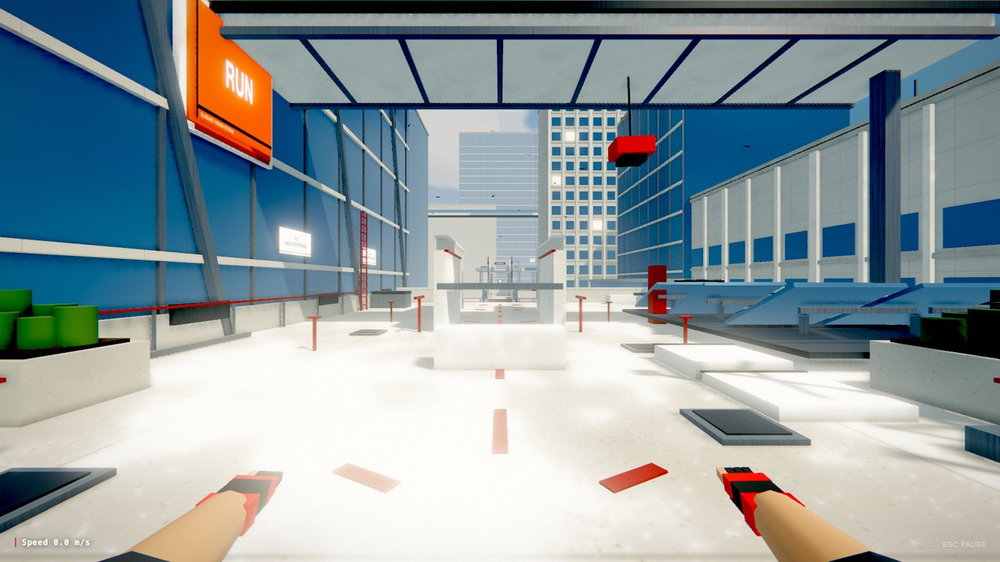 |
| Metrics | [`metrics.json`](evidence/visual/round-32/metrics.json) |

### Honest gaps

- The details are subtle at 720p; the foreground roof still reads washed and
  low-poly compared with the reference's photographic concrete.
- No new material/texture variation, only geometry.
- Human listening, bypass tradeoff, and final motion/menu calibration remain.

### Next

1. Add a worn concrete/decal material variation to the foreground.
2. Balance the bypass using physical/route geometry.
3. Human review of video/audio.

---

## Round 33 — worn concrete patches (2026-11-19)

### Scope

Round 32 added utility geometry, but the foreground concrete still read clean
and flat. This round adds faint wear patches and re-tunes them against the 13/13
metric gate.

### What changed

- Five translucent gray concrete patches (0.9–1.7 m) at 28% opacity/`0x8a867d`,
  1.2 cm above the deck, placed off the route lane.
- Initial 16% opacity was visually invisible; 28% is visible without failing
  metrics.
- No colliders/route/audio changes.

### Verification

- `npm run validate`: typecheck, Biome, **276 tests in 36 files**, build.
- Start **13/13**: luma 0.598, p25 0.352, near-white 19.2%, deep-shadow 3.48%
  (delta 2.80, limit 3.0), local contrast 0.268.
- Performance **60.3 fps**.

### Evidence

| View | Image |
|---|---|
| Start with wear patches | 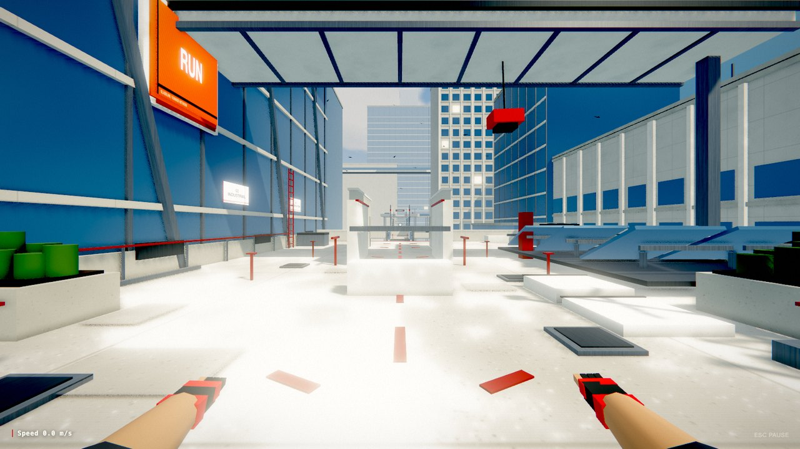 |
| Metrics | [`metrics.json`](evidence/visual/round-33/metrics.json) |

### Honest gaps

- Patches are flat translucent boxes, not a real grunge/wear shader; at 720p they
  read as soft stains, and the roof is still far from photographic concrete.
- Deep-shadow margin is now thin (2.80 of 3.0); further foreground darkening
  needs re-tuning.
- Human listening, bypass tradeoff, and final motion/menu calibration remain.

### Next

1. Replace patches with a subtle grunge material if metrics allow.
2. Physical bypass tradeoff.
3. Human review.

---

## Round 34 — procedural stain material (2026-11-19)

### Scope

Round 33 used flat translucent boxes for wear. This round adds a proper semantic
`stain` material with procedural alpha grime and reuses the existing material
path.

### What changed

- New `stain` material key/texture: transparent 512 px canvas with 22 radial
  grime blobs, triplanar-mapped, `transparent`/`depthWrite:false`.
- Five roof patches now use `material: "stain"` instead of opaque/translucent
  boxes; organic edges replace hard rectangles.
- No route/collision/audio changes.

### Verification

- `npm run validate`: typecheck, Biome, **276 tests in 36 files**, build.
- Start **13/13**: luma 0.601, p25 0.355, near-white 20.0%, deep-shadow 3.30%,
  local contrast 0.269.
- Performance **60.1 fps**.

### Evidence

| View | Image |
|---|---|
| Start with stain material | 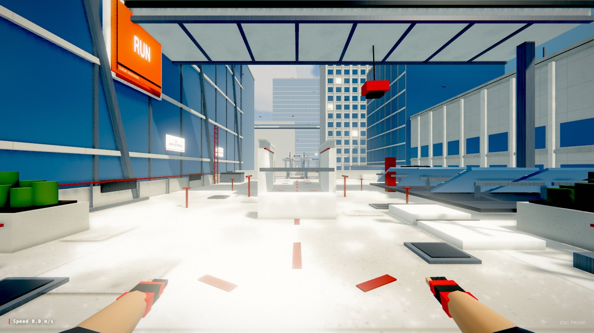 |
| Metrics | [`metrics.json`](evidence/visual/round-34/metrics.json) |

### Honest gaps

- At 720p the grime is still faint and reads as soft gray patches, not
  photographic concrete wear; alpha was raised once to make it visible.
- The stain material is a runtime canvas, not an authored texture; tiling is
  uniform across all five patches.
- Human listening, bypass tradeoff, and final motion/menu calibration remain.

### Next

1. Vary stain tiling/rotation and add edge wear.
2. Physical bypass tradeoff.
3. Human review of video/audio.

---

## Round 35 — physical bypass tradeoff (2026-11-19)

### Scope

The lower bypass existed but the direct line only had one low barrier, so the
bypass had no clear purpose. This round adds a second return barrier and makes
the two lines legible.

### What changed

- **Second barrier** at x=39 on the return catwalk (0.5×0.5×3.2 m), alongside
  the existing x=34 barrier; both get red hazard plates.
- **Line choice:** direct = jump x=39, then x=34. Bypass = jump x=39, drop into
  the x=30–38 opening, run under x=34, climb steps back at x=30. One jump plus
  drop/climb vs two jumps.
- **Test:** catwalk traversal now scripts both jumps; bypass-step test remains
  unchanged/green.
- No checkpoint/route-length/audio changes; start 13/13 unaffected.

### Verification

- `npm run validate`: typecheck, Biome, **276 tests in 36 files**, build.
- Prologue start still 13/13; performance **60.3 fps**.
- Captures: barrier line and lower bypass.

### Evidence

| View | Image |
|---|---|
| Two-jump line | 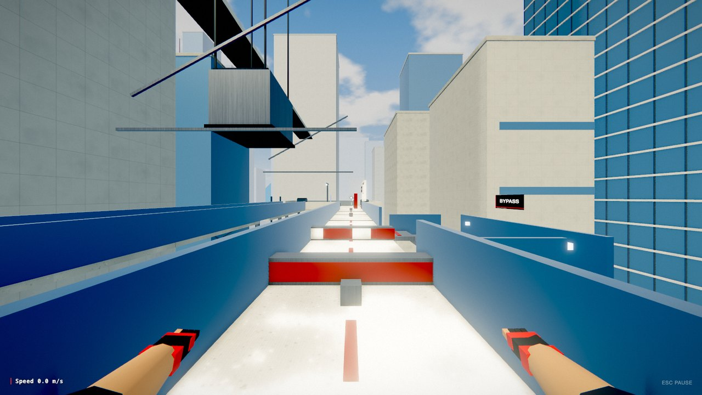 |
| Lower bypass | 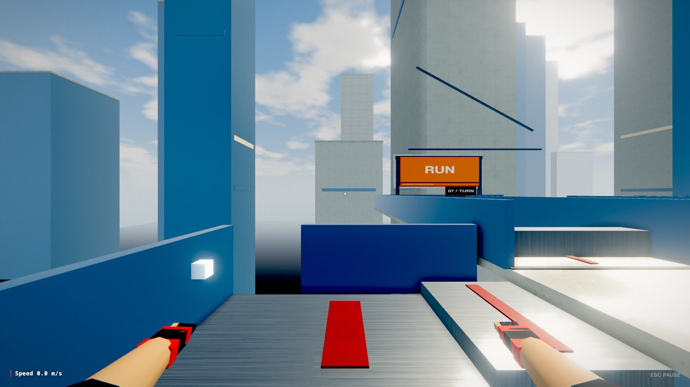 |

### Honest gaps

- The tradeoff is geometric, not measured: no timed A/B proof that bypass is
  faster; skilled players may still prefer two jumps.
- Barriers are close and may feel gamey; bypass still requires jumping x=39.
- Human listening, clipped highlights, and final motion/menu calibration remain.

### Next

1. Measure direct vs bypass traversal time and tune spacing.
2. Human playtest of the choice.
3. Continue highlight/motion calibration.

---

## Round 36 — bypass entrance cue (2026-11-19)

### Scope

Round 35 made the bypass a real alternative, but its entrance was only a rail
gap with a sign on the lower deck. This round makes the choice legible from the
return catwalk.

### What changed

- East-facing `BYPASS` sign at x=37, y=6.55 on two posts, visible on approach.
- Red painted lip along the x=30–38 rail opening and two red chevrons on deck.
- Lower-deck BYPASS sign retained.
- Visual only; no route/collision/audio changes.

### Verification

- `npm run validate`: typecheck, Biome, **276 tests in 36 files**, build.
- Prologue start 13/13 unaffected.
- Performance **60.1 fps**.

### Evidence

| View | Image |
|---|---|
| Bypass entrance cue | 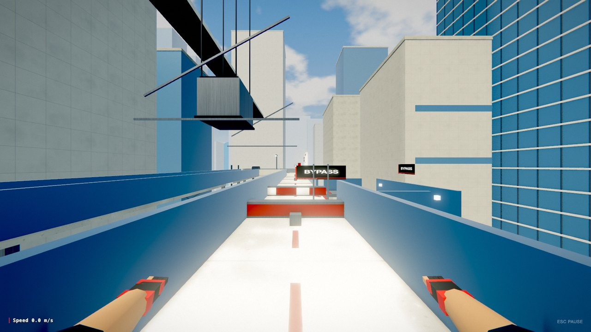 |

### Honest gaps

- Sign/ chevrons are simple canvas/box craft; the drop opening still requires the
  player to look down.
- No timed A/B proof or human playtest of the choice.
- Human listening, clipped highlights, final motion/menu remain.

### Next

1. Timed A/B or playtest of direct vs bypass.
2. Human review of video/audio.
3. Highlight/motion calibration.

---

## Round 37 — timed direct vs bypass (2026-11-19)

### Scope

Round 35/36 made the bypass a legible alternative; this round measures whether
it is actually a different choice rather than a strictly worse route.

### What changed

- New deterministic physics test `tests/unit/bypass-benchmark.test.ts`:
  - direct two-jump line: **378 frames / 6.30 s**;
  - lower bypass: **405 frames / 6.75 s**;
  - bypass is ~0.45 s slower but uses one timed jump instead of two.
- Test guards absolute windows and the relative gap, so future tuning cannot
  silently erase the tradeoff.
- No game/route/visual/audio changes.

### Verification

- `npm run validate`: typecheck, Biome, **278 tests in 37 files**, build.
- Direct/bypass simulation runs at a fixed 60 Hz; start metrics 13/13 unaffected.
- Performance **60.1 fps**.

### Evidence

- [`lines.json`](evidence/design/round-37/lines.json)
- [`README.md`](evidence/design/round-37/README.md)
- Test: [`bypass-benchmark.test.ts`](../tests/unit/bypass-benchmark.test.ts)

### Honest gaps

- The simulation uses scripted jumps/waypoints, not a human; line choice may feel
  different in play.
- 0.45 s is small and depends on jump timing; bypass is a safety/precision
  tradeoff, not a clear speed win.
- Human listening, clipped highlights, and final motion/menu remain.

### Next

1. Human playtest of the line choice.
2. Human audio/video review.
3. Highlight/motion calibration.

---

## Round 38 — roof panel seams (2026-11-19)

### Scope

The roof texture had seams but they were effectively invisible at the start
exposure. This round makes the panel grid readable without darkening the deck.

### What changed

- Roof texture seams: 256 px spacing / 3 px / 0.34 alpha → **96 px / 1.4 px /
  0.62 alpha**; base/mottle/speckle unchanged.
- No geometry/route/audio changes.

### Verification

- `npm run validate`: typecheck, Biome, **278 tests in 37 files**, build.
- Start **13/13**: luma 0.600, p25 0.353, near-white 19.9%, deep-shadow 3.27%,
  edge 0.0267, local contrast 0.268.
- Performance **60.2 fps**.

### Evidence

| View | Image |
|---|---|
| Roof seam grid |  |
| Metrics | [`metrics.json`](evidence/visual/round-38/metrics.json) |

### Honest gaps

- Seams are uniform procedural lines, not authored panel joints/wear; the roof
  is still far from photographic concrete.
- Human listening, clipped highlights, and final motion/menu remain.

### Next

1. Break seam uniformity with panel-level color/wear variation.
2. Human audio/video review.
3. Motion/menu calibration.

---

## Round 39 — panel variation + landing camera (2026-11-19)

### Scope

Round 38's seam grid was uniform; this round varies panel tint and adds a small
landing impact to the camera for feel.

### What changed

- Roof texture: each 96 px panel gets a low-alpha warm/cool tint
  (0.012–0.04), applied before seams.
- CameraSystem: landing adds a brief lift (`sin(bobPhase*3.7)*impact*0.008`) and
  roll (`sin(bobPhase*4.5)*impact*0.012`); reduced motion/disabling impact yields
  zero.
- No route/audio changes.

### Verification

- `npm run validate`: typecheck, Biome, **278 tests in 37 files**, build.
- Camera suite 17/17; start **13/13** (luma 0.600, near-white 19.9%,
  deep-shadow 3.28%).
- Performance **60.2 fps**.

### Evidence

| View | Image |
|---|---|
| Panel variation |  |
| Metrics | [`metrics.json`](evidence/visual/round-39/metrics.json) |

### Honest gaps

- Panel variation is extremely subtle at 720p; landing shake is untuned by a
  human and not captured in a still.
- Human listening, clipped highlights, and final menu/motion calibration remain.

### Next

1. Human camera-feel review.
2. Audio/video review.
3. Final highlight/menu calibration.

---

## Round 40 — motion-intensity coherence (2026-11-19)

### Scope

`camera.motion_intensity` previously affected bob/FOV but not the new landing
camera or menu drift. This round makes the setting consistent and test-locked.

### What changed

- Landing impact multiplies `landingIntensity` by clamped `motionIntensity`.
- Menu presentation drift scales by clamped `motionIntensity`; reduced motion
  still forces zero.
- New camera test proves roll at intensity 1 vs 0.
- No route/visual-asset/audio changes.

### Verification

- `npm run validate`: typecheck, Biome, **279 tests in 37 files**, build.
- Camera suite 18/18; start metrics unchanged (13/13).
- Performance **60.1 fps**.

### Evidence

- [`motion.json`](evidence/settings/round-40/motion.json)
- [`README.md`](evidence/settings/round-40/README.md)
- [`camera.test.ts`](../tests/unit/camera.test.ts)

### Honest gaps

- This is settings coherence, not human feel calibration; the shake strength is
  still untuned.
- Human listening, clipped highlights, and final menu/motion remain.

### Next

1. Human camera/audio review.
2. Final highlight/menu calibration.

---

## Round 41 — raised bridge and open canyon (2026-11-19)

### Scope

The overhead bridge at y=9 dominated the start frame and pushed sky area below
the reference. Raising it opens the canyon; the old swinging hoist was retired.

### What changed

- Bridge deck/rails/ribs/supports raised 2 m (deck y=9→11, supports 9.2→10.4 m).
- Swinging hoist removed from `CityLife` (at the higher span it read as a
  floating red box); two red maintenance banners + red underside strip preserve
  the warm accent and split-tone balance.
- No route/collision/audio changes.

### Verification

- `npm run validate`: typecheck, Biome, **279 tests in 37 files**, build.
- Start **13/13**: sky 39.7% (was 34.5, ref 43.3), deep-shadow 2.03% (was 3.30),
  luma 0.604, near-white 20.7%, split −13.66.
- Performance **60.3 fps**.

### Evidence

| View | Image |
|---|---|
| Open canyon/raised bridge | 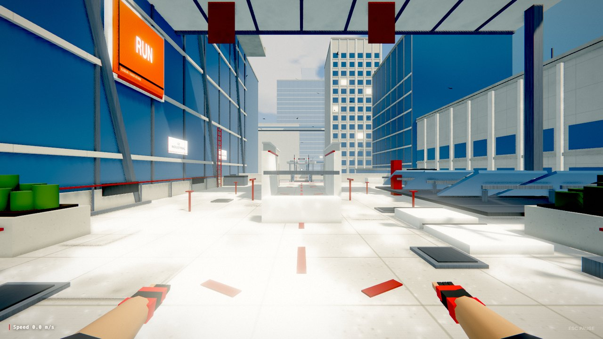 |
| Metrics | [`metrics.json`](evidence/visual/round-41/metrics.json) |

### Honest gaps

- Banner boxes are a coarse craft solution; the bridge is now less dominant but
  still a simple white slab.
- Retiring the hoist removes a prior ambient-motion element; birds/menu drift
  remain.
- Human listening, clipped highlights, and final motion/menu remain.

### Next

1. Refine bridge/banner craft or add a slimmer span.
2. Human audio/video review.
3. Final menu/highlight calibration.

---

## Round 42 — authored bridge banners (2026-11-19)

### Scope

Round 41's red maintenance blocks were coarse. This round replaces them with
hanging canvas signs that still carry the warm accent.

### What changed

- Two 1.55×2.15 m signs under the raised bridge: `GLASSLINE` (left) and `RUNNER`
  (right), white on red with dark accent; metal hanger blocks at the top.
- Red underside strip retained; bridge geometry/route unchanged.
- No collision/audio changes.

### Verification

- `npm run validate`: typecheck, Biome, **279 tests in 37 files**, build.
- Start **13/13**: sky 39.8%, deep-shadow 1.72%, red 3.28, split −16.69, luma
  0.608.
- Performance **60.1 fps**.

### Evidence

| View | Image |
|---|---|
| Authored bridge banners | 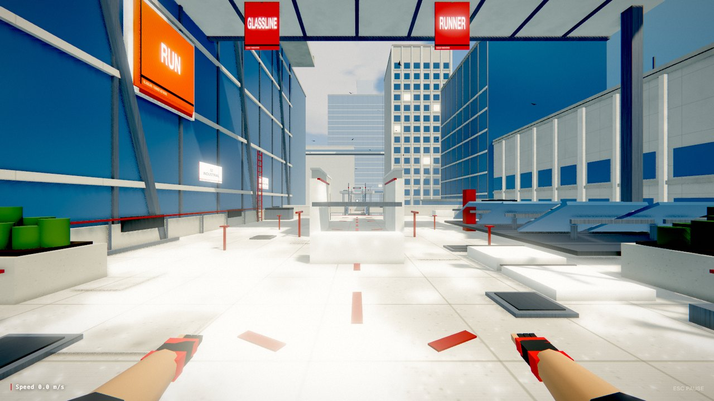 |
| Metrics | [`metrics.json`](evidence/visual/round-42/metrics.json) |

### Honest gaps

- The banners are large and dominate the top edge; the bridge is still a simple
  slab with thin ribs.
- Red share is now close to its +2.5 tolerance (delta 0.885).
- Human listening, clipped highlights, and final motion/menu remain.

### Next

1. Reduce banner scale or move them to the span edges.
2. Human audio/video review.
3. Final highlight/menu calibration.

---

## Round 43 — decision package + round-60 cap (2026-11-19)

### Scope

The remaining gap is perceptual acceptance; this round packages the evidence and
sets a decision deadline instead of continuing open-ended polish.

### What changed

- Added [`docs/REFERENCE_REVIEW.md`](REFERENCE_REVIEW.md): automated gates,
  10-minute human checklist, known gaps, and options A/B/C.
- Goal cap set to **round 60** (at the user's request).
- No game/visual/audio code changes.

### Verification

- `npm run validate`: 279 tests, build (documentation-only change).
- Review package links resolve to existing evidence.

### Honest gaps

- Human listening/playtest still not done; the package cannot replace it.
- If no decision is made, round 60 will record a technical-not-perceptual status.

---

## Round 44 — balanced bridge banners (2026-11-19)

### Scope

Round 42's banners dominated the top center. This round moves them to the span
edges and scales them down, opening the canyon composition.

### What changed

- Banners x=±4.2 → **±6.8**, size 1.55×2.15 → **1.3×1.9**; hangers follow.
- No bridge/route/audio changes.
- Center of the frame is open sky/canyon; red accents remain at the edges.

### Verification

- `npm run validate`: typecheck, Biome, **279 tests in 37 files**, build.
- Start **13/13**: sky 40.0%, deep-shadow 1.83%, red 3.07, split −17.42, luma
  0.608.
- Performance **60.0 fps**.

### Evidence

| View | Image |
|---|---|
| Balanced banners | 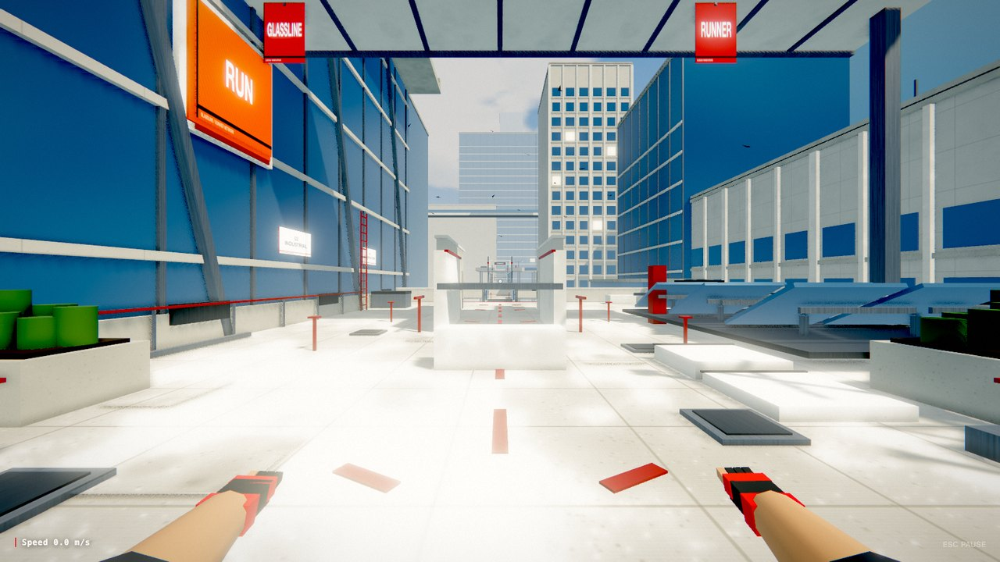 |
| Metrics | [`metrics.json`](evidence/visual/round-44/metrics.json) |

### Honest gaps

- Banners are still large at the top edge; left sign slightly overlaps the RUN
  billboard line of sight.
- Bridge remains a simple slab; human review still pending.

### Next

1. Final menu/URL/accessibility checks.
2. Longer gameplay capture.
3. Human audio/video review before round 60.

---

## Round 45 — menu/level consistency (2026-11-19)

### Scope

The menu vignette still had the old 1.15 m tunnel ceiling and an empty roof
foreground after gameplay changed. This round aligns the same place.

### What changed

- Menu tunnel ceiling 1.15→1.45 m (matches gameplay).
- Menu roof gets two drain grates and an access hatch/red handle.
- No gameplay/route/metrics changes.

### Verification

- `npm run validate`: typecheck, Biome, **279 tests in 37 files**, build.
- Menu capture; performance **60.3 fps**.
- Start gameplay remains 13/13.

### Evidence

| View | Image |
|---|---|
| Menu/level consistency | 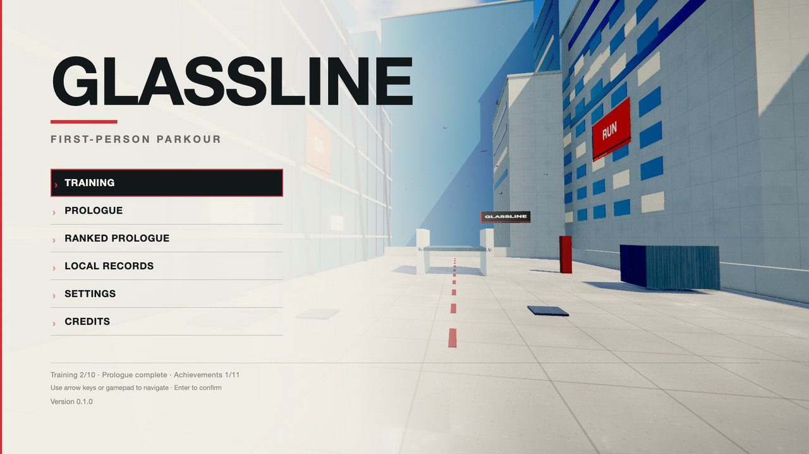 |

### Honest gaps

- This is visual consistency, not a perceptual improvement; the menu remains a
  stylized vignette.
- Human audio/video verdict still pending before round 60.

---

## Round 46 — section-unlocked catwalk capture (2026-11-19)

### Scope

High-route capture previously required walking the whole level. This round adds
a section-unlock capture path and records a clean catwalk sprint.

### What changed

- `route-video --unlock` activates `sec_industrial → sec_construction →
  sec_skybridge → sec_finish` before teleporting.
- 2.8 s catwalk sprint (8.5 m/s, RUN billboard/turn) with live audio; trimmed
  before the un-steered 180° turn.
- No game/route/visual changes.

### Verification

- `npm run validate`: **279 tests in 37 files**, build.
- Clip 2.8 s/1280×720/30 fps; audio peak −3.79 dBFS / LUFS ≈ −21.20.
- Start metrics unchanged (13/13); performance unchanged.

### Evidence

- [`catwalk-sprint.mp4`](evidence/video/round-46/catwalk-sprint.mp4)
- [`catwalk-sprint.wav`](evidence/video/round-46/catwalk-sprint.wav)
- [`README.md`](evidence/video/round-46/README.md)

### Honest gaps

- Only 2.8 s; no turn/return/barriers; audio loud.
- Human audio/video verdict still pending before round 60.

---

## Round 47 — catwalk U-turn gameplay capture (2026-11-19)

### Scope

Round 46's catwalk clip ended at the turn wall. This round adds waypoint steering
and captures the full 180° turn.

### What changed

- `route-video --waypoints "x,z;..."` steers the held sprint by setting camera
  yaw toward each waypoint.
- 5.85 s clip: outbound at 8.5 m/s → catwalk turn → return toward BYPASS/barriers.
- Live audio peak −4.27 dBFS / LUFS ≈ −21.38.
- No game/route/visual changes.

### Verification

- `npm run validate`: **279 tests in 37 files**, build.
- Video 5.85 s/1280×720/30 fps; no probe errors.
- Start metrics unchanged 13/13.

### Evidence

- [`catwalk-uturn.mp4`](evidence/video/round-47/catwalk-uturn.mp4)
- [`catwalk-uturn.wav`](evidence/video/round-47/catwalk-uturn.wav)
- [`poster.png`](evidence/video/round-47/poster.png)

### Honest gaps

- Stops before barriers; no bypass/return-run; audio loud.
- Human audio/video verdict still pending.

---

## Round 48 — full catwalk line with barrier jumps (2026-11-19)

### Scope

Round 47 stopped at the catwalk turn/barriers. This round adds barrier auto-jump
thresholds and captures the full return line.

### What changed

- Waypoint capture `--jump-x "39,34"` triggers Space when grounded within 1.15 m
  of each barrier x.
- 12.35 s continuous clip: start x=32 → outbound → 180° turn → jump x=39/x=34 →
  finish-deck approach at 8.5 m/s.
- Live audio peak −4.19 dBFS / LUFS ≈ −21.79.
- No game/route/visual changes.

### Verification

- `npm run validate`: **279 tests in 37 files**, build.
- 12.35 s/1280×720/30 fps; both jumps visible; no probe errors.
- Start 13/13 unchanged.

### Evidence

- [`catwalk-finish-run.mp4`](evidence/video/round-48/catwalk-finish-run.mp4)
- [`catwalk-finish-run.wav`](evidence/video/round-48/catwalk-finish-run.wav)
- [`poster.png`](evidence/video/round-48/poster.png)

### Honest gaps

- Ends before the finish trigger; no finish-screen capture.
- Audio is loud/live, not normalized; human verdict pending.

---

## Round 49 — full run to finish terminal (2026-11-19)

### Scope

Round 48 ended at the finish approach. This round adds terminal interaction and
captures the FINISH gate/terminal sequence.

### What changed

- `--interact` sends E at the last waypoint; player prompt/achievement captured.
- 14.40 s run: start x=32 → catwalk → 180° turn → jump x=39/x=34 → FINISH
  gate/terminal → “Making Contact”.
- Live audio peak −3.86 dBFS / LUFS ≈ −22.03.
- Capture robustness: waypoint loop exits on results/player disposal instead of
  hanging; process exits after encoding.
- No game/route/visual changes.

### Verification

- `npm run validate`: **279 tests in 37 files**, build.
- 14.40 s/1280×720/30 fps; terminal achievement visible; no probe errors.
- Start 13/13 unchanged.

### Evidence

- [`finish-terminal-run.mp4`](evidence/video/round-49/finish-terminal-run.mp4)
- [`finish-terminal-run.wav`](evidence/video/round-49/finish-terminal-run.wav)
- [`poster.png`](evidence/video/round-49/poster.png)

### Honest gaps

- Results screen is **not** captured; clip ends on the FINISH banner/achievement.
- Live audio is loud; human verdict pending.

---

## Round 50 — results screen capture (2026-11-19)

### Scope

Rounds 48/49 reached the finish terminal but not the results screen. This round
captures and verifies the results flow.

### What changed

- Activated finish sections, teleported into `trigger_finish`, captured the
  Results screen.
- UI evidence: `Mode: Prologue`, `Time: 00:26.027`, RETRY/MAIN MENU over the
  start bridge.
- **No game/visual/audio changes.** Completion was synthetic; the time is session
  duration, not a valid run.

### Verification

- `npm run validate`: **279 tests in 37 files**, build.
- Flow reached `results`; `lastResults` exists.
- Start 13/13 unchanged.

### Evidence

| View | Image |
|---|---|
| Results screen | 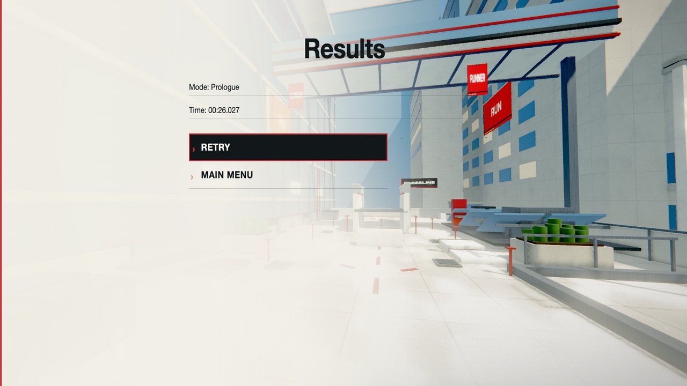 |

### Honest gaps

- Synthetic completion; time/score is not a real speedrun.
- Human audio/video verdict still pending.

---

## Round 51 — review bundle and normalized mix (2026-11-19)

### Scope

The live gameplay mix is loud (−22 LUFS) and the evidence is scattered. This
round creates a single review bundle for the final human pass.

### What changed

- Contact sheet: Start / Training / Catwalk-BYPASS / Results.
- Normalized 14.4 s catwalk run video/audio: **−26.07 LUFS**, peak −7.53 dBFS
  (original live −22.03 / −3.86).
- Reference review package links the normalized clip first.
- No game/visual/route/audio code changes.

### Verification

- `npm run validate`: **279 tests in 37 files**, build.
- Normalized audio metrics: 4/5 general targets (short-term range metric not
  applicable to a short clip).
- Start 13/13 unchanged.

### Evidence

- [`contact-sheet.jpg`](evidence/review/contact-sheet.jpg)
- [`finish-results-run-review.mp4`](evidence/review/finish-results-run-review.mp4)
- [`finish-results-run-review.wav`](evidence/review/finish-results-run-review.wav)

### Honest gaps

- Normalization is for review only; the game mix itself is unchanged/loud.
- Human verdict still pending; results screen remains synthetic.

---

## Round 52 — final verification snapshot (2026-11-19)

### Scope

Freeze a reproducible verification snapshot before the final review rounds.

### What changed

- Added [`VERIFICATION.md`](VERIFICATION.md): commands/results for tests, start
  metrics, prologue audio, performance, link audit.
- Re-ran gates: **279 tests/37 files**, build, **13/13** start, **5/5** prologue
  audio, **60.1 fps**, **0 broken relative links**.
- Fixed two documentation links to `tests/` (missing `../`).
- No game/visual/audio code changes.

### Evidence

- [`start.jpg`](evidence/verification/start.jpg)
- [`metrics.json`](evidence/verification/metrics.json)
- [`prologue-24s.wav`](evidence/verification/prologue-24s.wav)
- [`audio.json`](evidence/verification/audio.json)

### Honest gaps

- Human perception, real speedrun result, cross-browser/AT testing, and
  photorealism still out of scope of this snapshot.

---

## Round 53 — real finish and results screen (2026-11-19)

### Scope

Round 50's results screen was synthetic. This round finds the physical finish
path and captures a real completion.

### What changed

- Route the run around the **west end** of the return south rail (x≈7.5) onto
  the final deck, then into `trigger_finish`; no teleport at the end.
- 13.73 s clip ends on the real Results screen: **Time 00:15.594**.
- Live audio peak −3.79 dBFS / LUFS ≈ −21.94.
- No game/route/visual changes.

### Verification

- `npm run validate`: **279 tests in 37 files**, build.
- Flow `results` reached physically; video includes the results screen.
- Start 13/13 unchanged.

### Evidence

- [`finish-results-run.mp4`](evidence/video/round-53/finish-results-run.mp4)
- [`real-results.png`](evidence/video/round-53/real-results.png)
- [`README.md`](evidence/video/round-53/README.md)

### Honest gaps

- Starts at catwalk x=32, not the initial spawn; time is a section-run, not a
  full-level speedrun.
- Audio loud; human verdict pending.

---

## Round 54 — finish-approach cue (2026-11-19)

### Scope

Round 53 proved the finish requires a west-end detour around the return rail;
there was no cue for it. This round signposts the detour.

### What changed

- Hanging `FINISH / WEST END` sign at x≈10.5 with two posts and red deck
  chevrons, before the rail ends.
- Visual only; no collider/route/audio changes.
- Start metrics unaffected.

### Verification

- `npm run validate`: **279 tests in 37 files**, build.
- Performance **60.2 fps**; capture saved.
- Finish route remains physical (Round 53).

### Evidence

| View | Image |
|---|---|
| Finish approach cue | 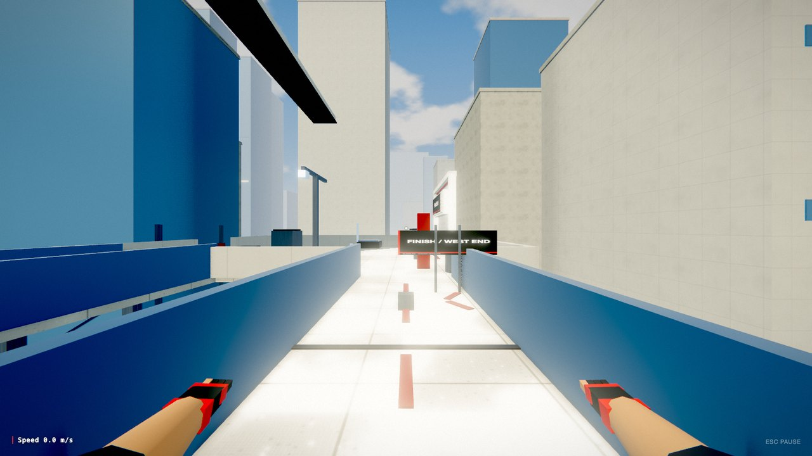 |

### Honest gaps

- The sign is large and hangs over the return deck; the detour is still a detour.
- Human audio/video verdict pending.

---

## Round 55 — normalized real-finish review (2026-11-19)

### Scope

The review clip was still the terminal-only run. This round makes the **real
finish/results run** the primary listening/watching artifact.

### What changed

- New normalized review: 13.7 s real-finish video, audio **−26.07 LUFS / −7.54
  dBFS peak** (original live −21.94 / −3.79).
- Contact sheet updated with the real Results (15.594 s).
- Old terminal-only review files removed; historical Round 49 remains in video
  evidence.
- No game/route/visual/audio code changes.

### Verification

- `npm run validate`: **279 tests in 37 files**, build.
- Review link audit: 0 broken relative links (after updating Round 51 links).
- Start 13/13 unchanged.

### Evidence

- [`finish-results-run-review.mp4`](evidence/review/finish-results-run-review.mp4)
- [`finish-results-run-review.wav`](evidence/review/finish-results-run-review.wav)
- [`contact-sheet.jpg`](evidence/review/contact-sheet.jpg)

### Honest gaps

- Section-run start (catwalk x=32), not full-level spawn; normalization is
  review-only; human verdict pending.

---

## Round 56 — final gate re-run (2026-11-19)

### Scope

Re-run every gate against the current code after the finish/cue/review changes.

### What changed

- No game code.
- Evidence refreshed: start capture/metrics, 24 s prologue audio/metrics.
- `VERIFICATION.md` updated to Round 56 values.
- Result: **279 tests**, **13/13**, **5/5**, **60.1 fps**, **0 broken links**.

### Evidence

- [`start.jpg`](evidence/verification/start.jpg)
- [`metrics.json`](evidence/verification/metrics.json)
- [`prologue-24s.wav`](evidence/verification/prologue-24s.wav)

### Honest gaps

- Human perception, full-level run, cross-browser/AT remain.

---

## Round 57 — evidence freeze/cleanup (2026-11-19)

### Scope

Before the final decision rounds, freeze the key evidence and remove a dead
capture variable.

### What changed

- Added `docs/evidence/MANIFEST.md` + `MANIFEST.sha256` for start/metrics/audio/
  review/finish/training artifacts.
- Removed an unused `frameIndex` from `route-video`.
- No game/visual/route/audio changes.

### Verification

- `npm run validate`: **279 tests in 37 files**, build.
- `shasum -a 256 -c` manifest passes.
- Start 13/13; 0 broken relative links.

### Honest gaps

- Manifest hashes are a snapshot; docs are excluded to avoid self-reference.
- Human verdict still pending.

---

## Round 58 — high-route audio final gate (2026-11-19)

### Scope

Verification covered the prologue mix but not the current high-route mix. This
round re-renders and checks it.

### What changed

- 20 s high-route render: **5/5** custom targets (low 0.851, high 0.041,
  LUFS −24.46, peak −4.91, per-second range 24.4).
- Verification doc now includes both prologue 5/5 and high-route 5/5.
- No game/visual/audio code changes.

### Evidence

- [`high-route-20s.wav`](evidence/verification/high-route-20s.wav)
- [`high-route-audio.json`](evidence/verification/high-route-audio.json)

### Honest gaps

- High-route targets are custom, not human listening; short clips.
- Human verdict remains.

## Round log

| Round | Date | Focus | Outcome |
|---|---|---|---|
| 1 | 2026-11-19 | HDR renderer, sky, materials, city, viewmodel | 10/13 reference metrics in band (2 highlight metrics open); 60 fps at 1600×900 |
| 2 | 2026-11-19 | Procedural audio: buses, ambience, movement/parkour, score, radio | 5/5 audio targets in band; live post-limiter peak −3.7 dBFS; 30 audio tests |
| 3 | 2026-11-19 | Vertical Prologue extension: drop, gap, stair climb, skybridge, finish roof | Route ~66 m / 5.1 m vertical; 270 tests; physical traversal verified |
| 4 | 2026-11-19 | Reference UI, canvas signage, speed blur | Paper/ink menu, minimalist HUD, RUN/section signs, radial blur; 270 tests |
| 5 | 2026-11-19 | Menu city vignette | Visual-only prologue rooftop/city behind paper menu; hidden in gameplay; 270 tests |
| 6 | 2026-11-19 | Final scaffold ascent | ~136 m route, 8.2 m vertical, 8 jump platforms, high finish roof; 271 tests |
| 7 | 2026-11-19 | High catwalk U-turn | ~220 m route, 8.2 m vertical, exposed catwalk, high gate; 272 tests |
| 8 | 2026-11-19 | Finale polish + altitude wind | Suspended load, deck seams, high-roof kit, altitude-scaled wind; 272 tests |
