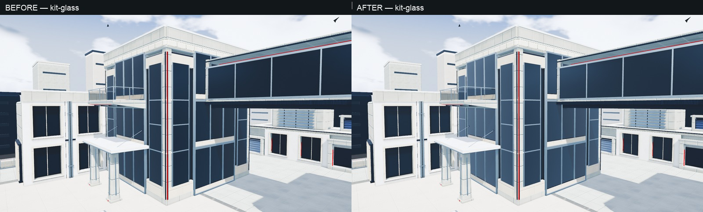
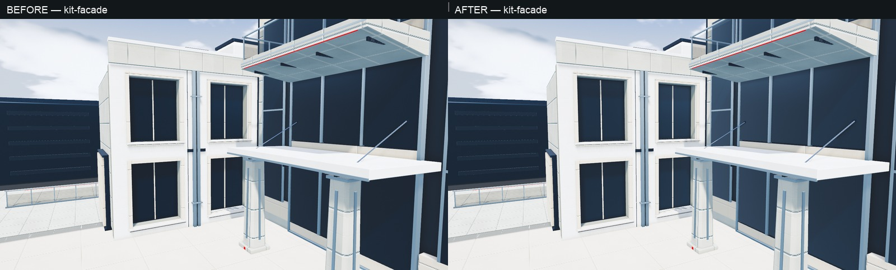
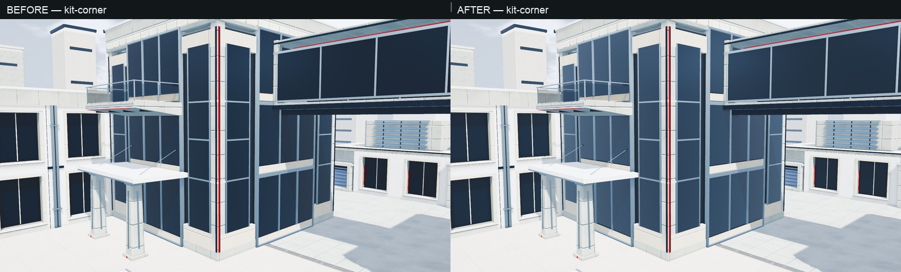
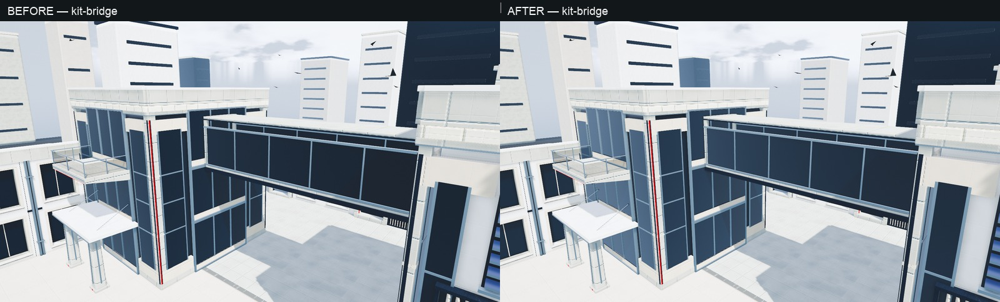
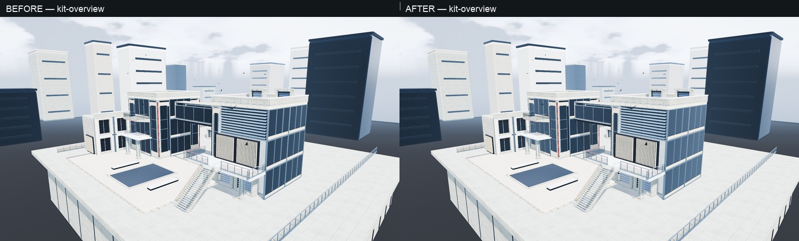
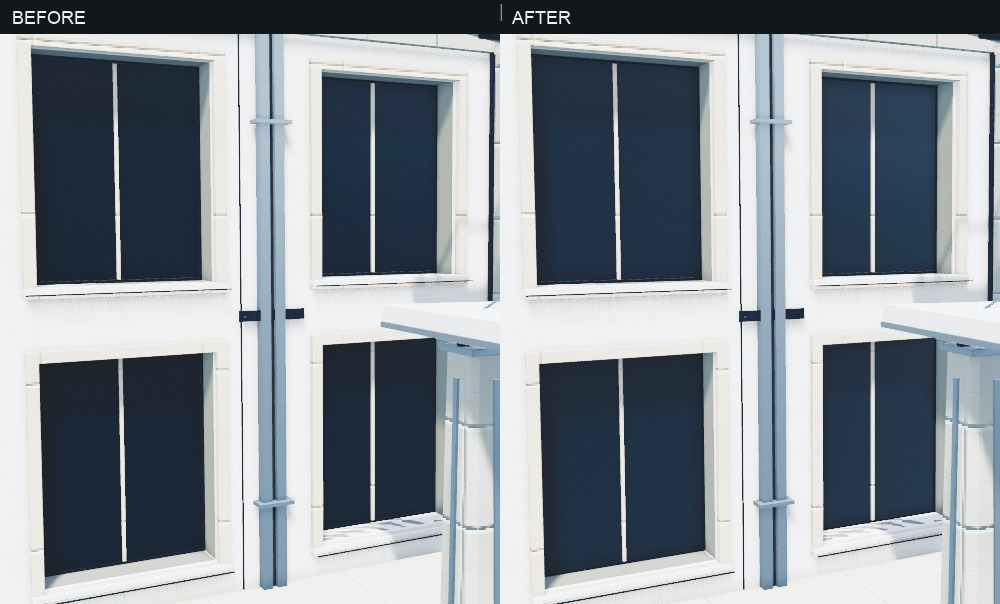
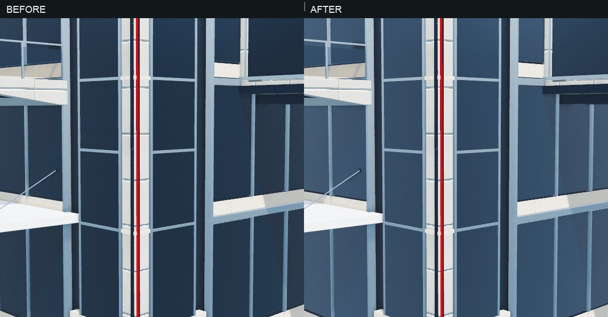
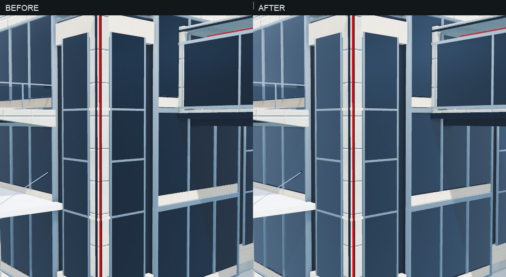
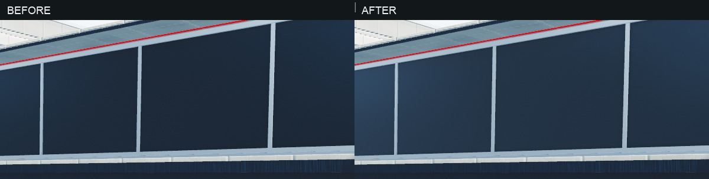

# Glassline — Architectural Kit — Step 2.3A — Near Glass Material

**Статус:** реализовано, проверки и deterministic captures сняты, ожидает ревью.
Коммит создаётся по отдельному указанию; merge не выполнялся.

**Дата:** 2026-11-21
**Baseline:** `docs/evidence/arch-kit/` (captured from `f8512c5`; re-captured from
current `475e2b8` in `captures/step23a-before` with identical hashes).
**After:** `captures/step23a-final2/` (рабочее дерево Step 2.3A).
**Маршрут:** `?capture=1&level=architecture&shot=<id>`, 1600×900, DPR 1,
Microsoft Edge 157 headless, display quality `high`.

---

## 1. Список изменённых файлов

Исходники и документация:

| Файл | Изменение |
|---|---|
| `src/rendering/MaterialLibrary.ts` | новый ключ `glass-near`, spec по ART_BRIEF, отдельные sheen-параметры |
| `src/levels/architecture/KitModulesEnvelope.ts` | 4 замены `glass` → `glass-near` (facade-bay, curtain-wall, corner ×2) |
| `src/levels/architecture/KitModulesServices.ts` | 2 замены (louver, facade-screen) |
| `src/levels/architecture/KitModulesStructure.ts` | 1 замена (bridge glazing, обе стороны) |
| `tests/unit/architectural-kit.test.ts` | контракт: кит использует `glass-near`, общие роли не перекалиброваны |
| `docs/ARCHITECTURAL_KIT.md` | таблица материалов: near-роль отделена от shared `glass` |

Evidence-файлы (добавлены этим коммитом):

- `docs/evidence/arch-kit-near-glass/` — манифест, SHA256, pixel-diff, glass-metrics,
  Prologue-regression, 9 after-JPG, 9 compare-JPG, 4 detail-JPG;
- `docs/reports/ARCH_KIT_STEP_2_3A_NEAR_GLASS.md` — этот отчёт.

---

## 2. Полный diff

Diff исходников; evidence/report добавлены тем же коммитом отдельно.

```diff
diff --git a/docs/ARCHITECTURAL_KIT.md b/docs/ARCHITECTURAL_KIT.md
index 4e0cf86..75ffc6a 100644
--- a/docs/ARCHITECTURAL_KIT.md
+++ b/docs/ARCHITECTURAL_KIT.md
@@ -180,7 +180,8 @@ The kit uses the shared `MaterialLibrary` and extends it with three semantic key
 | `concrete` | warm white structural concrete | rough 0.9 |
 | `composite` | light matte composite cladding/frames | rough 0.56, panel-joint texture |
 | `reveal` | deep window-reveal lining | rough 0.94, dark warm mineral tone |
-| `glass` | tinted curtain-wall / punched glazing | rough 0.13, metal 0.6, sky sheen |
+| `glass-near` | near curtain-wall / punched glazing (kit) | ART_BRIEF curtain glass: `#1A2530`, rough 0.10, metal 0.6, near sheen for the reflection gradient |
+| `glass` | Prologue / distant-city glazing (shared) | rough 0.13, metal 0.6, distance-tuned sheen |
 | `glass-far` | glazing cavity / distant glass | dark, rougher, lower env response |
 | `glass-rail` | balustrade glass | transparent 0.32 with Fresnel falloff |
 | `aluminium` | anodized aluminium mullions/trims/rods | rough 0.30, metal 0.92, env 1.2 |
@@ -189,7 +190,7 @@ The kit uses the shared `MaterialLibrary` and extends it with three semantic key
 | `red` | runner-red navigation accent | rough 0.6, non-metallic |
 
 Hierarchy per module: a structural mass (`concrete`/`white`), one secondary skin
-(`composite`/`glass`/`reveal`), one metal system (`aluminium`/`dark-metal`) and a
+(`composite`/`glass-near`/`reveal`), one metal system (`aluminium`/`dark-metal`) and a
 single red accent only where it carries navigation meaning (window reveal line,
 joint, bridge ceiling, railing line, portal jamb, stair nosing, column base tag).
 
diff --git a/src/levels/architecture/KitModulesEnvelope.ts b/src/levels/architecture/KitModulesEnvelope.ts
index 65f8e62..b7b49d5 100644
--- a/src/levels/architecture/KitModulesEnvelope.ts
+++ b/src/levels/architecture/KitModulesEnvelope.ts
@@ -86,7 +86,7 @@ export function buildFacadeBay(collector: KitPartCollector, definition: FacadeBa
   collector.box(
     [openingWidth - 0.09, openingHeight - 0.09, 0.04],
     [0, openingCenterY, glassZ],
-    "glass",
+    "glass-near",
   );
 
   // Dark anodized lining around the glass: a crisp shadow line that keeps the
@@ -170,7 +170,7 @@ export function buildCurtainWall(collector: KitPartCollector, definition: Curtai
       const y = baseY + panelHeight * (row + 0.5);
       const paneZ = (column + row) % 2 === 0 ? 0.055 : 0.02;
 
-      collector.box([panelWidth - 0.055, panelHeight - 0.055, 0.035], [x, y, paneZ], "glass");
+      collector.box([panelWidth - 0.055, panelHeight - 0.055, 0.035], [x, y, paneZ], "glass-near");
     }
   }
 
@@ -230,7 +230,7 @@ export function buildCorner(collector: KitPartCollector, definition: CornerModul
   collector.box(
     [0.06, glassHeight, depth - 1.2],
     [-0.02, glassBottom + glassHeight / 2, -depth / 2],
-    "glass",
+    "glass-near",
   );
   collector.box(
     [0.1, glassHeight, 0.08],
@@ -254,7 +254,7 @@ export function buildCorner(collector: KitPartCollector, definition: CornerModul
   collector.box(
     [width - 1.2, glassHeight, 0.06],
     [-width / 2, glassBottom + glassHeight / 2, -0.02],
-    "glass",
+    "glass-near",
   );
   collector.box(
     [0.08, glassHeight, 0.1],
diff --git a/src/levels/architecture/KitModulesServices.ts b/src/levels/architecture/KitModulesServices.ts
index c015ad8..2b1adb2 100644
--- a/src/levels/architecture/KitModulesServices.ts
+++ b/src/levels/architecture/KitModulesServices.ts
@@ -157,7 +157,7 @@ export function buildLouver(collector: KitPartCollector, definition: LouverModul
   const spacing = usableWidth / bladeCount;
 
   // Tinted glass behind the screen keeps the louver reading as a facade layer.
-  collector.box([width - 0.1, height - 0.2, 0.025], [0, height / 2, -0.06], "glass");
+  collector.box([width - 0.1, height - 0.2, 0.025], [0, height / 2, -0.06], "glass-near");
 
   // Frame rails and side posts.
   collector.box([width, 0.11, depth * 0.78], [0, height - 0.055, depth * 0.28], "dark-metal");
@@ -188,7 +188,7 @@ export function buildFacadeScreen(
   const spacing = (height - 0.3) / ribbons;
 
   // Glass behind the ribbon screen.
-  collector.box([width - 0.1, height - 0.1, 0.025], [0, height / 2, -0.04], "glass");
+  collector.box([width - 0.1, height - 0.1, 0.025], [0, height / 2, -0.04], "glass-near");
 
   // Three vertical supports carry the ribbons.
   for (const x of [-width / 3, 0, width / 3]) {
diff --git a/src/levels/architecture/KitModulesStructure.ts b/src/levels/architecture/KitModulesStructure.ts
index bf4e2cd..4e35e3c 100644
--- a/src/levels/architecture/KitModulesStructure.ts
+++ b/src/levels/architecture/KitModulesStructure.ts
@@ -244,7 +244,7 @@ export function buildBridge(collector: KitPartCollector, definition: BridgeModul
     collector.box(
       [length - 0.55, glassHeight, 0.03],
       [0, glassBottom + glassHeight / 2, side * (halfWidth - 0.04)],
-      "glass",
+      "glass-near",
     );
     collector.box(
       [length, 0.1, 0.13],
diff --git a/src/rendering/MaterialLibrary.ts b/src/rendering/MaterialLibrary.ts
index 2677e95..cd7766d 100644
--- a/src/rendering/MaterialLibrary.ts
+++ b/src/rendering/MaterialLibrary.ts
@@ -8,6 +8,7 @@ export type MaterialKey =
   | "roof"
   | "facade"
   | "glass"
+  | "glass-near"
   | "glass-far"
   | "glass-rail"
   | "metal"
@@ -130,6 +131,24 @@ const MATERIAL_SPECS: Record<MaterialKey, MaterialSpec> = {
     uvScale: 0.4,
     envMapIntensity: 0.5,
   },
+  "glass-near": {
+    // Architectural Kit near glazing (ART_BRIEF §2 curtain glass): the shared
+    // `glass` is calibrated for the distant city, where a strong sky response
+    // pushes the towers past the sky metric. At facade distance that same trim
+    // leaves vertical panes nearly black, so the near role keeps the dark
+    // blue-graphite albedo but restores the authored sky reflection.
+    //
+    // NOTE: `envMapIntensity` is the authored ART_BRIEF value. With three r187
+    // the renderer replaces the material value with `scene.environmentIntensity`
+    // whenever the material has no own `envMap` (all materials here use the
+    // scene PMREM), so the 1.3 does not reach the shader; the visible near-glass
+    // lift comes from the albedo/roughness and the sheen term.
+    color: 0x1a2530,
+    roughness: 0.1,
+    metalness: 0.6,
+    uvScale: 0.4,
+    envMapIntensity: 1.3,
+  },
   "glass-far": {
     color: 0x0d1a26,
     roughness: 0.2,
@@ -982,15 +1001,31 @@ function applyGlassRailOpacity(
 const GLASS_SHEEN_TINT = 0x585c60;
 
 /**
- * Grazing sheen for the dark glass masses.
+ * Near-glazing sheen: `glass` and `glass-far` run a low base (0.07/0.15) and
+ * strength (0.9/1.0) because they are tuned for the distant city, where a
+ * brighter response breaks the sky silhouette. At close range a vertical pane
+ * needs the view-dependent term to carry the reflection gradient, so
+ * `glass-near` raises the base from 0.08 at normal incidence to ~0.55 at
+ * grazing before the 2.0 strength is applied — still below a mirror response.
+ * Higher bases (0.24 and 0.12) were measured first: they lifted the whole pane
+ * uniformly and read as flat blue paint, while the panel gradient barely moved.
+ * The low base keeps head-on glass dark and lets the grazing term carry the
+ * reflection.
+ */
+const GLASS_NEAR_SHEEN_BASE = 0.08;
+const GLASS_NEAR_SHEEN_STRENGTH = 2.0;
+
+/**
+ * Grazing sheen for the dark glass roles.
  *
  * With `metalness` 0.6 the specular lobe is tinted by the dark albedo, so a
  * large facade seen close to normal reads as flat near-black instead of a
  * reflective mass. This adds a view-dependent blue-grey term to the indirect
  * specular (pure ALU: one dot, one pow, one add in the glass fragment shaders;
- * no extra texture fetch, so the `low` tier cost is unchanged). At normal
- * incidence it is ~0, at grazing angles it restores the sky-gradient sheen
- * without brightening the albedo.
+ * no extra texture fetch, so the `low` tier cost is unchanged). The shared
+ * `glass` roles keep the term near zero at normal incidence; the near role
+ * starts from a higher base so a close facade carries the gradient too. The
+ * term tints only the reflection, never the albedo.
  */
 function applyGlassSheen(
   material: THREE.MeshStandardMaterial,
@@ -1065,6 +1100,12 @@ export class MaterialLibrary implements Disposable {
       applyGlassRailOpacity(material, 0.32, 0.18);
     }
 
+    if (key === "glass-near") {
+      // Same sheen shader/cache key as the other glass roles; only the
+      // per-material uniforms differ, so this adds no shader program.
+      applyGlassSheen(material, GLASS_SHEEN_TINT, GLASS_NEAR_SHEEN_STRENGTH, GLASS_NEAR_SHEEN_BASE);
+    }
+
     if (key === "glass" || key === "glass-far") {
       // Env sheen is a pure fragment-shader term; see applyGlassSheen.
       applyGlassSheen(
diff --git a/tests/unit/architectural-kit.test.ts b/tests/unit/architectural-kit.test.ts
index 5a62881..9365fa9 100644
--- a/tests/unit/architectural-kit.test.ts
+++ b/tests/unit/architectural-kit.test.ts
@@ -164,7 +164,8 @@ describe("Architectural Kit module builders", () => {
     // semantic key of the shared library.
     expect(used.size).toBeGreaterThanOrEqual(6);
     expect(used.has("concrete")).toBe(true);
-    expect(used.has("glass")).toBe(true);
+    expect(used.has("glass-near")).toBe(true);
+    expect(used.has("glass")).toBe(false);
     expect(used.has("aluminium")).toBe(true);
     expect(used.has("composite")).toBe(true);
     expect(used.has("dark-metal")).toBe(true);
@@ -183,6 +184,48 @@ describe("Architectural Kit module builders", () => {
     library.dispose();
   });
 
+  it("keeps glass-near calibrated for close panes without retuning shared glass roles", () => {
+    const library = new MaterialLibrary();
+    const near = library.get("glass-near");
+    const shared = library.get("glass");
+    const far = library.get("glass-far");
+    const rail = library.get("glass-rail");
+
+    // ART_BRIEF §2 curtain glass: dark blue-graphite albedo, glossy but opaque.
+    expect(near.color.getHexString()).toBe("1a2530");
+    expect(near.roughness).toBeCloseTo(0.1, 5);
+    expect(near.metalness).toBeCloseTo(0.6, 5);
+    expect(near.envMapIntensity).toBeCloseTo(1.3, 5);
+    expect(near.transparent).toBe(false);
+    expect(near.depthWrite).toBe(true);
+
+    // The distant-city and balustrade roles keep their previous calibration.
+    expect(shared.color.getHexString()).toBe("0e1d2a");
+    expect(shared.roughness).toBeCloseTo(0.13, 5);
+    expect(shared.metalness).toBeCloseTo(0.6, 5);
+    expect(shared.envMapIntensity).toBeCloseTo(0.5, 5);
+    expect(shared.transparent).toBe(false);
+
+    expect(far.color.getHexString()).toBe("0d1a26");
+    expect(far.roughness).toBeCloseTo(0.2, 5);
+    expect(far.metalness).toBeCloseTo(0.5, 5);
+    expect(far.envMapIntensity).toBeCloseTo(0.35, 5);
+    expect(far.transparent).toBe(false);
+
+    expect(rail.roughness).toBeCloseTo(0.08, 5);
+    expect(rail.metalness).toBeCloseTo(0.2, 5);
+    expect(rail.envMapIntensity).toBeCloseTo(1.2, 5);
+    expect(rail.transparent).toBe(true);
+    expect(rail.depthWrite).toBe(false);
+    expect(rail.opacity).toBeCloseTo(0.32, 5);
+
+    // The near role reuses the existing sheen shader; only uniforms differ.
+    expect(near.customProgramCacheKey()).toBe("glassline-glass-sheen");
+    expect(near.customProgramCacheKey()).toBe(shared.customProgramCacheKey());
+
+    library.dispose();
+  });
+
   it("stays inside a sane triangle budget for a reusable kit", () => {
     let total = 0;
```

---

## 3. Замены `glass` → `glass-near`

| # | Файл:строка | Модуль | Поверхность | Почему `glass-near` |
|---|---|---|---|---|
| 1 | `KitModulesEnvelope.ts:89` | `facade-bay` | остекление punched-окна, утопленное на 0.7 м в reveal | ближний фасад; именно этот тип панели в `kit-facade` был плоским |
| 2 | `KitModulesEnvelope.ts:173` | `curtain-wall` | сетка панелей 3×2 (обе раскладки setback) | ближняя curtain wall стеклянного атриума |
| 3 | `KitModulesEnvelope.ts:233` | `corner` | glass return крыла A, грань +X | ближний угол; должен отражать небо, а не читаться чёрным |
| 4 | `KitModulesEnvelope.ts:257` | `corner` | glass return крыла B, грань +Z | то же для второй грани угла |
| 5 | `KitModulesServices.ts:160` | `louver` | стекло за ламелями на уровне земли | ближний фасадный слой, а не дальний город |
| 6 | `KitModulesServices.ts:191` | `facade-screen` | стекло за ribbon screen | ближний фасадный слой |
| 7 | `KitModulesStructure.ts:247` | `bridge` | боковое остекление моста, обе стороны (один box в цикле `side`) | ближний объект, по которому игрок идёт |

Итого 7 код-сайтов; замена `bridge` покрывает обе боковые панели (по одной на
сторону), поэтому фактических панелей больше.

### Что осталось на прежних ролях

| Место | Роль | Причина |
|---|---|---|
| `KitModulesEnvelope.ts:154` — cavity за панелями curtain-wall | `glass-far` | фоновая полость, а не фасадное остекление |
| `glass-railing` панели (`KitModulesServices.ts:238`, `KitModulesStructure.ts:146/154/354`) | `glass-rail` | прозрачный балласт; не трогали |
| `KitDemoLayout.ts:402` — context city shell | `glass` | дальний город, должен сохранить прежний вид |
| `KitDemoLayout.ts:512` — `pool_surface` | `glass` | горизонтальное зеркало воды, не вертикальный фасад; near-роль калибрована под вертикальные панели |
| Prologue / Training / MenuBackdrop | `glass`, `glass-far`, `glass-rail` | вне Architectural Kit, не трогали |

`grep` по `src/levels/architecture/` подтверждает: `"glass"` в модулях кита больше
не встречается; остались только `glass-near`, `glass-far`, `glass-rail`.

---

## 4. Фактические параметры материала и sheen

### `MATERIAL_SPECS["glass-near"]`

| Параметр | Значение | Комментарий |
|---|---|---|
| `color` | `0x1A2530` | ART_BRIEF §2, тёмный сине-графитовый |
| `roughness` | `0.10` | ART_BRIEF |
| `metalness` | `0.60` | ART_BRIEF |
| `envMapIntensity` | `1.3` | ART_BRIEF; фактически перекрывается renderer'ом, см. §8.1 |
| `uvScale` | `0.4` | как у shared `glass`; карты нет, параметр не влияет |
| `transparent` | `false` | прозрачность не добавлялась |
| `depthWrite` | `true` | сортировка/depthWrite не менялись |
| `opacity` | `1` | |
| `side` | `FrontSide` | как у shared `glass` |

### Sheen (`applyGlassSheen`, существующий шейдер)

| Параметр | `glass` | `glass-far` | **`glass-near`** |
|---|---:|---:|---:|
| tint | `#585C60` | `#585C60` | `#585C60` |
| base | 0.07 | 0.15 | **0.08** |
| strength | 0.9 | 1.0 | **2.0** |
| shader cache key | `glassline-glass-sheen` | `glassline-glass-sheen` | **`glassline-glass-sheen`** |

Формула (без изменений в коде шейдера):

```text
glassNdotV  = clamp(dot(normalize(vViewPosition), normal), 0, 1)
glassGrazing = min(1 - glassNdotV, 0.62)
glassSheen   = base + (1 - base) * pow(glassGrazing, 1.4)
indirectSpecular += tint * glassSheen * strength
```

- при нормальном падении: `0.08 * 2.0 = 0.16 × tint`;
- при grazing: `(0.08 + 0.92 * 0.62^1.4) * 2.0 ≈ 1.10 × tint`;
- стоимость: один `dot`, один `min`, один `pow`, одно сложение; без texture fetch;
- новый program не появляется: cache key общий, программы в кадрах остались
  38–41 (разброс из-за lazy warm-up, см. §8.4);
- отдельного tint для near-роли нет: попытка более холодного tint
  (`#6E7F8F`) отклонена — стекло читалось синей краской.

Общие `glass`, `glass-far`, `glass-rail` не менялись; это закреплено тестом
(цвет, roughness, metalness, env, opacity, depthWrite, transparent).

---

## 5. Результаты тестов и сборки

| Проверка | Результат |
|---|---|
| `npm test` | **49 files / 444 tests — all pass** |
| `npm run typecheck` | **pass** (`tsc --noEmit`) |
| `npm run check` | **pass**, 0 errors; 15 warnings + 1 info — все pre-existing и вне изменённых файлов |
| `npm run build` | **pass**, 123 modules; `dist/assets/index-CMX2wq0f.js` 5,429.98 kB (gzip 1,953.61 kB); chunk-size warning — pre-existing |
| `npm run kit:lifecycle` | **PASSED**: loaded 131 children / 121 instanced / 118 geometries; menu 10 / 1 / 9; reload/restart ×2 стабильны; 0 errors |
| Deterministic captures | **9/9 byte-identical** (two fresh Edge instances) |
| Console errors | **0** на всех 9 kit-кадрах и на Prologue `start-roof` |

Новый тест `keeps glass-near calibrated for close panes without retuning shared
glass roles` фиксирует значения `glass-near` и всех трёх общих glass-ролей, а
также общий program cache key.

---

## 6. Baseline и новые SHA256

| Shot | Required | Baseline SHA256 | After SHA256 |
|---|---|:--|---|
| `kit-overview` | **да** | `b51341fe5d529665be704cacce5dbc05451748c5fafed880f65264578bac72fa` | `d8a64e071aae84378114d065f89c7ff75693888c4d4ecf56008cca2bfaa771a0` |
| `kit-facade` | **да** | `862932413b6b1722b9645a1a6449142a8ee7b50133b156354b4ad7fc25036ba8` | `0f16edf3994e5d60f4d2af843fec3ca04b13f843a6b19527d12904d039d3e6e0` |
| `kit-glass` | **да** | `4aee63f9590d2bd20f01bda921ee31f13161a130efbb03bd2ba4f5955a08e3f5` | `87ab8642560ef4042251cdb8efa8f108046bd85338605018639ad510f35e8b94` |
| `kit-corner` | **да** | `6cb801b1d3bdaf3e6596c06ad4c9e8e0603f08093c62a181a53dd89a4559475b` | `b74f03c2c8381e92f34f71490ba18e8051ccaa1dc9ca95d2d935e06bd8c304f4` |
| `kit-canopy` | нет | `a633457918eeb8d63fb4d3972908bb48cc69e6cb5ddc071411b08f8d4fa52422` | `7f1c6d224c127c7923226ac8f3010b1cc67ce9c4ff14c6f059cf155a1ea24b78` |
| `kit-service` | нет | `4e57722b3312541f0b1e5cb2ee8e53f41bb42c31251e7bde3af02c1b5f74e50d` | `800e1c2e857ba937da52a285c6b8643e4d02d9568d4bc896b99529e2042a703b` |
| `kit-player-eyes` | нет | `ee7573fc1711f6b61ed5d181e8d1d5382a0c246927155ef310bf73c3a3e087e6` | `b343ab85aa53d2ca5f0775d4d83bd44d160c21920f8c0c2b9ad967e07068dbc2` |
| `kit-distant` | нет | `9013fca0c03867668cdd23d375890759e91413ec323562fcb67cbcd4c28d09bb` | `6ed2cb8b05ede3093c28501dd362efe10b24c68ecfdf95159838730c0e4d8131` |
| `kit-bridge` | **да** | `1dfe4655706700894ae71cc14ee794c7361aff6bb13888a025ecd6b2e87289cb` | `05d17e1b1beff72b61466de2866251ce989eb82f6a9f902ca2772f3fa488bc12` |

Prologue regression (`start-roof`):

| | SHA256 | Draw calls | Triangles |
|---|---|---:|---:|
| Baseline | `59c977dddc4a9c638995015698a372cc1b933807b6edcff8e81b622cbc936ba2` | 210 | 4,363,071 |
| After | `59c977dddc4a9c638995015698a372cc1b933807b6edcff8e81b622cbc936ba2` | 210 | 4,363,071 |

Хэш идентичен; Prologue не изменился.

---

## 7. Сравнение кадров до/после

### 7.1 Визуальный результат

Ключевые кадры (слева baseline, справа after):







Крупные фрагменты:






Наблюдения:

- ближнее стекло перестало быть почти чёрным: появился сине-графитовый тон,
  различающийся по поверхностям;
- на punched-окнах появился вертикальный градиент (низ панели светлее верха);
  row range вырос примерно вдвое (см. таблицу ниже);
- самый большой прирост отражения — у высоких правых плоскостей curtain-wall и
  corner returns; самые тёмные — punched-окна, что сохраняет иерархию
  «стеклянный объём / глубокий проём»;
- дальний город пиксельно не изменился (см. §7.3);
- белые рамы, стойки и тёмные lining'и читаются; на самых светлых гранях
  контраст белой рамы немного снизился, но потеря читаемости не наблюдалась;
- зеркала нет: grazing-вклад ≈ `1.10 × tint`, roughness 0.10, панели остаются
  тёмными и непрозрачными;
- прозрачность не добавлялась: сортировка, depthWrite и читаемость интерьера
  не менялись.

### 7.2 Числовые измерения

Whole-frame diff (1600×900, required shots):

| Shot | Mean abs diff /255 | Max diff /255 | Changed pixels (>2) |
|---|---:|---:|---:|
| `kit-glass` | 4.51 | 96 | 25.8% |
| `kit-facade` | 3.25 | 32 | 24.4% |
| `kit-corner` | 6.30 | 102 | 34.4% |
| `kit-bridge` | 3.38 | 97 | 20.9% |
| `kit-overview` | 1.40 | 78 | 6.3% |

Чистые области стекла (без рам; luma 0…1):

| Область | Mean before | Mean after | Δ | Row range before | Row range after |
|---|---:|---:|---:|---:|---:|
| `kit-glass` bridge pane, left | 0.1682 | 0.2167 | +28.8% | 0.0120 | 0.0183 |
| `kit-glass` bridge pane, middle | 0.1563 | 0.1927 | +23.3% | 0.0029 | 0.0044 |
| `kit-glass` curtain-wall pane, right face | 0.1908 | 0.2728 | +43.0% | 0.0054 | 0.0050 |
| `kit-facade` punched window, upper-left | 0.1536 | 0.1841 | +19.9% | 0.0052 | 0.0104 |
| `kit-facade` punched window, upper-right | 0.1571 | 0.1909 | +21.5% | 0.0069 | 0.0124 |
| `kit-corner` return, left face | 0.2063 | 0.2949 | +43.0% | 0.0064 | 0.0074 |
| `kit-corner` return, right face | 0.2015 | 0.2829 | +40.4% | 0.0114 | 0.0156 |

Ориентация:

- curtain-wall right face vs punched window: **+48.2%** по средней яркости
  (0.2728 vs 0.1841) — разные ориентации и высота/экспозиция;
- два corner return под 90°: **−4.1%** (0.2829 vs 0.2949), т.е. практически
  одинаковая яркость. Это честный компромисс: обе грани видят один и тот же
  ровный band неба, а env-map содержит только sky dome. Различие «по ориентации»
  на этой паре не доказано; различие curtain-wall/punched — доказано, но оно
  не является чистым экспериментом только по ориентации.

Draw calls / triangles:

| Shot | Draw calls before → after | Triangles before → after |
|---|---|---|
| все 9 kit-кадров | 270 → **270** | 305,727 → **305,727** |

Console errors: **0** во всех after-кадрах. Материал — только per-material
uniforms, без нового shader program.

### 7.3 Дальний город

Пиксельные проверки областей дальнего города (baseline vs after):

| Кадр | Область | Mean abs diff | Max diff | Changed px |
|---|---|---:|---:|---:|
| `kit-bridge` | far-right city tower | 0.0 | 0 | 0 |
| `kit-distant` | far-left city | 0.0 | 0 | 0 |
| `kit-distant` | far-right city | 0.0 | 0 | 0 |
| `kit-overview` | far-left city | 0.0 | 0 | 0 |
| `kit-overview` | far-right city | 0.0 | 0 | 0 |

Дальний город остался на shared `glass`/`glass-far`; ни один его пиксель в
проверенных областях не изменился.

---

## 8. Обнаруженные проблемы и компромиссы

### 8.1 `envMapIntensity: 1.3` не доходит до шейдера

Это главная находка. В three r187 `WebGLRenderer.setProgram()` перезаписывает
uniform `envMapIntensity` значением `scene.environmentIntensity`, если у
материала нет собственного `envMap`, а `scene.environment` есть:

```js
// node_modules/three/src/renderers/WebGLRenderer.js:2745-2749
if ( ( material.isMeshStandardMaterial || ... ) && material.envMap === null && scene.environment !== null ) {
    m_uniforms.envMapIntensity.value = scene.environmentIntensity;
}
```

В Glassline все материалы используют scene PMREM, поэтому у `glass-near`
фактически работает `scene.environmentIntensity = 0.78`, а не authored `1.3`.
Экспериментальное подтверждение: смена `1.3 → 1.5` дала **байт-идентичные**
кадры. Чтобы 1.3 реально работал, нужно либо привязать per-material `envMap`
в `RenderScene` (запрещено в этом шаге), либо добавить в glass-шейдер
env-scale/gradient term. Ни то, ни другое не делалось. Видимый прирост в этом
шаге даёт albedo/roughness + sheen, а не `envMapIntensity`.

### 8.2 Градиент внутри панели остался скромным

Row range вырос на punched-окнах и bridge-панелях до 0.010–0.018 luma
(1.0–1.8%), но у правой curtain-wall панели остался 0.005: там панель видна
почти по нормали, и градиент внутри неё не появляется. Это ниже ориентира
0.03 из root-cause заметки. Причина: PMREM содержит только sky dome, у
горизонта небо почти равномерное; параметры sheen меняют в основном среднюю
яркость, а не наклон внутри панели. Дальнейшие варианты требуют отдельного согласования:

- шейдерный sky-gradient term в `applyGlassSheen` (не «новый шейдер», но
  изменение существующего кода; в этом шаге не делалось);
- per-material env map / более богатое окружение (изменение `RenderScene`,
  запрещено);
- прозрачность (отдельное согласование: sorting, depthWrite, интерьер).

Параметрическая калибровка исчерпана: 0.24/1.6, 0.12/1.9 и 0.08/2.0 дают
близкий row range, но разную среднюю яркость. Выбран 0.08/2.0 как
компромисс: head-on стекло остаётся тёмным, grazing-член несёт отражение.

### 8.3 Прозрачность не добавлялась

Стекло остаётся непрозрачным (`transparent: false`, `depthWrite: true`,
`opacity: 1`). Элементы «за стеклом» в ките — это тёмная полость/интерьер,
который и так не моделируется; читаемость обеспечивают выступающие рамы,
mullion'ы и `dark-metal` lining. Прозрачность потребовала бы отдельного
обоснования сортировки, depthWrite и читаемости интерьера — по заданию без
согласования не внедрялась.

### 8.4 Счётчики textures/programs в capture «плавают»

В разных прогонах один и тот же кадр показывает 31/38 или 36/41
(textures/programs) из-за lazy material warm-up. Draw calls (270) и triangles
(305,727) стабильны; PNG-хэши детерминированы. Это артефакт измерения, не
регрессия. В evidence сохранён фактический манифест прогона.

### 8.5 Горизонтальный pool и дальний город

`KitDemoLayout.ts:512` (`pool_surface`) остался на shared `glass`: это
горизонтальная поверхность отражения, а не вертикальный фасад; near-роль
калибрована под вертикальные панели. `context city` (`:402`) остался на
shared `glass`, потому что это дальний город. Если ревью захочет перевести
pool на `glass-near`, это отдельное решение с другим визуальным результатом.

### 8.6 Прочее

- 15 pre-existing lint warnings (safari tools, CSS specificity, audio optional
  chain) и 1 info — не связаны с шагом; `npm run check` завершается 0 errors.
- Chunk-size warning сборки — pre-existing.
- Spandrel/reveal/mullion не менялись: их проблемы (светлый spandrel,
  светлый reveal, белые mullion'ы) остаются на следующий шаг.
- Prologue и Training не менялись: `start-roof` побайтно идентичен.

---

## 9. Что не менялось

- `Renderer.ts`, `PostPipeline.ts`, `RenderScene.ts`, глобальный свет и
  environment intensity;
- геометрия, позиции, размеры, количество панелей и параметры модулей кита;
- `glass`, `glass-far`, `glass-rail` (значения закреплены тестом);
- spandrel, reveal, mullion;
- Prologue, Training, MenuBackdrop;
- прозрачность, сортировка, depthWrite;
- коммиты/merge не создавались.

---

## 10. Вопросы к ревью

1. Принять ли `glass-near` в текущей калибровке (albedo/roughness/metalness по
   ART_BRIEF, sheen 0.08/2.0) как достаточный шаг, учитывая §8.1–8.2?
2. Нужно ли отдельным шагом сделать `envMapIntensity` реально действующим
   (per-material envMap в `RenderScene` или env-scale в шейдере)?
3. Нужно ли усиливать градиент шейдерным sky-gradient term — или принять
   текущий прирост и переходить к spandrel/reveal/mullion только после ревью?
4. Переводить ли `pool_surface` на `glass-near`? Сейчас — нет.

---

## Приложение A — evidence

`docs/evidence/arch-kit-near-glass/`:

- `capture-manifest.json` — after-прогон + determinism 9/9;
- `baseline-sha256.json`, `after-sha256.json`;
- `pixel-diff.json` — все 9 кадров;
- `glass-metrics.json` — чистые области, row gradient, ориентация, far city;
- `prologue-regression.json`;
- `kit-*.jpg`, `compare-kit-*.jpg`, `detail-kit-*.jpg`.

Короткий индекс: [`docs/evidence/arch-kit-near-glass/README.md`](../evidence/arch-kit-near-glass/README.md).
