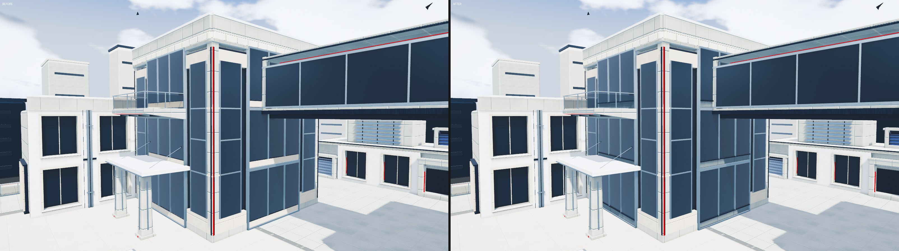
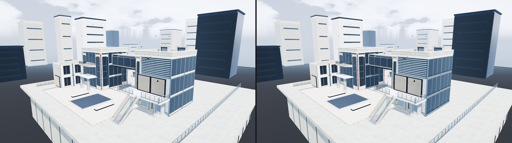
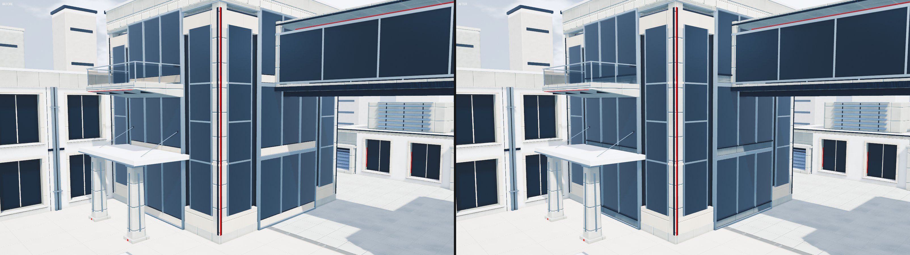
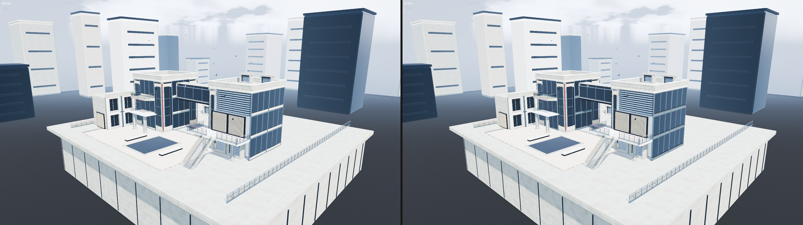
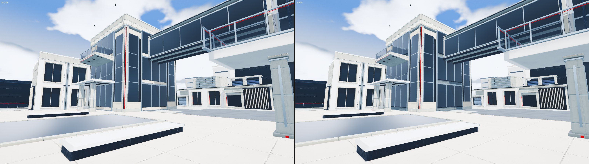
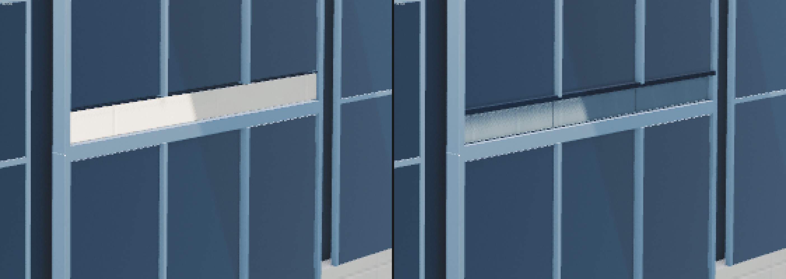
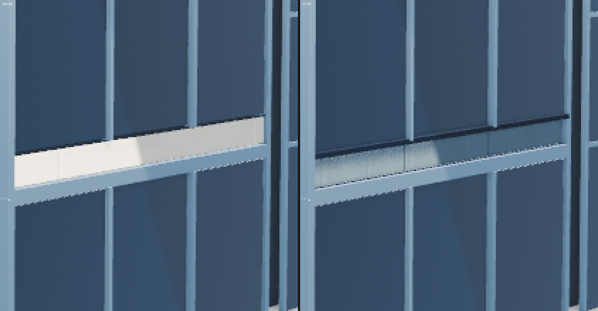
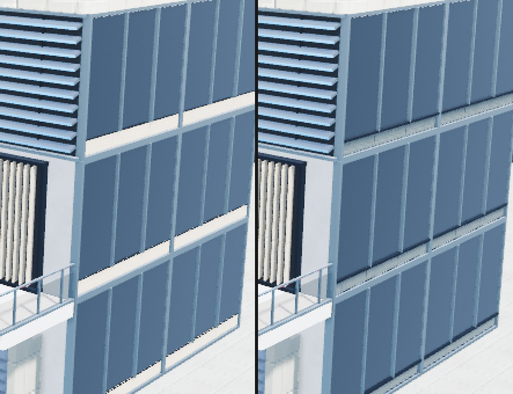
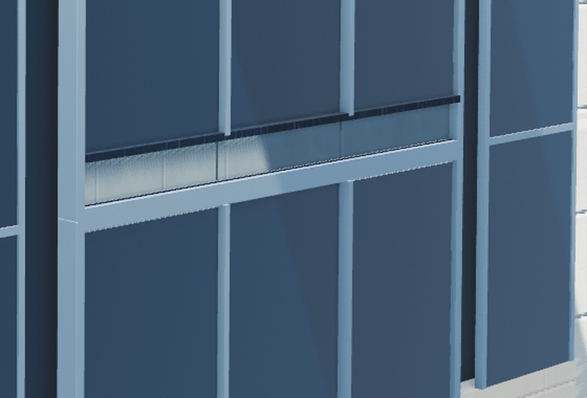

# Glassline — Architectural Kit — Step 2.3B — Spandrel Zone

**Статус:** реализовано; обязательные проверки и deterministic captures сняты,
ожидает ревью. Merge не выполнялся.

**Дата:** 2026-11-21
**Ветка:** `feat/arch-spandrel`, создана от `feat/architectural-kit` на commit
`4a502bdf550916e89672347f71291e4318bf910e`.
**Baseline:** `captures/step23b-before` — снят с базового commit на чистом дереве;
9/9 sha256 совпадают с архивным прогоном Step 2.3A (`captures/step23a-final2`).
**After:** `captures/step23b-final`; дополнительно `captures/step23b-detail`
(тот же кадр `kit-glass` при 3200×1800). Команда из задания
(`--iteration arch-spandrel`) воспроизвела те же 9/9 хэшей.
**Маршрут:** `?capture=1&level=architecture&shot=<id>`, 1600×900, DPR 1,
Microsoft Edge 157 headless, display quality `high`.

---

## 1. Список изменённых файлов

Исходники, тесты и документация:

| Файл | Изменение |
|---|---|
| `src/rendering/MaterialLibrary.ts` | новый семантический ключ `spandrel`: непрозрачный матовый материал панели; `MATERIAL_SPECS` |
| `src/levels/architecture/KitModulesEnvelope.ts` | `buildCurtainWall`: spandrel собран как зона — кассеты, тёмный head rail, backing, shadow gaps |
| `tests/unit/architectural-kit.test.ts` | +4 теста: материал/непрозрачность, `spandrel: false` без изменений, геометрия зоны, детерминизм/локальность |
| `docs/ARCHITECTURAL_KIT.md` | каталог модуля, описание spandrel-зоны, материал `spandrel`, калибровочная заметка, verification record |

Evidence (добавлены этим коммитом):

- `docs/evidence/arch-kit-spandrel/` — манифест, sha256, pixel-diff,
  spandrel-metrics, lifecycle, Prologue-regression, 9 after-JPG, 9 compare-JPG,
  5 detail-JPG;
- `docs/reports/ARCH_KIT_STEP_2_3B_SPANDREL.md` — этот отчёт.

`docs/IMPLEMENTATION_STATUS.md` обновлён отдельной записью §0.2.1.

`src/levels/architecture/KitTypes.ts` **не менялся**: нового параметра модуля не
потребовалось; `spandrel` остаётся булевым флагом, высота полосы 0.48 м и
схема валидации прежние.

---

## 2. Diff исходников

```diff
diff --git a/src/levels/architecture/KitModulesEnvelope.ts b/src/levels/architecture/KitModulesEnvelope.ts
@@ -188,16 +188,60 @@ export function buildCurtainWall(collector: KitPartCollector, definition: Curtai
   }
 
   if (spandrel) {
+    // The spandrel is the opaque band between two glazed storeys, so it is
+    // built as an architectural zone of its own: an expressed metal head rail
+    // on the glass line, a recessed field of matte cassettes aligned with the
+    // mullion grid, and shadow gaps that seat the field between the rails.
+    // The rail, backing and shadow gaps reuse the module's existing dark-metal
+    // batch; only the cassette field needs a new material role.
+    const bandTop = border + spandrelHeight;
+    // Glass panes are inset 0.0275 m inside their cell; the head rail ends on
+    // that edge so the glazing reads as seated in the frame above the band.
+    const headHeight = 0.075;
+    const headBottom = bandTop + 0.0275 - headHeight;
+    const jointGap = 0.024;
+    const cassetteTop = headBottom - 0.016;
+    const cassetteBottom = border + 0.018;
+    const cassetteHeight = cassetteTop - cassetteBottom;
+    const cassetteCenterY = (cassetteTop + cassetteBottom) / 2;
+    const cassetteWidth = usableWidth / columns;
+    const cassetteDepth = 0.045;
+    const cassetteFront = 0.02;
+    const cassetteCenterZ = cassetteFront - cassetteDepth / 2;
+
+    // Dark backing behind the cassette joints: a gap between panels must read
+    // as a recessed press joint, not as a hole through the glazing cavity.
     collector.box(
-      [usableWidth, spandrelHeight - 0.06, 0.06],
-      [0, border + spandrelHeight / 2, 0.03],
-      "composite",
+      [usableWidth, cassetteHeight + 0.016, 0.012],
+      [0, cassetteCenterY, cassetteCenterZ - cassetteDepth / 2 - 0.006],
+      "dark-metal",
     );
+
+    // Opaque matte cassette per structural bay. Joints land on the mullion
+    // lines above, so the opaque band keeps the facade's grid rhythm.
+    for (let column = 0; column < columns; column += 1) {
+      collector.box(
+        [cassetteWidth - jointGap, cassetteHeight, cassetteDepth],
+        [-halfWidth + border + cassetteWidth * (column + 0.5), cassetteCenterY, cassetteCenterZ],
+        "spandrel",
+      );
+    }
+
+    // Expressed head rail in the transom plane: the constructive transition
+    // between opaque panel and glass. Dark anodized metal keeps the glass line
+    // dark and lets the matte panel read as the lighter element between the
+    // dark transom above and the pale frame below. Its depth carries a shadow
+    // gradient down the recessed field.
     collector.box(
-      [usableWidth, 0.025, 0.025],
-      [0, border + spandrelHeight - 0.005, 0.07],
+      [usableWidth, headHeight, 0.15],
+      [0, headBottom + headHeight / 2, 0.075],
       "dark-metal",
     );
+
+    // Shadow gaps above and below the field: the cassettes sit in the frame
+    // instead of being pasted onto the facade.
+    collector.box([usableWidth - 0.02, 0.016, 0.03], [0, cassetteTop + 0.008, 0.045], "dark-metal");
+    collector.box([usableWidth - 0.02, 0.018, 0.024], [0, border + 0.009, 0.045], "dark-metal");
   }
 }
```

```diff
diff --git a/src/rendering/MaterialLibrary.ts b/src/rendering/MaterialLibrary.ts
@@ -14,6 +14,7 @@ export type MaterialKey =
   | "metal"
   | "aluminium"
   | "composite"
+  | "spandrel"
   | "reveal"
   | "dark-metal"
@@ -206,6 +207,28 @@ const MATERIAL_SPECS: Record<MaterialKey, MaterialSpec> = {
     heightFromAlpha: true,
     envMapIntensity: 0.5,
   },
+  // Opaque spandrel cassette panel for curtain walls. A spandrel is the solid
+  // band between two glazed storeys, so it must read as a matte clad panel, not
+  // as more glass: `glass-near` is glossy (roughness 0.10), metallic (0.6) and
+  // carries the view-dependent sheen term, while this role is diffuse and
+  // non-metallic, so it answers the warm sun instead of the cool sky.
+  //
+  // Calibration (Step 2.3B): the pale `composite` band it replaces merged with
+  // the white frame, while a first pass at the ART_BRIEF `#2A3A44` sat too close
+  // to the glazing value and read as a recess. This neutral mid-grey renders
+  // between the dark glazing (≈0.31 luma on the shaded review face) and the
+  // anodized frame (≈0.55–0.63), giving the facade a three-value hierarchy
+  // (frame / opaque panel / glass) without adding a colour accent. The facade
+  // panel-joint map at a fine 0.55 uv scale carries the cassette grain up close.
+  spandrel: {
+    color: 0x767d80,
+    roughness: 0.84,
+    metalness: 0.02,
+    uvScale: 0.55,
+    texture: "facade",
+    heightFromAlpha: true,
+    envMapIntensity: 0.3,
+  },
```

Тестовый diff — 149 строк, 4 новых теста в
`tests/unit/architectural-kit.test.ts`:

| Тест | Что фиксирует |
|---|---|
| `builds the spandrel as an opaque matte panel with its own material role` | `transparent:false`, `depthWrite:true`, `opacity:1`; roughness 0.84 > 0.7 и > 4× glass-near; metalness < 0.1 и < metalness/10; env < env/3; другой program cache key; цвет `#767D80` ≠ `#1A2530`; одна роль на все размещения (кэш `MaterialLibrary`) |
| `keeps spandrel: false on the previous curtain-wall behaviour` | ровно 3 батча `glass-far/aluminium/glass-near`, 328 треугольников, стекло на прежнем месте (`min.y = 0.1275`) |
| `builds the spandrel as a framed matte field inside the storey band` | ровно 1 батч `spandrel`; 5 батчей (как до шага); 412 треугольников; поле внутри полосы 0.10…0.58 м, по X ±2.888, recessed `max.z < 0.0375`; остекление не изменилось, только поднялось на 0.48 м |
| `builds finite, local and deterministic spandrel geometry` | повторная сборка даёт те же key/triangles/батчи/bounding spheres; все позиции конечны; геометрия локальна модулю |

---

## 3. Реализация

### 3.1 Материал

Добавлена одна семантическая роль в существующую `MaterialLibrary` (не новый
библиотечный класс и не per-instance материал):

| Параметр | `spandrel` | `glass-near` (не менялся) |
|---|---:|---:|
| `color` | `#767D80` | `#1A2530` |
| `roughness` | 0.84 | 0.10 |
| `metalness` | 0.02 | 0.60 |
| `envMapIntensity` | 0.3 | 1.3 |
| `transparent` / `depthWrite` / `opacity` | `false` / `true` / `1` | `false` / `true` / `1` |
| sheen (`glassline-glass-sheen`) | нет | да |
| texture | facade panel-joint map, `uvScale 0.55` | нет |

Панель отвечает на тёплое солнце диффузно, а стекло — на холодное небо
зеркально: это и есть различие «характера отражения», а не только цвета.
Материал не эмиссивный, не прозрачный и не металлический, поэтому не может
превратиться в «яркую вставку».

### 3.2 Геометрия зоны (модуль `curtain-wall`, `spandrel: true`)

Полоса 0.48 м между нижней рамой и остеклением собрана как конструктивная зона:

1. **Head rail** — тёмный анодированный профиль 0.075 × 0.15 м в плоскости
   transom'а, верхней гранью ровно по нижней кромке стекла: читаемый переход
   «стекло → непрозрачная панель».
2. **Кассеты** — по одной на структурную колонну модуля (`columns`), утоплены
   на 52–62 мм относительно плоскости стекла; швы 24 мм попадают на линии
   муллионов сверху, поэтому ритм сетки сохраняется.
3. **Backing** — тёмная пластина за швами: шов читается как утопленный
   пресс-шов, а не как дырка в фасадную полость.
4. **Shadow gaps** 16–18 мм сверху и снизу поля: кассеты «сидят» в раме.

Все элементы локальны (в пределах 6 × 4.2 × 0.34 м), детерминированы (нет
`Math.random`) и мержатся коллектором в один part на материал. Новый батч только
один — `spandrel`; rail/backing/gaps идут в существующий `dark-metal`, рама
осталась `aluminium`.

### 3.3 Draw calls

| Вариант | Батчи до шага | Батчи после | Треугольники до → после |
|---|---:|---:|---:|
| `curtain-wall` (demo, rows 1, `spandrel: false`) | 3 | 3 | 328 → 328 |
| `curtain-wall` (demo, rows 1, `spandrel: true`) | 5 | 5 | 352 → 412 |
| `curtain-wall` (canonical, rows 2, `spandrel: true`) | 5 | 5 | 400 → 460 |

Количество instanced-батчей на вариант не изменилось, поэтому draw calls на
размещение не выросли. На композиции: **270 → 270** draw calls; треугольники
305,727 → **308,463** (+2,736, +0.9 %). Текстур стало на одну больше (36 → 37):
у новой роли своя facade-карта; это единственный прирост ресурсов.

### 3.4 Калибровка

Первые проходы:

| Вариант | Результат |
|---|---|
| `composite` (было) | светлая кремовая полоса, сливается с белой рамой — исходная проблема |
| ART_BRIEF `#2A3A44`, rough 0.72 | полоса темнее стекла в тени, читается как глухой проём, а не панель |
| `#6A7370` / `#6E7476` | ближе, но в тени разница со стеклом всего ~12 % по luma |
| **`#767D80`, rough 0.84, тёмный rail** | панель между стеклом и рамой: ≈0.31 / 0.40 / 0.55–0.63 luma; устойчиво читается как матовая панель |

ART_BRIEF §2 задаёт spandrel `#2A3A44`; это отклонение зафиксировано явно в
`docs/ARCHITECTURAL_KIT.md` §5. Причина: при текущем освещении и тёмном
остеклении тёмная панель теряет значение и читается как проём, то есть не
выполняет критерий «непрозрачная фасадная панель». Тёмный вариант остаётся
референсом для будущего более тёмного фасада.

---

## 4. Результаты проверок

| Проверка | Результат |
|---|---|
| `npm run typecheck` | **pass** (`tsc --noEmit`, exit 0) |
| `npm run check` | **pass**, 0 errors; 15 warnings + 1 info — все pre-existing и вне изменённых файлов |
| `npm test` | **49 files / 448 tests — all pass** (было 444; +4 новых теста) |
| `npm run build` | **pass**, `dist/assets/index-DsGTuikY.js` 5,430.38 kB (gzip 1,953.74 kB); chunk-size warning — pre-existing; demo level id в production JS отсутствует |
| `npm run kit:lifecycle` | **PASSED**: loaded 118 geometries / 121 instanced / 37 textures / 41 programs; menu 9 geometries; reload/restart ×2 стабильны; 0 errors |
| Deterministic captures | **9/9 byte-identical** (два свежих Edge-инстанса), 0 console/page errors |
| Prologue regression | `start-roof` **байт-в-байт** `59c977dd…`, 210 draw calls / 4,363,071 triangles — без изменений |

Отдельно: первый финальный прогон с `--verify-determinism` дал 8/9
byte-identical плюс один кадр с 30 пикселями на 1/255 (в пределах принятого
правила ≤144 px / ≤1/255); повторный прогон — **9/9 byte-identical**, в evidence
сохранён именно он.

---

## 5. Baseline и новые SHA256

| Shot | Baseline SHA256 | After SHA256 |
|---|---|---|
| `kit-overview` | `d8a64e071aae84378114d065f89c7ff75693888c4d4ecf56008cca2bfaa771a0` | `b6a68439d8dea8044709b178f5a0bd003e6b967db51ea8aef0dc99d377d2e0f1` |
| `kit-facade` | `0f16edf3994e5d60f4d2af843fec3ca04b13f843a6b19527d12904d039d3e6e0` | `99a2f9e5a3f17cbbc93529d74ee9e5b6422096d7f977ec3f2065f6fa4948ebfb` |
| `kit-glass` | `87ab8642560ef4042251cdb8efa8f108046bd85338605018639ad510f35e8b94` | `2a9615230fb0948dfdda99f368498a560f2ae4e0cc42825177b19f9fcabd7753` |
| `kit-corner` | `b74f03c2c8381e92f34f71490ba18e8051ccaa1dc9ca95d2d935e06bd8c304f4` | `b24726a7a26a03751bb692e79b9f11688a5ddb9c67ee5acc0165e212b47c96b7` |
| `kit-canopy` | `7f1c6d224c127c7923226ac8f3010b1cc67ce9c4ff14c6f059cf155a1ea24b78` | `dd65a57a985f1ad5e1cc7b1704117a829bed1a3d4a89e31f9916d64c91e60e3f` |
| `kit-service` | `800e1c2e857ba937da52a285c6b8643e4d02d9568d4bc896b99529e2042a703b` | `800e1c2e857ba937da52a285c6b8643e4d02d9568d4bc896b99529e2042a703b` (без изменений) |
| `kit-player-eyes` | `b343ab85aa53d2ca5f0775d4d83bd44d160c21920f8c0c2b9ad967e07068dbc2` | `6cb011a67c2be31284ad3f3acea584939c21400dc6b10c7c3a9623f149b78092` |
| `kit-distant` | `6ed2cb8b05ede3093c28501dd362efe10b24c68ecfdf95159838730c0e4d8131` | `c270bc3792b2d945ff60d83d745da29ce25753ae9df6780344f1cbb889a59712` |
| `kit-bridge` | `05d17e1b1beff72b61466de2866251ce989eb82f6a9f902ca2772f3fa488bc12` | `394a691e4e6863ce4501a660c807fcd0d6e6fe14c1d07fdfa42cedeaf82c6f82` |

Whole-frame diff (1600×900):

| Shot | Mean abs /255 | Max /255 | Changed pixels |
|---|---:|---:|---:|
| `kit-overview` | 0.480 | 209 | 0.649 % |
| `kit-facade` | 1.683 | 207 | 2.004 % |
| `kit-glass` | 1.030 | 210 | 1.337 % |
| `kit-corner` | 1.431 | 210 | 1.835 % |
| `kit-canopy` | 0.910 | 208 | 1.123 % |
| `kit-service` | 0 | 0 | 0 % |
| `kit-player-eyes` | 0.405 | 209 | 0.552 % |
| `kit-distant` | 0.339 | 209 | 0.459 % |
| `kit-bridge` | 0.745 | 210 | 0.957 % |

Пиксельные проверки дальнего города (shared `glass`/`glass-far`): max channel
delta **0** в пяти областях (`kit-distant` ×2, `kit-overview` ×2,
`kit-bridge` ×1). Стекло и дальний город не менялись.

### 5.1 Метрики зоны (затенённая грань атриума)

| Область | Before luma | After luma |
|---|---:|---:|
| полоса spandrel, освещённая часть | 0.7871 | **0.4037** |
| полоса spandrel, теневая часть | 0.7192 | **0.4027** |
| остекление над полосой (свет) | 0.2716 | 0.2716 (не изменилось) |
| остекление над полосой (тень) | 0.3337 | 0.3337 (не изменилось) |
| анодированный слив под полосой | 0.7354 | 0.6323* |
| полоса башни (обзор) | 0.7891 | 0.6284* |

\* область включает границу панели и профиля; сам `aluminium` не менялся.

Итог: панель стала **матовая и средняя по значению** (≈0.40) вместо светлой
кремовой (≈0.72–0.79), при этом она остаётся заметно светлее стекла (≈0.27–0.33)
и заметно темнее рамы (≈0.55–0.63). Прозрачность и `depthWrite` не менялись.

---

## 6. Сравнение кадров до/после

Слева baseline, справа after.







Крупные фрагменты:






Наблюдения:

- белая кремовая полоса, сливавшаяся с рамой, заменена матовой средней панелью;
- между стеклом и панелью появился тёмный анодированный transom — переход
  читается как конструктивный узел, а не как смена цвета;
- панель утоплена: на ней есть мягкий градиент освещения (светлая часть в
  солнце, тёмная в тени), характерный для матовой диффузной поверхности;
  стекло остаётся тёмным и глянцевым;
- швы кассет совпадают с муллионами сверху, поэтому этажный ритм фасада
  сохраняется; на общих планах швы субпиксельные, но полоса читается как панель
  между тёмным transom'ом и светлой рамой;
- фасад не стал пёстрым: добавлен один нейтральный серый тон, красный акцент
  остаётся единственным насыщенным цветом;
- `kit-service` (без curtain wall в кадре) — байт-в-байт;
- дальний город и Prologue не изменились.

---

## 7. Известные ограничения и компромиссы

1. **Отклонение от ART_BRIEF §2 (`#2A3A44` → `#767D80`).** Обосновано выше:
   тёмная панель читалась как проём. Значение зафиксировано тестом и
   калибровочной заметкой в `docs/ARCHITECTURAL_KIT.md`.
2. **Субпиксельные детали.** Швы 24 мм и shadow gaps 16–18 мм на общих планах
   меньше пикселя; их чтение проверено крупными кропами и unit-тестами, а не
   широкими кадрами.
3. **+1 текстура.** У роли `spandrel` своя facade-карта (36 → 37 текстур в
   lifecycle-пробе). Draw calls и геометрии не выросли; это единственный
   ресурсный прирост.
4. **+2,736 треугольников** на композиции (+0.9 %) — цена рамки и кассет;
   модуль остаётся в бюджете (412/460 треугольников против лимита 12 000).
5. **Нет штатного close-up кадра curtain wall.** Стандартные 9 ракурсов снимают
   полосу с 15–25 м; для детального evidence снят тот же `kit-glass` при
   3200×1800 (`captures/step23b-detail`) — это supporting-артефакт, не часть
   deterministic-контракта.
6. **Первый финальный прогон дал 8/9 byte-identical** (один кадр, 30 px на
   1/255, в допуске). Повторный прогон — 9/9; в evidence — он. Это
   GPU-недетерминизм уровня 1/255, не связанный с геометрией (оба прогона
   рисуют одну сцену).
7. **`spandrel: false` не тронут** — геометрия и материалы закреплены тестом
   (328 треугольников, 3 батча, прежняя посадка стекла).

---

## 8. Что не менялось

- `glass-near`, `glass`, `glass-far`, `glass-rail` — калибровка и sheen
  (значения закреплены прежним тестом и не редактировались);
- shader sheen (`applyGlassSheen`) и `applyGlassRailOpacity`;
- `MaterialLibrary` API, кроме нового ключа `spandrel`;
- геометрия остальных 14 модулей Architectural Kit;
- `KitDemoLayout.ts` (композиция), `KitTypes.ts`, загрузчик, размещение,
  коллизии, физика;
- Prologue, Training, production level content, меню;
- освещение, постобработка, `RenderScene`/`Renderer`;
- прозрачность, сортировка, `depthWrite`, материалы стекла.

---

## 9. Вопросы к ревью

1. Принять ли отклонение от ART_BRIEF `#2A3A44` в пользу `#767D80` как
   компромисс «панель читается между стеклом и рамой»?
2. Достаточен ли тёмный анодированный head rail как «читаемый конструктивный
   переход», или нужен более выраженный профиль (например, aluminium с тенью)?
3. Оставлять ли швы кассет 24 мм (субпиксельные на общих планах) или укрупнить
   их до 40–50 мм для чтения на дистанции?
4. Нужен ли отдельный штатный close-up ракурс curtain wall в наборе capture
   shots (сейчас деталь снимается только supporting-прогоном 3200×1800)?

---

## Приложение A — evidence

`docs/evidence/arch-kit-spandrel/`:

- `capture-manifest.json` — after-прогон + determinism 9/9;
- `baseline-sha256.json`, `after-sha256.json`;
- `pixel-diff.json` — все 9 кадров;
- `spandrel-metrics.json` — полоса/стекло/рама, saturation, far-city zero-diff,
  material contract;
- `lifecycle.json` — load/reload/restart ×2/unload, 118 geometries / 121
  instanced / 270 draw calls / 37 textures;
- `prologue-regression.json`;
- `kit-*.jpg`, `compare-kit-*.jpg`, `detail-*.jpg`.

Короткий индекс:
[`docs/evidence/arch-kit-spandrel/README.md`](../evidence/arch-kit-spandrel/README.md).
