# Glassline — Architectural Kit — Step 2.3C — Spandrel visual refinement

**Статус:** реализовано; обязательные проверки, deterministic captures и
regression-наборы сняты, ожидает ревью. Merge не выполнялся.

**Дата:** 2026-11-22
**Ветка:** `feat/arch-spandrel-refinement`, создана от `feat/arch-spandrel` на
commit `c94ec0a6b01187113217291c1e56cbd42856baa1` (Step 2.3B).
**Baseline:** `captures/step23c-before` — снят с чистого дерева базового commit;
9/9 исходных sha256 совпадают с архивным прогоном Step 2.3B
(`captures/step23b-final`), плюс новый кадр `kit-spandrel-closeup`, снятый на
том же baseline. Ветка стартует ровно с отревьюенного состояния 2.3B.
**After:** `captures/step23c-final` (10 кадров); дополнительно
`captures/step23c-detail` (+ baseline `step23c-detail-before`) и
`captures/step23c-detail-closeup` (after-only) — те же кадры при 3200×1800.
**Detail pass:** supporting-артефакт, не часть deterministic-контракта.
**Маршрут:** `?capture=1&level=architecture&shot=<id>`, 1600×900, DPR 1,
Microsoft Edge 157 headless, display quality `high`.

---

## 1. Список изменённых файлов

| Файл | Изменение |
|---|---|
| `src/levels/architecture/KitModulesEnvelope.ts` | `buildCurtainWall`: спанрель собран из клиновидных (chamfered) кассетных лиц в тёмном заглублённом основании; щели 24/26 мм; кассеты 28 мм над основанием, 9 мм фаска, 20 мм «прижимная» рамка (gasket); шов 24 мм не менялся |
| `src/levels/architecture/KitGeometry.ts` | `KitPartCollector.extrusion`: необязательный `bevelOffset` — позволяет автору инвертировать фаску (end faces внутрь, максимальное сечение на середине глубины) |
| `src/rendering/MaterialLibrary.ts` | локальная коррекция роли `spandrel`: `#5E5E5E` (идеально нейтральный), roughness 0.90, metalness 0, без карты и без sheen |
| `tests/unit/architectural-kit.test.ts` | 3 обновлённых + 2 новых теста (итого 15 тестов в файле): материал/нейтральность, `spandrel: false`, кассетное поле, фаска/тёмное основание, неизменность шага/ширины/поля |
| `src/diagnostics/captureShots.ts` | новый постоянный shot `kit-spandrel-closeup` (1600×900, fov 40) для регрессии спанреля |
| `tests/unit/capture-mode.test.ts` | список архитектурных кадров 9 → 10 |
| `docs/ARCHITECTURAL_KIT.md` | каталог, описание зоны, геометрия, материал `spandrel`, калибровочная заметка, capture-набор, verification record, known limits |
| `docs/IMPLEMENTATION_STATUS.md` | новая запись §0.2.2 |
| `docs/reports/ARCH_KIT_STEP_2_3C_SPANDREL_REFINEMENT.md` | этот отчёт |
| `docs/evidence/arch-kit-spandrel-refinement/` | evidence-набор: манифест, sha256, pixel-diff, `spandrel-metrics.json`, lifecycle, Prologue, 28 JPG |

`KitTypes.ts`, `KitDemoLayout.ts`, загрузчик, размещение, коллизии, остальные 14
модулей, glass-роли, освещение, Renderer, PostPipeline **не менялись**. Из девяти
прежних capture-кадров не изменён ни один: набор только расширен постоянным
close-up'ом.

---

## 2. Diff исходников

Сокращённо; полный diff — `git diff c94ec0a..HEAD`.

```diff
diff --git a/src/levels/architecture/KitGeometry.ts b/src/levels/architecture/KitGeometry.ts
@@ -366,13 +366,22 @@ export class KitPartCollector {
   /**
    * Extrudes a 2D shape along Z, centred on local z = 0. ...
+   *
+   * `bevelOffset` follows the extrusion's own semantics: the bevel starts that
+   * far from the authored outline. A negative offset equal to `bevel` turns
+   * the default outward roll into a *chamfer* — the end faces come out inset
+   * and the widest section sits mid-depth — which is how a pressed cassette
+   * plate is authored (curtain-wall spandrel, Step 2.3C).
    */
   extrusion(
     shape: THREE.Shape, depth: number, position: Vector3Tuple, material: MaterialKey,
-    options: Omit<KitPartOptions, "position" | "scale"> & { readonly bevel?: number } = {},
+    options: Omit<KitPartOptions, "position" | "scale"> & {
+      readonly bevel?: number;
+      readonly bevelOffset?: number;
+    } = {},
   ): void {
@@ -382,6 +391,7 @@
       bevelThickness: bevel,
       bevelSize: bevel,
+      bevelOffset: options.bevelOffset ?? 0,
       bevelSegments: 1,
```

```diff
diff --git a/src/levels/architecture/KitModulesEnvelope.ts b/src/levels/architecture/KitModulesEnvelope.ts
@@ -190,40 +196,71 @@ export function buildCurtainWall(collector, definition) {
   if (spandrel) {
-    const headHeight = 0.075;
-    const headBottom = bandTop + 0.0275 - headHeight;
-    const jointGap = 0.024;
-    const cassetteTop = headBottom - 0.016;
-    const cassetteBottom = border + 0.018;
-    ...
-    collector.box([usableWidth, cassetteHeight + 0.016, 0.012], ..., "dark-metal");
-    for (...) collector.box([cassetteWidth - jointGap, cassetteHeight, cassetteDepth], ..., "spandrel");
-    collector.box([usableWidth, headHeight, 0.15], ..., "dark-metal");
-    collector.box([usableWidth - 0.02, 0.016, 0.03], ..., "dark-metal");
-    collector.box([usableWidth - 0.02, 0.018, 0.024], ..., "dark-metal");
+    const headHeight = 0.075;
+    const headBottom = bandTop + 0.0275 - headHeight;
+    const fieldBottom = border;
+    const fieldTop = headBottom;
+    const shadowGapTop = 0.024;
+    const shadowGapBottom = 0.026;
+    const jointGap = 0.024;          // unchanged: cassette pitch is pinned
+    const gasketReveal = 0.02;
+    const faceWidth = cassetteWidth - jointGap - gasketReveal * 2;
+    const faceHeight = cassetteHeight - gasketReveal * 2;
+    const faceBevel = 0.009;
+    const faceDepth = 0.012;
+    const faceCenterZ = 0.03 - faceDepth / 2 - faceBevel;
+
+    // one continuous dark reveal behind the whole field (12 triangles)
+    collector.box([usableWidth, fieldHeight, 0.014], [0, fieldCenterY, -0.005], "dark-metal");
+
+    // chamfered cassette face per structural bay
+    for (let column = 0; column < columns; column += 1) {
+      collector.extrusion(
+        roundedRectShape(faceWidth, faceHeight, 0),
+        faceDepth,
+        [-halfWidth + border + cassetteWidth * (column + 0.5), cassetteCenterY, faceCenterZ],
+        "spandrel",
+        { bevel: faceBevel, bevelOffset: -faceBevel },
+      );
+    }
+
+    // head rail unchanged
+    collector.box([usableWidth, headHeight, 0.15], [0, headBottom + headHeight / 2, 0.075], "dark-metal");
   }
```

```diff
diff --git a/src/rendering/MaterialLibrary.ts b/src/rendering/MaterialLibrary.ts
@@ -231,13 +231,24 @@ const MATERIAL_SPECS: Record<MaterialKey, MaterialSpec> = {
   spandrel: {
-    color: 0x767d80,
-    roughness: 0.84,
-    metalness: 0.02,
-    uvScale: 0.55,
-    texture: "facade",
-    heightFromAlpha: true,
+    color: 0x5e5e5e,
+    roughness: 0.9,
+    metalness: 0,
+    uvScale: 0.12,
     envMapIntensity: 0.3,
   },
```

Тестовый diff — 179 добавленных / 23 удалённых строк, 15 тестов в файле
(было 13):

| Тест | Что фиксирует |
|---|---|
| `builds the spandrel as an opaque, neutral and matte panel role` | `transparent:false`, `depthWrite:true`, `opacity:1`; **R = G = B**, цвет `#5E5E5E`; rough 0.90 (>4× glass-near), metalness 0 (< metalness/10), env < env/3; нет карты (`map === null`); нет sheen-program; одна роль на все размещения |
| `keeps spandrel: false on the previous curtain-wall behaviour` | ровно 3 батча `glass-far/aluminium/glass-near`, 328 треугольников, стекло на прежнем месте |
| `builds the spandrel as a framed field of chamfered cassettes` | ровно 1 батч `spandrel`; 5 батчей; 436 треугольников; 84 треугольника на кассетное поле; поле 0.146…0.4885 м по Y, ±2.868 м по X, 0…0.03 м по Z; остекление не изменилось |
| `expresses each cassette as a chamfered plate seated in a dark reveal` | передняя грань каждой кассеты утоплена на 9 мм (фаска), высота лица 0.3245 м; основание `dark-metal` тянется от 0.10 до 0.6075 м и уходит за швы (`min.z ≈ −0.012`) |
| `keeps the cassette pitch, joint width and field extents when refining edges` | три кластера кассет с центрами −1.9333 / 0 / +1.9333 м (шаг `usableWidth/columns`); зазор 0.064 м = 24 мм шов + 2×20 мм рамка; 3 лица + 2 шва + 2 приставочных зазора = 5.8 м поля; лицо + 2×20 мм = ячейка кассеты (`шаг − 24 мм`) |
| `builds finite, local and deterministic spandrel geometry` | повторная сборка даёт те же key/triangles/батчи/bounding spheres; все позиции конечны; геометрия локальна модулю |

---

## 3. Реализация

### 3.1 Геометрия зоны (модуль `curtain-wall`, `spandrel: true`)

Границы полосы и модуль не менялись: 0.48 м между нижней рамой и остеклением,
6 × 4.2 × 0.34 м, 3 колонны (шаг кассеты 1.9333 м), 1 ряд в демо-варианте.

| Элемент | Размер / положение |
|---|---|
| Head rail (не менялся) | 0.075 × 0.15 м, верхняя грань 0.6075 м по нижней кромке стекла |
| Нижнее основание поля | одна непрерывная пластина `dark-metal` 0.014 м, передняя грань z = 0.002, от y = 0.10 до y = 0.5325 |
| Shadow gaps | 24 мм сверху, 26 мм снизу (было 16/18 мм) |
| Шов между кассетами | 24 мм — **не менялся** |
| Gasket reveal внутри кассеты | 20 мм по всему периметру (тёмное кольцо вокруг лица) |
| Cassette face | 1.8693 × 0.3425 м, extrusion 0.012 м + фаска 9 мм; передняя грань z = 0.03 (на 28 мм над основанием), максимальное сечение на середине глубины |
| Выраженный шов | 24 мм + 2 × 20 мм = **≈64 мм** (два пикселя на дистанции ревью атриума) |

Кассетное лицо — не плоскость, «наклеенная» на фасад, а клиновидная пластина:
фаска 9 мм даёт кромке собственный блик вместо плоского среза, поэтому
толщина панели читается даже когда лицо занимает несколько пикселей. Тёмное
основание, кольцо gasket'а, швы и shadow gaps работают как одна заглублённая
плоскость, в которую посажены лица.

Все элементы локальны (в пределах 6 × 4.2 × 0.34 м), детерминированы (нет
`Math.random`) и мержатся коллектором в один part на материал. Новых
материальных ролей и батчей нет: rail/backing/gasket идут в существующий
`dark-metal`, лица — в `spandrel`, рама осталась `aluminium`.

### 3.2 Материал

| Параметр | 2.3B | 2.3C | `glass-near` (не менялся) |
|---|---:|---:|---:|
| `color` | `#767D80` (B−R = 10/255) | **`#5E5E5E` (R = G = B)** | `#1A2530` |
| `roughness` | 0.84 | **0.90** | 0.10 |
| `metalness` | 0.02 | **0** | 0.60 |
| карта | facade panel-joint, uv 0.55 | **нет** | нет |
| sheen (`glassline-glass-sheen`) | нет | нет | да |
| `envMapIntensity` | 0.3 | 0.3 | 1.3 |

Три локальные коррекции:

1. **Нейтральный альбедо.** Старый `#767D80` сам по себе давал 10/255 холодного
   смещения поверх холодного ambient сцены: на затенённой грани панель уходила
   в синий, на солнечной читалась как бледно-кремовая полоса. `#5E5E5E` не
   может добавить оттенок ни в солнце, ни в тени — остаточный холодный тон в
   тени это свет сцены (и shadow-tint пост-грейда) на ахроматичной
   поверхности, а не свойство роли.
2. **Матовая диэлектрическая поверхность.** roughness 0.90 и metalness 0 —
   окрашенный металлический кассетный кожух. Прошлый проход 0.84/0.02 сохранял
   небольшую спекулярную долю, которая зеркалила синее небо именно в тени.
3. **Без карты.** Общая `facade`-карта при uv 0.55 укладывала вторую,
   произвольную сетку швов внутри каждой кассеты — лицо читалось как
   спекловатый шум, а не как прессованная панель, и альбедный моттл спорил с
   модельным ритмом швов. Панель теперь несёт зерно в фаске и открытых швах;
   заодно ушла одна генерируемая текстура (37 → 36) и triplanar-выборка у
   каждого spandrel-инстанса.

Кэш `MaterialLibrary` не менялся: по-прежнему одна семантическая роль и один
материал на все размещения и все кассеты — вариации цвета между кассетами нет.

### 3.3 Калибровка

Замеры на одном и том же кадре `kit-glass` (регион солнечной/теневой кассеты,
1600×900, те же бокс-координаты):

| Вариант | Солнечное лицо, luma / sat | Теневое лицо, luma / sat | Вывод |
|---|---:|---:|---|
| 2.3B: `#767D80` + карта | 0.585 / 0.199 | 0.409 / 0.393 | бледная полоса, синий в тени |
| `#757575`, без карты | 0.671 / 0.016 | 0.624 / 0.073 | нейтрально, но почти вровень с рамой; иерархия размывается |
| `#545454` | 0.419 / 0.091 | 0.303 / 0.274 | хорошо по цвету, но панель темнее целевого mid-grey |
| **`#5E5E5E`** | **0.475 / 0.082** | **0.329 / 0.277** | mid-grey, серый в солнце и в тени, иерархия сохранена |

`#5E5E5E` выбран, потому что он держит панель между остеклением (0.275) и
рамой (≈0.52) и при этом не уходит в почти-белый на солнце. Швы при этом
остаются существенно темнее лица: 0.273 против 0.475 (−43 %) на солнечной
кассете и 0.288 против 0.329 на теневой.

Отдельно: `envMapIntensity` для ролей без собственной env-карты перекрывается
`scene.environmentIntensity` (three r187), поэтому значение 0.3 — авторская
интенция, а не фактический uniform. Оно сохранено для совместимости контракта
и сработает, если у роли когда-нибудь появится собственная карта отражений.

### 3.4 Draw calls / ресурсы

| Вариант | Батчи | Треугольники |
|---|---:|---:|
| `curtain-wall` demo (6 м, 3 колонны, 1 ряд, `spandrel: false`) | 3 | 328 → 328 |
| `curtain-wall` demo (6 м, 3 колонны, 1 ряд, `spandrel: true`) | 5 | 412 → **436** |
| `curtain-wall` canonical (6 м, 3 колонны, 2 ряда, `spandrel: true`) | 5 | 460 → **484** |

Количество instanced-батчей на вариант не изменилось — draw calls на
размещение не выросли. На композиции: **270 → 270** draw calls; треугольники
308,463 → **309,423** (+960, +0.31 %); текстур 37 → **36** (роль больше не
держит facade-карту); программа 41. Это единственные изменения ресурсов.

### 3.5 Постоянный close-up ракурс

По решению ревью в штатный capture-набор добавлен десятый кадр:

| Параметр | Значение |
|---|---|
| id | `kit-spandrel-closeup` |
| title | Curtain-Wall Spandrel — Cassette Close-Up |
| position | `[-2.34, 5.08, -42.24]` (площадь перед восточной гранью атриума) |
| lookAt | `[-4.97, 4.58, -43.2]` (средняя полоса, y = 4.3…4.78) |
| fov | 40° |
| контракт | 1600×900, DPR 1, тот же deterministic-маршрут `?capture=1&level=architecture&shot=kit-spandrel-closeup` |

Ракурс — лёгкий three-quarter (≈23° от нормали, ≈10° сверху), в кадре две
кассеты и шов между ними: фаска лица, 20 мм gasket-reveal, тёмное основание,
shadow gaps и переход к head rail. Это не «красивый скриншот», а постоянная
регрессия: любое будущее изменение геометрии кромок или материала спанреля
обязано сдвинуть этот кадр и проверяться по нему. Кадр снят и на baseline
(`captures/step23c-before/kit-spandrel-closeup.png`, 2.3B), поэтому имеет
полноценное before/after; дополнительно снят 3200×1800 supporting-прогон
`captures/step23c-detail-closeup`.

---

## 4. Результаты проверок

| Проверка | Результат |
|---|---|
| `npm run typecheck` | **pass** (`tsc --noEmit`, exit 0) |
| `npm run check` | **pass**, 0 errors; 15 warnings + 1 info — все pre-existing и вне изменённых файлов |
| `npm test` | **49 files / 450 tests — all pass** (было 448; +2 новых теста) |
| `npm run build` | **pass**, `dist/assets/index-jF0tZJHP.js` 5,430,680 B (gzip 1,935,500 B); chunk-size warning — pre-existing; demo level id в production JS отсутствует |
| `npm run kit:lifecycle` | **PASSED**: loaded 118 geometries / 121 instanced / 36 textures / 41 programs / 270 draw calls; menu 9 geometries; reload/restart ×2 стабильны; 0 errors |
| Deterministic captures | **10/10 byte-identical** (два свежих Edge-инстанса, 0 differing pixels), 0 console/page errors; девять прежних кадров сохранили прежние хеши |
| Prologue regression | `start-roof` **байт-в-байт** `59c977dd…`, 210 draw calls / 4,363,071 triangles — без изменений |
| Far-city zero-diff | 5 областей на `glass`/`glass-far` в `kit-distant` / `kit-overview` / `kit-bridge` — max channel delta **0** |

---

## 5. Baseline и новые SHA256

| Shot | Baseline SHA256 | After SHA256 |
|---|---|---|
| `kit-overview` | `b6a68439d8dea8044709b178f5a0bd003e6b967db51ea8aef0dc99d377d2e0f1` | `610da66437872f1ca6cb880cc276e81d97f0a3feef6316d60c98fb4d1b8df4f4` |
| `kit-facade` | `99a2f9e5a3f17cbbc93529d74ee9e5b6422096d7f977ec3f2065f6fa4948ebfb` | `86af7ca0799ac66fa965e8c707b1d80179a00b896db224631c7af4b6d6fc1945` |
| `kit-glass` | `2a9615230fb0948dfdda99f368498a560f2ae4e0cc42825177b19f9fcabd7753` | `0540169890380506a5086b037f0dfeb72a179d1fa23d6981061e34280fd47ca7` |
| `kit-spandrel-closeup` | `a280011f381984f9d407acccf3c6df6c8cab25d161b1a68060bb057f7770352a` | `32bd04be55b81f03220520d854b7c41ec99cfa865c188f072ab926794704dcd0` |
| `kit-corner` | `b24726a7a26a03751bb692e79b9f11688a5ddb9c67ee5acc0165e212b47c96b7` | `c2cfa4610aa3879453996603ddb73fbca79f0ab645dacbe53896224fdd1f6136` |
| `kit-canopy` | `dd65a57a985f1ad5e1cc7b1704117a829bed1a3d4a89e31f9916d64c91e60e3f` | `b2e6802ec34087da80d1081d559fd3a103f5cca102f2f8758dd4ab6607dcec80` |
| `kit-service` | `800e1c2e857ba937da52a285c6b8643e4d02d9568d4bc896b99529e2042a703b` | `800e1c2e857ba937da52a285c6b8643e4d02d9568d4bc896b99529e2042a703b` (без изменений) |
| `kit-player-eyes` | `6cb011a67c2be31284ad3f3acea584939c21400dc6b10c7c3a9623f149b78092` | `45e08dad85e25d98b4da3f017141134a77893991e65044057f43e17113ac9c1a` |
| `kit-distant` | `c270bc3792b2d945ff60d83d745da29ce25753ae9df6780344f1cbb889a59712` | `e5795f2db8350e98954c08067e00b114b48aef69c3de087fcd9ad0ef0fb2356f` |
| `kit-bridge` | `394a691e4e6863ce4501a660c807fcd0d6e6fe14c1d07fdfa42cedeaf82c6f82` | `a25e7e23cbf997e6be91a66d9bfab9a392c591633be905975f585f48275c2c2e` |

Whole-frame diff (1600×900):

| Shot | Mean abs /255 | Max /255 | Changed pixels |
|---|---:|---:|---:|
| `kit-overview` | 0.136 | 162 | 0.504 % |
| `kit-facade` | 0.351 | 160 | 1.408 % |
| `kit-glass` | 0.287 | 163 | 1.029 % |
| `kit-spandrel-closeup` | 7.694 | 171 | 20.337 % |
| `kit-corner` | 0.398 | 162 | 1.404 % |
| `kit-canopy` | 0.236 | 179 | 0.806 % |
| `kit-service` | 0 | 0 | 0 % |
| `kit-player-eyes` | 0.129 | 130 | 0.448 % |
| `kit-distant` | 0.095 | 142 | 0.371 % |
| `kit-bridge` | 0.189 | 151 | 0.716 % |

### 5.1 Метрики кассет и швов (грань атриума, `kit-glass`)

| Область | Before luma | After luma | Before sat | After sat |
|---|---:|---:|---:|---:|
| солнечная кассета | 0.5851 | **0.4746** | 0.1991 | **0.0818** |
| теневая кассета | 0.4095 | **0.3294** | 0.3931 | **0.2771** |
| выраженный шов 1 | 0.5150 | **0.2726** | 0.2495 | 0.2729 |
| выраженный шов 2 | 0.3781 | **0.2881** | 0.4209 | 0.2781 |
| остекление над полосой | 0.2747 | 0.2747 | 0.4910 | 0.4910 |
| анодированный слив под полосой\* | 0.5190 | 0.5206 | 0.3098 | 0.3089 |
| южная грань, теневая полоса | 0.3753 | 0.3508 | 0.4099 | 0.3815 |

\* регион включает границу панели и слива, поэтому он двигается вместе с
полосой; сам материал `aluminium` не менялся.

Иерархия сохранена: рама ≈0.52 > панель 0.475 (солнце) / 0.329 (тень) >
остекление 0.275. Панель стала заметно нейтральнее и в солнце (sat 0.199 →
0.082), и в тени (0.393 → 0.277); остекление и рама не изменились.

### 5.2 Читаемость швов на дальнем плане (`kit-overview`, верхний этаж башни)

Профиль вдоль спроецированной осевой линии полосы (x 1080–1220, наклон
−0.3053, ±3 px), после удаления тренда:

| Метрика | Before | After |
|---|---:|---:|
| std профиля, уровни /255 | 6.5 | **9.3** |
| средняя глубина провала на четырёх внутренних швах, уровни /255 | −18.6 | **−38.4** |

Дополнительно пиксельная проверка: вертикальные швы видны как регулярные
тёмные насечки на полосе в `detail-kit-overview-tower.jpg`; до шага полоса была
сплошной светлой лентой без делений.

### 5.3 Метрики постоянного close-up (1600×900)

| Область | Before luma | After luma | Before sat | After sat |
|---|---:|---:|---:|---:|
| кассетное лицо (солнечное) | 0.493 | **0.375** | 0.232 | **0.151** |
| выраженный шов между кассетами | 0.464 | **0.262** | 0.230 | 0.281 |
| gasket / тёмное основание | 0.212 | 0.212 | 0.404 | 0.404 |
| head rail, фронтальная полка | 0.183 | 0.183 | 0.433 | 0.433 |
| остекление над head rail | 0.198 | 0.198 | 0.444 | 0.444 |

Контраст шва относительно лица вырос с 5.8 % (0.493 → 0.464) до 30.1 %
(0.375 → 0.262); gasket, head rail и остекление попиксельно идентичны
(max channel delta 0 — это неизменные `dark-metal` и `glass-near`). Именно этот кадр стал постоянным регрессионным
контролем.

### 5.4 Whole-frame luma

По девяти прежним кадрам средняя яркость меняется не более чем на **0.0012**
(0.12 %), std — не более 0.0009. Общая яркость и контраст фасада сохранены; меняется только
локальная иерархия внутри полосы.

---

## 6. Сравнение кадров до/после

Слева baseline, справа after.

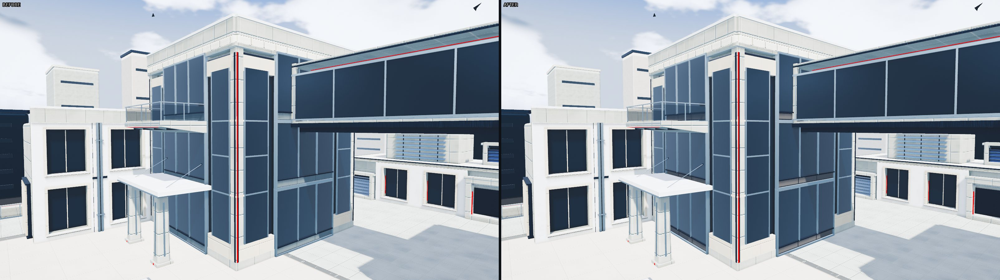
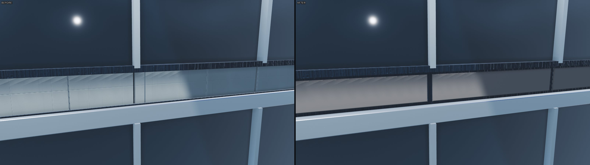
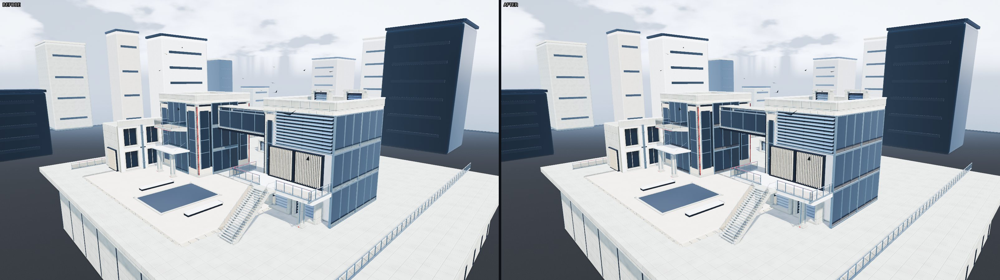
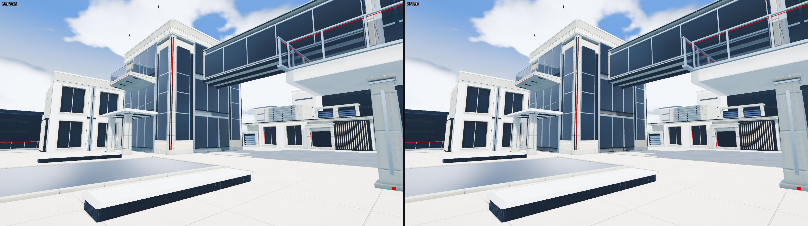
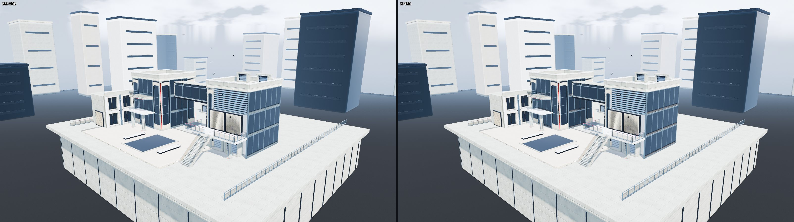

Крупные фрагменты:

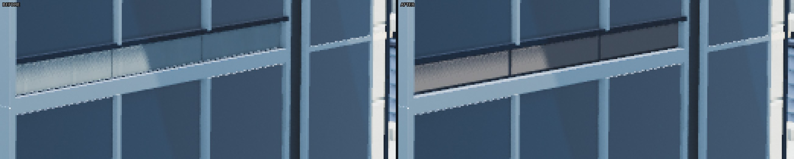
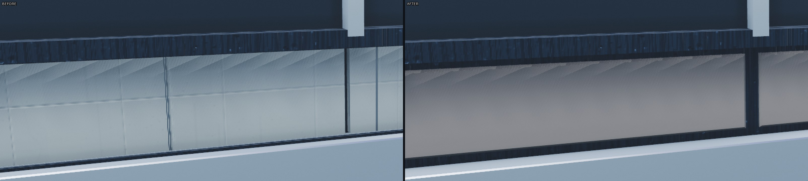
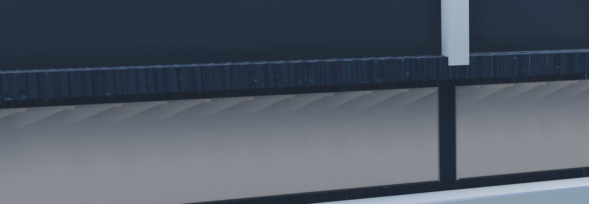
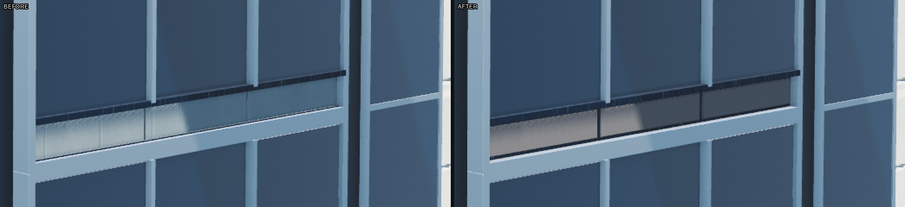
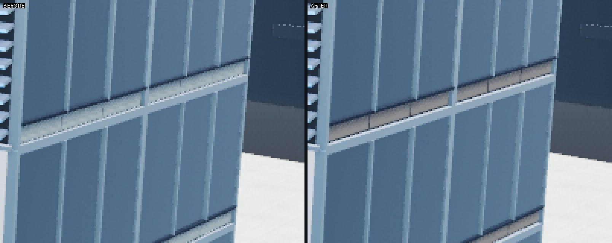
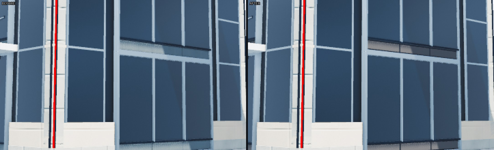

Наблюдения:

- полоса больше не выглядит одной сплошной светлой лентой: читаются три
  кассеты, разделённые тёмными швами, с заглублённым посадочным местом под
  head rail'ом и светлой анодированной рамой снизу;
- на лицах появилась толщина: фаска даёт кромке отдельный блик, а под лицом
  остаётся тёмный gasket-шов и основание; в 2× детали видно, что лицо стоит
  над тёмным основанием, а не наклеено на него;
- материал серый и в солнце, и в тени: солнечное лицо нейтральное (sat 0.08),
  теневое — холоднее только за счёт ambient сцены (0.28 против 0.39 в 2.3B);
- швы читаются и вблизи (`detail-kit-glass-band.jpg`), и на дистанции обзора
  (`detail-kit-overview-tower.jpg`), где до шага полоса была гладкой;
- `kit-service` (без curtain wall в кадре) — байт-в-байт;
- дальний город, Prologue и все не-спанрельные модули не изменились.

---

## 7. Известные ограничения и компромиссы

1. **Значение панели ниже, чем в 2.3B** (солнце 0.585 → 0.475, тень 0.409 →
   0.329). Это осознанная коррекция: старая панель на солнце уходила в
   бледно-кремовый и почти сливалась с рамой. Средняя яркость кадра при этом
   меняется менее чем на 0.12 %, а трёхступенчатая иерархия (рама / панель /
   остекление) сохранена и стала чище.
2. **Отклонение от ART_BRIEF §2 (`#2A3A44`).** `#2A3A44` темнее остекления и
   читается как проём; текущая нейтральная середина `#5E5E5E` — самый тёмный
   тон, который ещё остаётся «серым» над стеклом на ревью-дистанции. Отклонение
   зафиксировано в `ARCHITECTURAL_KIT.md` §5.
3. **Шов ≈64 мм** (24 мм авторский + 2×20 мм gasket). Дальше увеличивать его
   без изменения пропорций кассеты нельзя; на истинно городской дистанции
   (`kit-distant`) полоса 0.48 м занимает считанные пиксели, и швы там
   складываются в тональный ритм, а не в линии.
4. **Остаточный холодный тон в тени** (sat 0.277) — это свет сцены и
   shadow-tint пост-грейда на ахроматичной поверхности; материал собственного
   оттенка не вносит. Дальнейшее «посерение» тени потребовало бы правки
   освещения/пост-обработки, что вне рамок шага.
5. **Спекл на солнечной кассете** (сетка ~1 px) — pre-existing артефакт
   grazing-освещения/затенения, он виден и в evidence 2.3B. Нейтральная и более
   тёмная панель делает его существенно менее заметным; исправление
   потребовало бы правки Renderer/PostPipeline, что запрещено рамками шага.
6. **Текстурная карта у роли убрана.** Если в будущем понадобится «зерно»
   панели, его нужно делать UV-развёрткой на кассету, а не triplanar-картой:
   иначе снова появится произвольная сетка швов внутри лица.
7. **Кассетное лицо уменьшилось на 20 мм с каждой стороны** из-за gasket'а;
   шаг кассет, ширина модуля, границы поля и число колонн/рядов не менялись —
   это локальная геометрия кромок, а не изменение размеров кассет.
8. **Набор capture-кадров расширен с 9 до 10.** Девять исходных ракурсов не
   менялись (их хеши совпадают с прежними прогонами); добавлен постоянный
   `kit-spandrel-closeup`. Детальные прогоны 3200×1800 остаются
   supporting-артефактами, не частью deterministic-контракта.

---

## 8. Что не менялось

- `glass-near`, `glass`, `glass-far`, `glass-rail` — калибровка и sheen;
- shader sheen (`applyGlassSheen`) и rail-opacity;
- геометрия фасада, размеры пояса, шаг и ширина кассет, число колонн/рядов;
- остекление, perimeter frame, mullions/transoms, head rail;
- остальные 14 модулей Architectural Kit;
- `KitDemoLayout.ts` (композиция), `KitTypes.ts`, загрузчик, размещение,
  коллизии, физика;
- Prologue, Training, production level content, меню;
- освещение, постобработка, `RenderScene`/`Renderer`, `PostPipeline`;
- прозрачность, сортировка, `depthWrite`, материалы стекла;
- API `MaterialLibrary` (кроме значений существующей роли `spandrel`);
- вариация цвета между кассетами отсутствует: одна роль, один батч.

---

## 9. Вопросы к ревью

1. Принять ли нейтральный `#5E5E5E` без карты как финальную калибровку роли
   (значение панели на 15–20 % ниже 2.3B, но кадровая яркость и иерархия
   сохранены)?
2. Достаточен ли выраженный шов ≈64 мм для чтения сетки на дистанции обзора,
   или нужен более широкий gasket (например, 30 мм → шов 84 мм) ценой более
   узкого лица?
3. Достаточна ли фаска 9 мм, или для будущих более близких кадров нужна 12–14
   мм (в рамках этого шага фаска зафиксирована)?

---

## Приложение A — evidence

`docs/evidence/arch-kit-spandrel-refinement/`:

- `capture-manifest.json` — after-прогон (10 кадров) + determinism 10/10;
- `baseline-sha256.json`, `after-sha256.json`;
- `pixel-diff.json` — все 10 кадров;
- `spandrel-metrics.json` — кадровые метрики, регионы панель/шов/стекло/рама,
  близкие и дальние метрики швов, far-city zero-diff, счётчики рендера,
  lifecycle, material contract;
- `lifecycle.json` — load/reload/restart ×2/unload;
- `prologue-regression.json`;
- `kit-*.jpg` (10), `compare-kit-*.jpg` (10), `detail-*.jpg` (8).

Короткий индекс:
[`docs/evidence/arch-kit-spandrel-refinement/README.md`](../evidence/arch-kit-spandrel-refinement/README.md).
